# Critical Review — ML-assisted DDoS Mitigation (XDP/eBPF + GRU + Nginx heuristics)

**Repository:** `/home/artur/DDoS-mitigation/code` @ `6fc27fa` (= `origin/main`, clean tree) · **VM:** `ddos-mitigation`, Ubuntu 26.04, kernel 7.0.0-38 · **Review date:** 2026-10-11 (UTC)
**Reviewer access:** user `artur` (uid 1000) with passwordless sudo — *not* a root login as the brief assumed. All outputs live in `/root/project_analysis/` (written via `sudo tee`); every command is in `commands.log`. Nothing in the repo was modified; no forbidden script was run; no traffic was sent; no XDP/sysctl/iptables change was made.
**Evidence tags:** **[FACT]** = verified by file:line, command output or computation; **[INFERENCE]** = reasoned from facts; **[SIM]** = offline simulation (synthetic inputs through the real model).

---

## 1. Executive summary

**What the system is.** A single Python daemon (`control_plane.py`) attaches a BCC-compiled XDP program to `veth_server` inside `server_ns`. The XDP program drops black-listed IPv4 sources and records per-source counters (`telemetry_map`) and per-5-tuple forward features (`flow_map`). Four userspace engines ban sources into the XDP blacklist (or iptables): L4 heuristics (SYN rate, non-SYN volume, idle-connection "SlowConn" via `ss`, low-and-slow SYN), an L7 Nginx-access-log rate/error heuristic, an error-log R.U.D.Y. detector, and a 2×64 GRU fed with 15-step per-IP sequences of XDP flow snapshots (p>0.95 ×3). A 1,534-line harness builds a 20-client/5-bot namespace testbed on one Linux bridge and compares XDP, iptables and unprotected modes across 10 attack scenarios.

**Overall health.** The enforcement mechanism works: in XDP mode `PreStack_Dropped ≈ PPS_Rx` (≈1.0–1.19 M pps) while `IP_InReceives` falls to 22–64 pps; in iptables and unprotected modes 0.54–0.97 M pps reach the IP layer [FACT]. The Tier-1 model training is **bit-for-bit reproducible** and its reported test F1 0.9963 reproduces exactly [FACT]. **However, the comparative results do not measure what the thesis figures say they measure**, and the ML evidence does not support generalisation claims:

**Top 5 risks**
1. **Testbed L2 defect (Critical).** All 25 client/bot interfaces are named `veth_in`; udev's `MACAddressPolicy=persistent` derives the MAC from the name, so (almost) all of them share **12:af:eb:2d:8a:f2** on one bridge (proven by recomputing systemd's hash, and by 90 kernel "duplicate address" messages). Server→client frames go to whichever port last sent that MAC. While bots transmit, including after they are banned, legit responses are delivered into bot namespaces. Run-level flood availability tracks the number of colliding interfaces (Spearman ρ = −0.84, p = 0.005), not the defence mode.
2. **The availability metric is not comparable across modes (Critical).** "During" ends when the *harness* kills the attack. In protected modes that happens right after bans are seen; in unprotected mode it happens at the ban-wait timeout. Windows are 1.5–8× longer unprotected. Once all bots are banned but the flood continues, legit success is **XDP 32–36 %, iptables 36–48 %, unprotected 38–41 %**.
3. **Statistical power (Critical).** n = 3 runs/mode, with a random client-profile mix per run. The minimum detectable difference at 80 % power is **43–55 pp** for every SYN/UDP/ACK/fragmentation/multi-vector scenario (33 pp for the HTTP flood). No XDP vs iptables claim is resolvable.
4. **The GRU learned tool/OS fingerprints and has no demonstrated marginal value (High).** The test set holds 2 attacker IPs (95 % CI on IP-level recall: 16–100 %). A *single* feature (max request size) reproduces the GRU's F1 (0.994 vs 0.996). Real benign windows with 34-B requests, or an initial window of 65535 (macOS/iOS), are scored p > 0.95. Cross-domain AUC is ≈ 0.1 both ways. The GRU was never the sole detecting engine, and no ablation exists.
5. **Evidence trail and harness defects (High).** The daemon log of every protected run was overwritten or deleted, so per-bot attribution, ban times and probabilities are lost. TTM has a 1.1 s floor set by the harness. Nginx is never restarted between scenarios (a `pkill` argv bug), and 72 orphan Nginx workers leak across runs. Slow attacks are neutralised by Nginx itself: R.U.D.Y. gets **413**, so the R.U.D.Y. detector **never fired once** (0 matches in 15 error logs).

**Top 5 recommendations**
1. Give every namespace veth a unique MAC (3-line diff, §11 D1) and assert uniqueness. Then re-run a 3-run XDP A/B (EXP-1) before anything else.
2. Rework the protocol: fixed-duration attacks that are **not** killed on ban, fixed measurement windows, per-second time series and time-to-recovery, a 4th mode "Nginx limits, no daemon", seeded profiles, attackers isolated from the server CPUs, ≥10 interleaved runs/mode, and a per-campaign results directory committed with its git hash (§13).
3. Persist machine-readable ban events (JSONL: monotonic + wall time, engine, metric values, GRU probability, model hash). Derive TTM, attribution and FP from them, not from `ping` or log tailing.
4. Re-scope the ML claims. Report IP-level results with CIs, the deployment policy (0.95×3) and its time-to-detect. Add GRU-only vs heuristics-only ablations, and re-capture with a realistic benign mix (keep-alive, HTTPS/HTTP2, browsers, NAT, varied request sizes and OS fingerprints) and held-out families.
5. For the GRU's input, move to **Nginx request sequences** with an extended log format, keeping XDP for L3/L4 detection and for enforcement. Decide with the decisive experiment in §9.5. Confidence: moderate.

**What the current data *does* support:** XDP drops banned traffic before the IP stack (strong) [FACT]. The heuristics ban ≥4/5 bots within the timeouts in all 10 scenarios in both protected modes [FACT]. The protected Nginx config (`limit_req`/`limit_conn`) materially protects availability against the HTTP and Yo-Yo floods used here [FACT/INFERENCE].

---

## 2. Environment snapshot

| Item | Value |
|---|---|
| Host | KVM guest (VirtualBox-style NICs `enp0s3/enp0s8`, VMware SVGA), 8 vCPU (i7-10700F), 9.2 GiB RAM, no swap, 77 GB LV (29 %), no GPU |
| OS / kernel | Ubuntu 26.04 LTS, 7.0.0-38-generic (PREEMPT_DYNAMIC); booted 2026-10-11 11:59 UTC; TZ = UTC; `/tmp` is **tmpfs** |
| BPF stack | python3-bpfcc / libbpfcc 0.35.0 (apt), bpftool 7.7.0 (libbpf 1.7), bpftrace 0.25; **no clang/llc/gcc** on PATH (BCC uses embedded LLVM); `CONFIG_BPF_JIT_ALWAYS_ON=y`, `CONFIG_DEBUG_INFO_BTF=y`, `CONFIG_INET_DIAG_DESTROY=y` (so `ss -K` works) |
| Nginx | 1.28.3 (http_v2, http_v3, ssl, realip); compiled `--error-log-path=stderr` |
| Python | 3.14.4; `code/venv` (system-site-packages = false): torch 2.14.0+cpu, sklearn 1.9.0, pandas **3.0.6** (req: 3.0.5), numpy 2.5.2, psutil 7.2.2, gunicorn 26.2.0, matplotlib 3.11.2, pipreqs/yarg; **`bcc` is a hand-copied, byte-identical copy of the apt module (2026-09-06, no dist-info)** |
| requirements.txt | pipreqs-generated; `bcc==0.1.10` = PyPI *"N-dim invertible BCC lattice"* (unrelated); missing psutil, gunicorn |
| Interpreters | suite run as `sudo python3` (system: psutil 7.1.0, **no torch**); daemon/gunicorn launched with `venv/bin/python` (`test_distributed_suite.py:52,485,505`) |
| Tools | hping3 3.0.0a2, wrk 4.1.0, curl 8.18 (nghttp2), iproute2 6.19, ethtool 6.19, iptables 1.8.11 (**nf_tables**); missing: ab, h2load, conntrack, cppcheck |
| Runtime now | no XDP attached, no project maps, no netns entries; **72 orphaned `nginx: worker process` (user nobody, PPID 1), 9 batches of 8 started at each run start (12:15:31 … 13:53:04), each holding a zombie netns listening on :80/:443, ≈903 MB RSS** |
| Git | HEAD `6fc27fa` (2026-10-11 15:15:50) = origin/main; reflog: `checkout main` 12:34:09 + ff-merge 12:34:15 *during XDP run 2*; unmerged branches incl. `chore/audit-telemetry-lru` (per-CPU LRU telemetry) and `chore/audit-cleanup` |
| How the 3×3 ran | not in shell history; driven by an earlier Claude Code session `d1a6f299…` (its scratchpad holds `avail_nruns.log` + the 4 charts). Committed `test_console_logs.txt` == ANSI-stripped `avail_nruns.log`; committed PNG/PDF == scratchpad copies. **The wrapper command line is not preserved anywhere.** |

---

## 3. Architecture

### 3.1 Component / topology diagram (reconstructed from code + runtime)

```mermaid
flowchart LR
  subgraph ROOT["root netns"]
    BR["ddos_br0 (Linux bridge, FDB learning)"]
  end
  subgraph L["legit_1..20 (10.0.1.i/16)"]
    LC["curl worker, 1 req/conn, --max-time 10<br/>tc netem on veth_in egress"]
  end
  subgraph B["bot_1..5 (10.0.2.i/16)"]
    BC["hping3 / wrk / _dist_*.py"]
  end
  LC -- "veth_in ⇄ vo_legit_i<br/>MAC 12:af:eb:2d:8a:f2 (shared!)" --> BR
  BC -- "veth_in ⇄ vo_bot_i<br/>MAC 12:af:eb:2d:8a:f2 (shared!)" --> BR
  BR -- "veth_srv_br ⇄ veth_server (8 rxq)" --> XDP
  subgraph S["server_ns (10.0.0.1/16)"]
    XDP["XDP (native veth, flags=0)<br/>blacklist_map → DROP<br/>telemetry_map (per-CPU hash 100k)<br/>flow_map (LRU 262k, 5-tuple fwd)"]
    IPT["iptables INPUT DROP (iptables mode)"]
    NGX["nginx :80 / :443 ssl+h2<br/>limit_req 30 r/s b100, limit_conn 50<br/>access JSON + error log (info)"]
    GUN["gunicorn 127.0.0.1:8080 (8w×4t)"]
    D["control_plane.py (venv python)<br/>T1 telemetry+GRU feed (1 s)<br/>T2 inference worker<br/>T3 error-log RUDY tail<br/>Main: access-log L7 tail"]
    XDP --> IPT --> NGX --> GUN
    NGX -. "/var/log/nginx/ddos_ml_access.log" .-> D
    NGX -. "/var/log/nginx/error.log" .-> D
    XDP -. "BCC map reads every 1 s; ss -tan" .-> D
    D -- "blacklist_map[ip]=0 / iptables -A; ss -K dst ip" --> XDP
  end
  D -. "stdout → /tmp/mitigation_distributed_test.log (recreated per scenario)" .-> LOG[("lost")]
  H["test_distributed_suite.py (system python3)"] -. "/tmp/{mitigation_performance,metrics_*,availability_*}.csv (append)" .-> CSV[("results")]
```



### 3.2 End-to-end data flows
* **Packet path** [FACT `xdp_ddos_filter.c:49-148`]: ETH → IPv4 only (else `XDP_PASS`) → blacklist lookup (drop + atomic counter) → L4 parse (TCP/UDP header at `ip + ihl*4`, no fragment/ihl/doff/version checks) → `telemetry_map` (packets, SYNs, bytes, first-seen) → `flow_map` (first/last seen, IAT max, fwd packets, payload bytes, header bytes, max payload, init window) → `XDP_PASS`.
* **Telemetry thread** [FACT `control_plane.py:551-777`]: sleep 1 s → TTL sweep → idle eviction (60 s) → drain GRU results → `ss -tan state established` → per-IP **cumulative→delta** (not time-normalised) → SYN > 200, non-SYN > 5000, SlowConn (≥8 ESTAB & <250 B for 3 intervals), Low-SYN (≥3 SYN & 0 ESTAB & no handshake in 15 s for 4 intervals) → unless "volumetric suppression" is active: iterate the whole `flow_map`, append 8-feature snapshots of TCP flows whose packet count advanced to the per-IP deque(15), enqueue full windows → aggregate SYN > 5000 or pkts > 50 000 ⇒ suppression for 15 s (+ `sysctl tcp_syncookies=1`).
* **Inference thread** [FACT `:461-490`]: GRU on (1,15,8) → probability → result queue, drained only once per poll by the telemetry thread → p > 0.95 three times in a row (results can come from the same poll) → ban unless suppressed [`:493-549`].
* **L7 path** [FACT `:809-868`]: tail JSON access log → per-IP 10-s window → `rps > 50` or `(error_ratio > 0.8 and rps > 10)`, errors = `status ≥ 400 and != 503` → ban + `ss -K`. **R.U.D.Y. path** [`:398-459`]: regex on error log ("client timed out … while reading client request body"), 3 in 60 s → ban.
* **Ban** [`:234-287`]: XDP `blacklist_map[ip]=0` (prints "Rule is active on hardware") or `ip netns exec server_ns iptables -A INPUT -s ip -j DROP`. TTL 300 s. In iptables mode **the XDP program still runs** (telemetry + flow maps), only enforcement moves.

### 3.3 Training vs inference (Tier-1, the deployed model) — ✗ marks a divergence

| Aspect | Training (`capture_testbed_dataset.py` → `train_testbed_gru.py`) | Inference (`control_plane.py`) |
|---|---|---|
| Data source | XDP `flow_map` | XDP `flow_map` ✓ |
| XDP attach mode | `XDP_FLAGS_SKB_MODE` (generic) `:155` | `flags=0` → native veth mode `:114` ✗ (native mode disables the peer's GSO, so bulk transfers are counted per-MTU in native vs per-GSO-super-packet in generic) [INFERENCE: negligible for current small-request traffic] |
| Feature formula | inline copy `:190-194` | `flow_features()` `:213-232` — identical arithmetic, duplicated code ✓/risk |
| Units | µs, pkts/s | same ✓ |
| Snapshot unit | flows whose fwd packet count advanced in the 1-s poll | same ✓ |
| Attack sampling | ≤ 80 attack rows/poll `:46,196` (still 89 % of rows) | all active flows ✗ |
| Conditions | no daemon, no floods, attackers unmitigated 150 s | flows during floods suppressed; flows spanning a flood never scored ✗ |
| L2 | same duplicate-MAC topology (suite helpers reused) | same ✗ (both contaminated) |
| Benign | 24 curl one-request clients, 6 per profile | 20 curl one-request clients, random profiles ✓ (same narrow benign) |
| Families | wrk -c50/-c30, Slowloris N8/N30, R.U.D.Y. N10/N20 | + SYN, low-SYN, UDP, ACK, frag, Yo-Yo, multi ✗ (GRU suppressed or TCP-only for most) |
| Sequences | per IP, sorted by poll, stride-1 windows of 15, ≤800/IP | per IP deque(15), one window per new snapshot ✓ |
| Scaler | StandardScaler on train rows (Init_Win σ = 1,492 due to 2 rows with value 63) | `scaler_testbed.save` ✓ |
| Decision | p ≥ 0.5 (all reported metrics) | p > 0.95 × 3 "consecutive" ✗ (never evaluated by the project) |
| Model selection | val = 3 benign IPs + **1** attacker IP; `f1 >= best` keeps the last epoch tying at 1.0 | — |

### 3.4 Which engine catches which attack *in the current code and data* [FACT: console log + code]

| Scenario (suite) | Engines seen (6 protected runs) | GRU involvement | Notes |
|---|---|---|---|
| S1 SYN 1000/s/bot | L4 SYN | never (suppressed: aggregate SYN 5000) | |
| S2 Low&Slow SYN ("GRU ML Target") | L4 Low-SYN | **never** | title is wrong |
| S3 UDP flood | L4 Volumetric | never (UDP, suppressed) | iptables r3 4/5 banned |
| S4 HTTP flood (wrk -c50) | L7 Heuristic (+GRU 3/6) | co-engine | XDP r2 4/5 banned |
| S5 ACK flood | L4 Volumetric | never | XDP r3 ping-"FP" |
| S6 Fragmentation | L4 Volumetric | never | hping3 `-f` uses a 16-B "virtual MTU" (hping3(8)) → no fragment holds a full 20-B TCP header → counted as non-SYN |
| S7 Slowloris N=8 | L4 SlowConn (+GRU 3/6) | co-engine | exactly at the ≥8 threshold |
| S8 R.U.D.Y. N=10 | L4 SlowConn (+GRU 2/6) | co-engine | **R.U.D.Y. detector never fires** (413) |
| S9 Yo-Yo | L7 Heuristic (+GRU 5/6) | co-engine | flows ≡ wrk fingerprint (in-distribution) |
| S10 Multi (1 SYN, 1 HTTP, 3 UDP) | L4 SYN/Vol + L7, **SlowConn** in 2 runs | never | HTTP bot's connections stalled (L2 defect) |

---

## 4. Component analysis

### 4.1 XDP program (`xdp_ddos_filter.c`, 148 LOC)
*Static analysis:* `clang-tidy 22.1.8` (clang-analyzer-*, bugprone-*, cert-*) through a BCC-syntax shim found **0 issues in the file** (`outputs/clang_tidy_xdp.txt`). The problems below are protocol-semantic, so generic analysers cannot see them.

| # | Observation | Evidence | Consequence |
|---|---|---|---|
| X1 | Only `ETH_P_IP` is parsed; IPv6, 802.1Q/QinQ, ARP → `XDP_PASS` **before** the blacklist check | `:56-57` | An IPv6 or VLAN-tagged source is never dropped and never counted. In the testbed Nginx listens IPv4-only, so the gap is latent, but in production IPv6 bypasses all L3/L4 engines and the ban. |
| X2 | No `ip->version==4`, `ihl>=5`, `doff>=5` checks | `:71,80,84` | Malformed headers produce garbage ports, flags and lengths in the maps (the kernel later drops the packet, but the counters are already polluted). |
| X3 | **No fragment handling** (`frag_off` never read) | `:79-98` | A non-first fragment with ≥20 B of payload is parsed as a TCP/UDP header: random ports, spurious SYN bits and new `flow_map` keys. In S6 hping3's 16-B fragments contain no full L4 header, so they fall into the "non-SYN packets" volumetric rule. Detection works **by accident**. |
| X4 | `telemetry_map` = `BPF_PERCPU_HASH` 100 k, **not LRU**; `lookup_or_try_init` fails silently when full; userspace deletes keys only after 60 s idle | `:45,107`; `control_plane.py:298-320` | A spoofed-source flood (≥1.7 k new IPs/s) keeps the map full, so every *new* source (bot or client) becomes invisible to SYN/volumetric/SlowConn/Low-SYN until the flood stops. No scenario uses `--rand-source`, so this is untested. The LRU fix exists only on unmerged branch `chore/audit-telemetry-lru` (2c2c71c). |
| X5 | `flow_map` = shared LRU 262 k, updated non-atomically (`+=`, max) | `:47,128-144` | hping3 increments the source port per packet (man page `-s`), so ~1 s of `--flood` before the ban churns the whole LRU and evicts every legit flow. A re-created flow gets `init_win` from a mid-flow packet (2 such rows with value 63 exist in the training set). Races between RX queues are possible but rare (one flow normally stays on one queue). |
| X6 | `struct flow_key` is 13 B, padded to 16; `= {}` initialisation | `:26-32,119` | OK in practice (clang zero-fills the stack object). `__builtin_memset` or `__attribute__((packed))` would make the hash-key consistency explicit. |
| X7 | Fail-open everywhere (`XDP_PASS`); blacklist 100 k entries; drop counter via `lock_xadd` | `:64-68` | Fine. But bans live only in an un-pinned map: if the daemon is SIGKILLed, the program **stays attached with its blacklist and no TTL process**, so bans become permanent (the suite detaches explicitly, `test_distributed_suite.py:551`). |

### 4.2 Control plane (`control_plane.py`, 874 LOC)
* **Structure.** A module-level script with no `main()`, no config file, CWD-relative paths (`:21,37`), `print` logging, and attach-on-import (`:112-114`), so it cannot be unit-tested. In 4 places a blind `except Exception` swallows errors (`:251,277,487,867`; ruff BLE001/S110).
* **Lock discipline.** `state_lock` / `banned_ips_lock` are used as documented for the shared dicts. Deviations: `unblock_expired_bans` runs `iptables -D` **while holding** `banned_ips_lock` (`:268-287`), contradicting the rule at `:154-155`. `ban_ip()` is not an atomic test-and-set: the main (L7), RUDY and telemetry threads can ban the same IP concurrently, which yields duplicate `iptables -A` rules (`:249`), and `-D` removes one, so the ban outlives its TTL. `rudy_tracker` is single-threaded (OK).
* **Unbounded state.** `prev_flow_pk` grows with every flow of any IP that is never idle for 60 s (e.g. a busy NAT), and LRU-evicted kernel flows are never pruned from it. `rudy_tracker` keeps entries for IPs with fewer than 3 timeouts. `inference_queue` is unbounded and drained once per poll (`:203,584`).
* **Cost per poll.** Full BCC iteration of `flow_map` (up to 262 k entries, ≥2 syscalls/entry) and `telemetry_map`, plus an `ss` subprocess, every second. Measured symptom [FACT]: in iptables mode the UDP flood is *not* dropped in XDP, `flow_map` fills with flood flows, and once suppression expires the daemon spends **35 % (mean) / 101.6 % (max) of a core and 846 MB RSS** at Phase 3. In XDP mode it uses 1–5 %. GRU inference is **0.675 ms + 0.126 ms scaler per snapshot** (1 thread), so ≈ 1,250 snapshots/s/core, unbatched.
* **Rates are not time-normalised.** Deltas are compared with per-second thresholds while the loop period is `1 s + work` (`:579,611-616`). When iteration is slow, every rate threshold silently tightens.
* **Clock correctness.** The flow-age gate compares `time.monotonic_ns()` with `bpf_ktime_get_ns()` (`:711,736`). Both are CLOCK_MONOTONIC, so this is **correct** [FACT].
* **Suppression is an evasion vector** [INFERENCE]. Any aggregate of >5,000 SYN or >50,000 packets per interval (`:758-760`), even from spoofed sources and repeated every <15 s, pauses all GRU bans and clears every sequence (`:714-721`). The flow-age gate then permanently ignores any flow that spanned the flood (`:736`).
* **Ban side effects.** `ss -K dst <ip>` is correct inside `server_ns` (`:332`). The "Rule is active on hardware" message (`:237`) is wrong on veth. Per-IP bans impose collateral damage on NAT/CGNAT users: thresholds of 50 rps, 5,000 non-SYN pkts/s (≈ 58 Mbit/s of 1460-B uploads) and ≥8 idle connections are easily exceeded by many users behind one address.
* **L7 rule.** 503s are excluded from the error ratio (`:822`), and Nginx's `limit_req`/`limit_conn` reject with **503** (no `limit_req_status`). [FACT] the 10-09 capture log contains 5,803,159 such 503 lines. The error-ratio sub-rule is therefore blind to rate-limited floods, but the **RPS sub-rule still counts them** (every 503 is logged), and that is what bans the wrk bots. The per-line error ratio is recomputed over the whole window: 2.8 µs/line post-ban, 11 µs at 490 entries, **317 µs at 20 k entries** [FACT, `outputs/` bench]. That is quadratic for an un-banned heavy sender, e.g. every HTTP flood under `GRU_ONLY=1`.
* **R.U.D.Y. detector.** Its regex appears **0 times in all 15 Nginx error logs** on the VM (09-22 → 10-11) [FACT]. The scripts send `Content-Length: 1000000`, which exceeds `client_max_body_size 64k`, so Nginx answers **413** after the headers ("client intended to send too large body", 330× in `error.log.3.gz`). The engine is dead code under this configuration.
* **SYN cookies.** `tcp_syncookies` is already **1** in a fresh netns: read via `nsenter` from the zombie netns of unprotected run 1, where no daemon ever ran [FACT]. The daemon's `sysctl -w … =1` is a no-op, and "flag reset" never disables anything.
* **`GRU_ONLY`** disables the non-GRU *bans* only. Suppression, the flow-age gate and the L7 computation (now quadratic) keep running.

### 4.3 Nginx (`nginx.conf`, `nginx_unprotected.conf`)
* `limit_req 30 r/s burst 100 nodelay` + `limit_conn 50` (`:9,12,54,57`) vs the daemon's `HEURISTIC_MAX_RPS = 50`. A client at 31–50 rps is partly rejected by Nginx but never banned; above 50 rps it is banned. **"Unprotected" differs only by dropping these two limits** (diff verified), so it still has the 5-s header/body timeouts and the 64 k body limit. Those alone neutralise this suite's Slowloris (408) and R.U.D.Y. (413).
* `client_header_timeout 5s` covers the *whole* header, and the Slowloris script re-sends every 5 s (`test_distributed_suite.py:1278`), so connections die at 5 s. R.U.D.Y. sends 1 byte every 7 s against `client_body_timeout 5s` and is 413'd anyway.
* `large_client_header_buffers 2 1k` (`:35`): real browsers with cookies/JWTs above 1 KiB get **400**. Those count as errors in the L7 ratio, so an L7 false ban is likely once their rate exceeds 10 rps. `client_max_body_size 64k` blocks normal uploads.
* `listen 443 ssl; http2 on` (`:39-40`), but the legit traffic is `http://10.0.0.1/` only (`test_distributed_suite.py:46`). HTTPS and HTTP/2 are never exercised by clients or attackers.
* Logging: `$time_iso8601` (1-s resolution). The format lacks `$msec`, `$remote_port`, `$connection`, `$connection_requests`, `$request_completion`, `$upstream_response_time`, `$limit_req_status`, `$server_protocol` and `$ssl_protocol`. `error_log … info` inside `http{}` only covers request-level messages. Core startup/bind errors go to **stderr** (build default) and are discarded by the suite. Default `limit_req_log_level error` writes one error line per rejected request: in the 10-09 capture, **1.12 GB access + 1.08 GB error log in ~188 s** (≈ 31 k lines/s, ≈ 44 GB/h) [FACT].
* Listen backlog 511 (`ss -ltn` Send-Q). SYN-RECV saturates at **512 = backlog + 1** in every SYN/frag flood (Lead 18).

### 4.4 ML pipeline
* **Generations** [FACT, git]:
  * v0 `2229aa7`: inference took 3 Nginx request fields (`request_time×1e6`, `request_length`, `bytes_sent`) *by analogy* to CIC flow features, while the same commit's trainer selected 6 CICFlowMeter flow features. `INPUT_SIZE=3` vs 6, so the stack could not have run as committed.
  * v1 `ff0d546`: 6 per-IP XDP aggregates. Legacy training merged UNSW benign with CIC-DDoS2019 SYN, which `docs/ml_confounding_analysis.md` shows is confounded.
  * v2 `acdbf92`: CIC-IDS2017 completed flows, 8 fwd features.
  * v3 `2e93e0e/b1f1ff0` (deployed): testbed XDP snapshots.
* **CIC-IDS2017 trainer leakage.** Stride-1 attack windows are split randomly (`GRU_ML_init.py:84-102`), so **90.9 %** of test windows have a training window that is the same window shifted by one row (14/15 rows identical) [FACT]. The reported F1 0.9962 is leakage-inflated. The data has 2 "attacker" IPs, one of which (192.168.10.50) is the *victim* server (reverse-direction flows).
* **Domain gaps** [FACT]: the CIC model on testbed windows scores AUC **0.094** (inverted; FPR@0.5 87 %). The deployed model on CIC-IDS2017 scores AUC **0.115**, with recall@0.95 = **0.000** for DDoS, Slowloris, Slowhttptest, Hulk and GoldenEye.
* **Reproducibility:** deployed weights are **bit-identical** to a re-run of the trainer logic (max |Δw| = 0) [FACT]. Seeds and config are consistent; `feature_config_testbed.json` matches the checkpoint shapes. Not reproducible: the capture itself (random, one-shot, and on the faulty L2), and `scratchpad/confound_analysis.py` cited by the docs (lost with the tmpfs).
* **Capture fragility:** `SCR` points at another Claude session's tmpfs scratchpad (`capture_testbed_dataset.py:49-50`) and nothing creates it. The first `open(path,"w")` (`:97`) raises `FileNotFoundError` after the topology and Nginx are already up. It works today only because that session id was resumed after the 11:59 boot. The script also overwrites `dummy_app.py`.

### 4.5 Test harness (`test_distributed_suite.py`, 1,534 LOC)

| # | Defect | Evidence | Effect |
|---|---|---|---|
| H1 | Duplicate MAC on all `veth_in` | `:375,383-391` + udev policy | see §8.3 — dominant confound |
| H2 | `run("pkill -f 'nginx: master process'")` → `str.split()` → `pkill: only one pattern can be provided` | `:562`; reproduced with `pgrep` (exit 2) | Nginx is **never restarted** between scenarios; the new `nginx -c` fails to bind and logs to stderr → `/dev/null` |
| H3 | `pkill -9 -f "nginx: master"` kills only the master | `:269` | 8 orphan workers per run, 9 zombie netns, ≈ 903 MB RSS, `RAM_Total_MB` +≈ 65 MB per run |
| H4 | Daemon log `os.remove`d per scenario and in unprotected mode | `:499,585` | No daemon log of any protected run survives |
| H5 | TTM = time at which the suite's 0.5-s poll sees `[BAN]`, starting only after the ~1.1-s Phase-2 capture | `:735-745,1142-1143` | Flood TTMs of 1.12–1.16 s are a floor, not a measurement |
| H6 | Attack killed after bans (protected) or after the timeout (unprotected) | `:1143-1146` etc. | Mode-dependent "during" windows (1.5–8×) |
| H7 | Collateral check = `ping -c 2 -W 2` from each legit ns | `:720` | A lossy client can "FAIL" without any ban; ban ground truth is never read |
| H8 | `eff_pass = banned ≥ 80 %` | `:1093` | 4/5 counted PASS (XDP r2 HTTP, iptables r3 UDP) |
| H9 | Legit-HTTP check runs after the attack is killed | `:1010-1031` | 15/15 in all 90 scenario-runs, so non-informative |
| H10 | Profiles drawn with unseeded `random.choices` per run | `:638` | mobile_bad 0–4, perfect 4–9 across runs |
| H11 | Requests tagged by start time with a 10-s timeout | `:676-690` | 118/118 "before" failures were in flight at attack onset |
| H12 | Raw availability rows carry no client IP | `:189-193` | Per-client analysis impossible |
| H13 | `CPU_Total` is host-wide, `RAM_Total` host-wide, `IP_InReceives` includes loopback (nginx→gunicorn), PPS not time-normalised, one ~1-s sample per phase | `:919,947,956-960` | Metrics mix attackers and defender |

---

## 5. ML methodology assessment (offline re-evaluation)

Scripts: `scripts/ml_data_profile.py`, `ml_eval_tier1.py`, `ml_shortcut_probes.py`, `ml_retrain_ablation.py`, `ml_cross_domain.py`, `ml_yoyo_probe.py`. Outputs in `outputs/ml_*.txt|csv`. All runs used the CPU, `torch.load(weights_only=True)`, and wrote only under `/root/project_analysis`.

### 5.1 Data
* 12,729 rows: **benign 1,378 (10.8 %) from 24 IPs; attack 11,351 (89.2 %) from 6 IPs. One IP (wrk -c50) supplies 8,862 rows (70 %)** [FACT].
* Every benign flow is a single curl GET: **`Fwd Packet Length Max = Total Length = 72 B`**, 5–6 forward packets. Attack request sizes: wrk 34 B, Slowloris ≤ 36 B, R.U.D.Y. ≤ 51 B [FACT].
* Row-level single-feature AUC: `Total Length` **0.994**, `Fwd Header Length` 0.973, `Fwd Packet Length Max` 0.918, flow lifetime (`Fwd IAT Total`) only 0.727. A stump `fwd_pkts > 8` gives benign FPR 0 % at attack TPR 89.7 %.
* `Init_Win_bytes_forward` is 64240 in 12,727 rows and 63 in 2 rows, so the scaler σ is 1,492, *not* 0 as the trainer's docstring claims (`train_testbed_gru.py:9`).
* 271 benign rows last > 2 s (up to ≈ 10 s, i.e. timeouts) [FACT]. The capture used the same duplicate-MAC topology [INFERENCE: benign "stall" flows are artefacts of the L2 defect].

### 5.2 Reported vs re-computed performance (deployed checkpoint, exact split)

| Split | windows (atk) | F1@0.5 | P | R | AUC | F1@0.95 |
|---|---|---|---|---|---|---|
| train | 1,849 (1,151) | 1.0000 | 1.0 | 1.0 | 1.0000 | 1.0000 |
| val | 927 (800) — **1 attacker IP** | 1.0000 | 1.0 | 1.0 | 1.0000 | 1.0000 |
| test | 1,025 (808) — **2 attacker IPs, 5 benign IPs** | **0.9963** | 1.0 | 0.9926 | 0.9998 | 0.9956 |

* **IP-level test evidence:** attackers detected **2/2 → 95 % Clopper-Pearson CI 15.8–100 %**; benign IPs falsely banned **0/5 → CI 0–52 %**. Cluster bootstrap over the 7 test IPs gives F1 0.988–1.0, which only resamples the same IPs.
* **Deployment policy (p > 0.95 × 3), simulated chronologically on all windows:** all 6 attacker IPs are banned at their first full window. Time-to-detect from the first captured row: wrk 0 s, Slowloris N30 4 s, R.U.D.Y. 6 s, Slowloris N8 14 s. 0/24 benign IPs are ever banned, and benign p ≈ 3·10⁻⁴ everywhere. The model is maximally confident on this data, so calibration cannot be assessed.

### 5.3 Shortcut learning (Lead 2)

| Experiment (same split & seed unless stated) | test F1@0.5 | Note |
|---|---|---|
| Full GRU, 8 features | 0.9963 | reproduced |
| **Single feature `Fwd Packet Length Max`** | **0.9938** | one scalar = request size |
| Timing only (IAT Total/Max/Mean, pps) | 0.9969 | |
| Drop payload features | 0.9956 | packet/header counts suffice |
| Drop payload + header length | 0.8196 | Slowloris windows >0.95: 0 % |
| Flow lifetime only | 0.6688 | "long-lived = attack" is **not** the main shortcut |
| LOFO: hold out HTTP flood | 0.9991 | |
| LOFO: hold out Slowloris | 1.0000 | |
| **LOFO: hold out R.U.D.Y.** | **0.484** | per-IP recall 0.25–0.38 |

**Counterfactual edits of real benign test windows (217 windows):**
* Request size 72 → **34 B: 84 % of windows p > 0.95**; → 51 B: 62 %; → 150…1,400 B: 0 %.
* Initial window 64240 → **65535 (macOS/iOS default): 56 % p > 0.95**, median p 0.98; → 29200 / 14600 / 8192 / 63: 0 %.

[FACT] The decision boundary therefore sits on client-tool and OS fingerprints.

**Synthetic protocol-consistent probes** [SIM; generator validated: curl-like flows p = 3·10⁻⁴, wrk-like p ≈ 1]:
* Keep-alive browsers sending 400–600 B requests (1 or 6 connections) and 60 KB uploads → benign.
* **Keep-alive with 72-B requests → p 0.9997, policy BAN.**
* **10 MB download ACK stream → p ≈ 0.995.**
* **A flood of new curl-like connections (50 conn/s from one IP) → p 3·10⁻⁴**: the GRU is blind to it; only the L7 rate rule could catch it.
* **Yo-Yo-shaped flows (≤ 2 s, 34-B requests) → p 0.9996, BAN.** Their lifetime is *shorter* than the trained HTTP-flood flows, so the Yo-Yo GRU bans reflect the wrk fingerprint (in-distribution), not generalisation and not the long-flow shortcut.

### 5.4 Methodology verdict
* The 0.996 F1 is a correct, reproducible **in-distribution** number on a data set where one scalar separates the classes. It is **not** evidence of DDoS-behaviour detection or generalisation.
* The test set (2 attacker IPs, both from families seen at another intensity) cannot support any claim beyond "detects the two held-out bots".
* Model selection on a validation set with one attacker IP is uninformative: `f1 >= best` keeps the last epoch tying at 1.0.
* Overlapping stride-1 windows inflate n roughly 15-fold.
* Threshold 0.5 (evaluation) ≠ 0.95×3 (deployment), and the project never computes PR curves, calibration or time-to-detect.
* "3 consecutive" is not temporal persistence: the three windows can come from the same poll and share 13–14 of their 15 steps.

---

## 6. Testing assessment

### 6.1 What exists
* **System test only:** `test_distributed_suite.py` (10 scenarios × 3 modes; `ONLY_SCENARIOS`, `GRU_ONLY`, `MITIGATION_BACKEND`, `MITIGATION_MODE`). The legacy `test_mitigation_suite.py` targets the obsolete `attacker_ns` topology from `setup.sh`.
* **No unit tests, no CI, no pytest config** [FACT: no test files besides the two suites].
* **PASS/FAIL meaning:** PASS = ≥80 % of bots banned within a scenario-specific timeout **and** every legit node answers 1 of 2 pings **and** 15 sampled legit curls succeed *after* the attack is killed. **In unprotected mode PASS is impossible by construction** (nothing can be banned), so the unprotected PASS/FAIL table carries no information about service quality. It says only "no daemon ran".

### 6.2 Gaps — the most important missing tests (sketches)

| Test | Sketch |
|---|---|
| **XDP parser** (`BPF_PROG_TEST_RUN`) | Load `xdp_ddos_filter.c` with BCC in a throw-away netns, then use `bpf.get_table(...)` and `BPF_PROG_TEST_RUN` (`libbpf.bpf_prog_test_run_opts` via ctypes) with crafted packets: TCP SYN, ihl=6 with options, ihl=4 (malformed), first and non-first fragments, UDP, IPv6, 802.1Q, truncated. Assert return codes and the map contents (no flow key for non-first fragments, SYN counted once). |
| **Feature parity** | Move `flow_features()` into a module imported by both capture and daemon; table-driven test with hand-computed values (µs units, pk=1 edge case, dur=0). |
| **Heuristics** | Refactor the telemetry loop into a pure function `evaluate(deltas, established, now, state) -> bans` and drive it with synthetic sequences: SYN 201/interval → ban; lossy client 2 SYN/interval for 10 intervals → no Low-SYN ban; 8 idle ESTAB × 3 → SlowConn; time-normalisation (2-s loop period must not double the rate). |
| **Ban / unban** | Inject a fake clock and backend. Double ban from two threads → exactly one rule; TTL expiry → removal; iptables idempotency (`-C` before `-A`). |
| **Log parsing** | Fixtures for 200/408/413/429/503 lines, `$limit_req_status`, log rotation (inode change), truncation, a partial last line. |
| **Harness invariants** | After `build_topology()`: assert all `veth_in` MACs are unique (`ip -n ns -j link`). After reset: assert the Nginx master PID changed and no orphan workers remain. Before each run: assert an empty results directory. |
| **Availability window** | Unit-test `_avail_*` with a fake clock: fixed windows, tagging by start and by end, and that report curls are excluded. |
| **Model contract** | Checkpoint ↔ config ↔ scaler shapes; prediction on a frozen fixture batch equals stored probabilities (detects silent retraining). |

### 6.3 Statistical repetition (`outputs/power_analysis.txt`)
* Between-run SD of "during" success (n = 3): floods **12–27 pp**, HTTP 7–22, slow attacks 0.6–4.5.
* **Minimum detectable difference with n = 3 (α .05, power .8):** SYN 43, UDP 44, ACK 45, Frag 46, Multi 55, HTTP 33, Yo-Yo 14, Low-SYN 9, R.U.D.Y. 6, Slowloris 5.5 pp.
* Detecting Δ = 10 pp at the *current* variance would need 56–92 runs per mode. Most of that variance comes from the MAC-collision lottery (§8.3) and the random profile mix. Fix those first, then run a ≥10-run pilot per mode, interleaved and paired by seed, and recompute.
* Treatment: cluster bootstrap over runs (and clients), or a GLMM `success ~ mode*scenario*segment + (1|run) + (1|client)`. Wilson intervals on pooled requests (used in my charts) ignore clustering and are optimistic.

### 6.4 Proposed test plan (commands are in §13; none were run)
1. Unit tests above (pytest; XDP tests need root and a scratch netns).
2. EXP-0: reproduce the duplicate MAC with 3 throw-away netns (≈10 s, no traffic).
3. EXP-1: XDP A/B with unique MACs, 3 runs (≈40 min).
4. EXP-2: corrected campaign, 4 modes × 10 interleaved runs (≈10–12 h).
5. EXP-3: GRU-only vs heuristics-only ablations.
6. EXP-6: effective slow attacks against a realistic unprotected baseline.
7. EXP-7: spoofed-source flood (telemetry-map saturation).

---

## 7. Logs and runtime health

* **Daemon log:** none available for any protected run (H4). Ban reasons by engine are therefore known only as *sets* per scenario-run from the console (§3.4). Per-bot first engine, margins, GRU probabilities and inference errors **cannot be recovered**.
* **Nginx:**
  * `ddos_ml_access.log` covers only the last scenario (unprotected r3 multi-vector, 14:05:05–14:06:37, 539 rows). `.1` = XDP r2 fragmentation (12:33:09–12:34:25, 415 rows), rotated by **logrotate at 12:34:25** mid-campaign (persistent daily timer after the 11:59 boot).
  * Error log: 415/416 lines are `info` "closed keepalive connection". No bind errors are visible, because they go to stderr.
  * Older rotated logs show the 10-09 capture: 5.8 M lines of 503, 546×408 (Slowloris) and 330×413 (R.U.D.Y.).
* **Kernel journal** (12:10–14:10):
  * No verifier errors and no OOM.
  * Per run: 10 printed plus 11–14 rate-limited duplicate-address messages for MAC 12:af:eb:2d:8a:f2, and one "Possible SYN flooding on port 0.0.0.0:80. Sending cookies."
  * VM starvation: "e1000_watchdog hogged CPU >10000us" (up to 35×), "clocksource: Long readout interval … 1.019 s".
  * veth teardown: "page_pool_release_retry() stalled pool shutdown … inflight 60/121 s".
* **False bans of 10.0.1.x:** one reported (XDP r3 ACK flood, 10.0.1.3, mobile_bad), detected **only by ping**. The engine is undeterminable. None of the 7 ban paths can plausibly fire on a single-connection curl client in that timeline, mobile_bad "after" requests were 2/2 OK, and Legit-HTTP was 15/15. With 5 % loss plus 1 % corruption plus residual FDB flapping, about 1 spurious ping-FP is expected in 60 scenario-runs. **Most likely a measurement artefact** [INFERENCE].
* **Daemon CPU** (`CPU_Daemon_Pct` = psutil, % of **one** core):
  * XDP mode: HTTP 25 % (max 42.5), Yo-Yo 59 % (max 85), Multi P3 41 % (max 96).
  * iptables mode: UDP P3 35 % (max 101.6) with RSS 846 MB.
  * Baseline RSS ≈ 460 MB (torch + BCC/LLVM).
  * Hot paths: `flow_map` iteration, unbatched GRU (≈1,250/s/core), per-line JSON with O(window) error ratio, `ss` every second, all under one GIL [FACT/INFERENCE]. At realistic production rates (≥10⁵ req/s, ≥10⁵ active flows) the daemon would be the bottleneck.
* **Can an incident be reconstructed from logs alone? No.** There are no machine-readable ban events, no monotonic timestamps, no feature vector or probability or model hash at ban time, and no per-run log retention. Access-log timestamps have 1-s resolution, and access logs are truncated per scenario.

---

## 8. Results and collection-method assessment

### 8.1 Provenance and freshness
* [FACT] All 9 runs were executed between 12:15 and 14:06 on 2026-10-11 (XDP → iptables → unprotected) with daemon, XDP, Nginx configs and models identical to HEAD (last changed 10-09/10-10).
* The suite file was rewritten on disk at 12:34:09/12:34:15 by `git checkout main` plus a fast-forward merge **during XDP run 2**. Content before and after equals HEAD, and the running interpreter had already compiled it [INFERENCE: no effect].
* The previous snapshot (`c9a7f0c`, 10-03) predates the concurrency fix, the Tier-1 GRU, Low-SYN, flow-age gating and the availability metric, so it was stale (Lead 1).
* [FACT] The repo's 3 metrics CSVs are byte-identical to `/tmp`. The `/tmp` availability CSVs contain exactly these 9 runs: 30 scenario blocks per mode, the order asserted in `results_analysis.py`, and the tmpfs was reset at boot. Raw-derived "during" success equals the aggregated CSV (max diff 0.05 pp; identical n). The console tables, metrics CSVs and availability CSVs agree on scenarios, order and run boundaries.
* [FACT] **Regenerated figures:** `plot_availability.py` (HEAD) run on the `/tmp` CSVs gives PNGs that are **byte-identical** to the committed `availability_phases.png` and `availability_crossmode.png` (`charts/regen_*`). The PDFs differ only in embedded dates (same size).

### 8.2 Availability metric definition — what "during" means
* "during" = from the Phase-2 call (attack just launched) until `kill_procs` + `_avail_phase("after")` (`:1145-1146` etc.). **In protected modes the harness kills the attack as soon as all bots appear in the daemon log**; in unprotected mode it waits for the timeout (10/30/15/40/25/20 s).
* Measured window length (attack start → kill, mean of 3 runs; `charts/diag2_during_window_length.png`):

| Scenario | XDP | iptables | Unprotected | Unprot / protected |
|---|---|---|---|---|
| SYN | 2.9 s | 2.7 s | 11.4 s | 4× |
| Low&Slow SYN | 5.1 | 5.2 | 31.3 | 6× |
| UDP | 16.1 | 19.4 | 24.9 | 1.3–1.5× |
| HTTP | 9.5 | 5.8 | 17.3 | 1.8–3× |
| ACK | 16.0 | 16.5 | 25.1 | 1.5× |
| Frag | 17.0 | 16.4 | 24.9 | 1.5× |
| Slowloris | 7.2 | 8.2 | 41.3 | 5–6× |
| R.U.D.Y. | 7.9 | 7.2 | 41.3 | 5–6× |
| Yo-Yo | 4.1 | 3.4 | 27.2 | 7–8× |
| Multi | 16.9 | 19.6 | 34.7 | 2× |

* Requests are tagged by **start** time with `--max-time 10`. **All 118 "before" failures were in flight at attack onset** (start −4.0 … +0.4 s), and **0 of 5,238 "after" requests failed** [FACT]. The "before" < 100 % is onset bleed, not netem loss or carry-over (Lead 16).
* **Weighting:** `plot_availability.py:52-57` averages per-run percentages unweighted (n per cell 8–323) with population SD. Pooled and unweighted means differ by ≤ 7 pp (iptables SYN 18.2 vs 25.0). That is secondary to the window and L2 problems.

### 8.3 The duplicate-MAC defect — evidence chain (Leads 13, 16, 17)
1. **Mechanism [FACT].** `create_client_ns()` names every inner end `veth_in` (`:375`) and moves it into its netns right after creation (`:391`). `/usr/lib/systemd/network/99-default.link` sets `MACAddressPolicy=persistent` for `OriginalName=*`. Recomputing systemd's `siphash24(machine-id ‖ "veth_in")` (`scripts/persistent_mac_check.py`) yields **12:af:eb:2d:8a:f2**, exactly the MAC in all 90 kernel DAD messages. Uniquely named devices (`vo_legit_1`, `veth_server`, …) get distinct MACs.
2. **Extent [FACT].** Each run shows 10 printed plus 11–14 suppressed detections, so **22–25 of the 25 interfaces collided** per run (25, 25, 23 | 25, 23, 22 | 22, 25, 22). The same symptom appears in all 8 previous boots, so every historical result and the Tier-1 training capture are affected.
3. **Every failure is a timeout [FACT].** 100 % of failed requests are curl `000`; there are no 5xx and no 503.
4. **Bans don't restore service while the flood continues [FACT].** For requests started after all bots were banned and before the attack was killed (`charts/diag4_segments.png`):

| Segment / scenario | XDP | iptables | Unprotected |
|---|---|---|---|
| UDP | 35.9 % (n 78) | 48.3 % (118) | 40.6 % (138) |
| ACK | 31.9 % (94) | 41.4 % (87) | 37.5 % (144) |
| Frag | 33.0 % (91) | 41.5 % (94) | 40.0 % (135) |
| Multi | 32.7 % (98) | 36.2 % (105) | 37.9 % (211) |

   Recovery coincides with the harness **kill**, not with the bans, in every mode (`charts/diag1_timeseries_by_mode.png`).
5. **Run effect [FACT].** Mean flood availability per run vs colliding interfaces: **Spearman ρ = −0.84, p = 0.005**. All 25 colliding: 19.0 % (n = 4) vs 22–23 colliding: 44.4 % (n = 5), Mann-Whitney p = 0.032. Unprotected r2 (25 collide) = 8 %, while unprotected r1 (22) = 53 % (`charts/diag3_mac_collision_vs_availability.png`).
6. **Per-client bimodality [FACT].** Unprotected r3 multi-vector (22 collide, so 3 unique MACs): during the 32-s flood, **10.0.1.18 (0.49 req/s) and 10.0.1.12 (0.31 req/s) are served at normal rates while the other 18 clients complete 1–3 requests**. The wrk bot itself logged exactly **50 requests (one per connection) in the first second, then nothing for 33 s**. In XDP r2 (all 25 collide), every client is uniformly starved during the post-ban flood.
7. **Alternative explanations** [INFERENCE].
   * CPU contention by the generators is real: CPU_Total ≈ 62–70 % = 5 busy hping3 out of 8 vCPUs, the hot core is at 100 % in all modes, and VM starvation messages appear.
   * However, CPU contention cannot explain three observations: two specific clients served normally while 18 starve; a 5,000-pps SYN flood (CPU ~25–30 %) collapsing availability to ~34 %; and the run-level correlation with the collision count.
   * Most likely both act; the MAC collision dominates.
   * Decisive test: EXP-1.

### 8.4 Other collection-method issues
* **"Phase 2: Pre-Mitigation"** *is* under attack (attack launched just before), but its 1-s window overlaps the bans (TTM ≈ 1.1 s).
* **Same load across modes?** The attack commands are identical (`hping3 … --flood`). Achieved PPS differs by mode and run (UDP P2: 0.66–0.92 M pps), because generator CPU, bans and RST/ICMP replies differ. The legit population also differs per run (H10).
* **Shared host.** Generators, bridge, clients, Nginx, Gunicorn and the daemon share 8 vCPUs. `CPU_Total_Pct` largely measures the attackers. `HotCore` is the NET_RX softirq CPU of the *sending* hping3: veth delivers in the sender's context, so in native XDP mode XDP itself runs on the attacker's CPU. No native-NIC numbers exist: everything is veth.
* **`PreStack_Dropped` vs `IP_InReceives`** (`:956-960`): `PPS_Rx` = `veth_server` rx_packets delta; `IP_InReceives` = `/proc/net/snmp` Ip InReceives in `server_ns`, which includes loopback Nginx→Gunicorn packets. Under floods, XDP shows PreStack ≈ PPS (1.0–1.19 M) and InReceives 22–64 pps; iptables and unprotected show PreStack 0 and InReceives 0.54–0.97 M. **This is the one metric that cleanly shows the XDP mechanism** [FACT]. At low rates loopback traffic makes InReceives > PPS (clamped to 0).
* **SYN-RECV = 512** = Nginx backlog 511 + 1 (queue full with cookies). It decays to ≈ 255 after bans in protected modes and stays at 512 unprotected (Lead 18).
* **RAM_Total_MB** drifts by +≈ 65 MB per run with the orphan workers, plus ≈ 460 MB when the daemon is present. Cross-mode RAM comparisons are confounded by run order.

### 8.5 Thesis-claim audit

| Claim the figures/tables could be used for | Evidence | Verdict | What would settle it |
|---|---|---|---|
| "XDP preserves availability better than iptables (and unprotected) under volumetric floods" | Post-ban flood segment XDP 32–36 % ≤ iptables 36–48 % ≈ unprotected 38–41 %; MDD 43–55 pp; L2 defect dominates | **Contradicted / unsupported** | EXP-1 then EXP-2 (unique MACs, CPU isolation, attacks continue after bans, ≥10 paired runs, time series) |
| "XDP drops attack traffic before the kernel stack" | PreStack ≈ PPS (≈1 M pps), InReceives 22–64 pps (XDP) vs 0.54–0.97 M (others) | **Supported** | — (add per-CPU softirq cost on isolated server cores) |
| "XDP reduces CPU usage vs iptables" | CPU_Total ≈ 62–70 % in all modes (= generators); hot core 100 % everywhere | **Inconclusive** | Attackers on separate VM/cores; `perf`/`bpftool prog profile`; server-core softirq only |
| "The system mitigates all 10 attack types" | ≥4/5 bots banned in all 60 protected scenario-runs; but availability does not recover while floods continue, and slow attacks were harmless even unprotected | **Partially supported** (detection yes, service protection not shown) | Attacks that continue after bans; effective slow attacks (EXP-6) |
| "TTM ≈ 1–6 s" | Flood TTM 1.12–1.16 s = harness floor; 0.5-s polling; daemon log lost | **Measurement artefact / inconclusive** | JSONL ban events with monotonic timestamps vs recorded attack start |
| "Zero false positives" | 1 ping-based FP (XDP r3 ACK), unverifiable; probes show FP risk for small-request clients, init-window 65535, large downloads | **Unsupported** (method can't confirm or deny) | Verify bans from map/iptables; richer benign mix; FP per client-hour with CI |
| "Protection restores availability under HTTP flood (58→91 %) and Yo-Yo (77→90 %)" | Advantage already present in the first second before any ban (85–87 % vs 33–47 %) → Nginx `limit_req/limit_conn` | **Partially supported — attributable mainly to Nginx config** | 4th mode "Nginx limits, no daemon" |
| "Slowloris / R.U.D.Y. are mitigated" | 95–97 % availability even unprotected; R.U.D.Y. gets 413; R.U.D.Y. detector never fired | **Not demonstrated** | EXP-6 (realistic slow attacks, default-timeout baseline) |
| "Low & Slow SYN is detected by the GRU" (scenario title) | Always L4 Low-SYN; GRU never involved | **Contradicted** | Retitle; GRU-only run |
| "The GRU detects attacks with F1 ≈ 0.996 and generalises" | In-distribution, reproducible; 2 test attacker IPs (CI 16–100 %); 1 feature gives 0.994; cross-domain AUC ≈ 0.1; unseen R.U.D.Y. F1 0.48; fingerprint probes | **Unsupported beyond the testbed tools** | §9.5 experiment; IP-level, family-disjoint evaluation |
| "The GRU adds detections the heuristics miss" | Co-engine in 13/60, never sole; no ablation | **Unsupported** | EXP-3 (GRU-only vs heuristics-only, sub-threshold L7 attacks) |
| "Results are reproducible" | Training bit-identical; figures byte-identical *on this VM*; CSVs not in git; wrapper lost | **Partially** | Commit per-campaign results + command + hash (§12) |

**Reproducibility verdict.** From the repository alone, *no* thesis figure can be regenerated: the source CSVs are git-ignored and the 3×3 wrapper is not saved. On this VM the PNGs are byte-identically reproducible from `/tmp` (lost at reboot) or from the untracked repo-dir copies (and from my snapshot `outputs/tmp_snapshot/`, sha256-listed). Model training *is* reproducible from `training_data/testbed_flows.csv`, but that file is git-ignored too.

---

## 9. Open question — should the production GRU be fed from XDP telemetry or from Nginx logs?

### 9.1 Facts
* **What each model generation was trained on vs fed with** [FACT, git + artifacts]:
  * v0 `2229aa7` was fed 3 Nginx request fields mapped *by analogy* onto CICFlowMeter flow features (`request_time`→Flow Duration, `request_length`→Fwd bytes, `bytes_sent`→Bwd bytes) while its trainer used 6 flow features. That is a schema *and* semantics mismatch.
  * v1 `ff0d546` (2 minutes later) was fed per-IP XDP aggregates and trained on the confounded UNSW+CIC-DDoS2019 merge.
  * v2 used CIC-IDS2017 completed flows against XDP live snapshots (`todo.txt` #4; AUC 0.094/0.115 across domains).
  * v3 (deployed) uses testbed XDP snapshots captured through the same code path.
  * **The original reason for the move to XDP ("consistency between training and runtime data") was consistency with CICFlowMeter-style training data.** With testbed-native capture, either source can be made train/serve-consistent, so that argument no longer discriminates.
* **What inference consumes today:** forward-only, per-5-tuple cumulative counters from `flow_map` (8 features), as per-IP sequences of 15 active-flow snapshots. TCP only. Paused during floods; flows spanning a flood are ignored.
* **Remaining train/serve skew (XDP path):** SKB vs native attach; attack-row cap; capture without floods or daemon; benign = curl only; both capture and runtime on the duplicate-MAC L2; `init_win` corrupted on LRU re-creation.
* **What the GRU is responsible for:** in this suite, nothing exclusively. The floods are owned by the L4 rules (and the GRU is suppressed during them); HTTP/Yo-Yo by the L7 rate rule; Slowloris/R.U.D.Y. by SlowConn; low-and-slow SYN by Low-SYN. The *only* niche a learned model can add is **application-layer abuse below the per-IP thresholds** (<50 rps, <8 connections): low-rate request floods, scraping and cache-busting, credential stuffing, slow-read/slow-body variants, and HTTP/2-specific abuse. That is precisely the class where forward packet counters carry the least information.

### 9.2 Comparison

| Criterion | XDP flow telemetry (current) | Nginx request logs |
|---|---|---|
| Train/serve consistency; cost of labelled data | Achievable (Tier-1 shows it). Capture tool exists; labels by namespace IP | Equally achievable: record the JSON log during the same capture; labels by `$remote_addr`. Needs a richer, versioned `log_format` |
| Coverage: L3/L4 floods, spoofing, pre-handshake | **Sees them** (but the GRU is deliberately suppressed then; heuristics own them) | Blind (floods never reach Nginx) |
| Coverage: HTTP semantics (method, URI, status, UA, response size, upstream time) | Blind; on **:443/TLS and HTTP/2 only encrypted sizes/timing**; one flow = many multiplexed requests | **Sees them**, including HTTPS and HTTP/2 streams (TLS terminates here); `$limit_req_status` separates rate-limit rejections from backend errors |
| Slowloris / incomplete requests | Visible at packet level (but only as tool fingerprints today) | Logged only at timeout (408/400/413 after 5 s here, 60 s default). SlowConn via `ss` covers it anyway |
| Detection latency | Packets at ingress, but 1-s polling and 15 snapshots per IP (≥15 s for a single-connection slow attacker; 1 poll for wrk) | Line at request completion (ms after the response; `$msec` gives ms). 15 requests from a flooding IP arrive in ms; slow attackers yield lines per timeout |
| Fidelity under attack | `telemetry_map` saturation (non-LRU), `flow_map` LRU churn by port-incrementing floods, non-atomic updates, 262 k-entry iteration cost (~1 core) | Worker saturation, log I/O (≈31 k lines/s ≈ 6 MB/s per log in the 10-09 capture), 503 noise; needs sampling/aggregation and `limit_req_log_level` tuning |
| Feature semantics / "sequence" | Snapshots of *flows* of one IP, mixed and cumulative, forward-only, no response information. The model learned request size and initial-window fingerprints | Sequence of the client's last N *requests*: the natural unit for a GRU (inter-request timing, status mix, URI diversity, request/response ratio, connection reuse) |
| Evasion / FP robustness | Trivial evasion: pad requests >72 B. FPs for small-request clients, macOS/iOS window 65535, large downloads. NAT IPs mix users in one sequence | Behaviour-level features are harder to fake cheaply, but are still per-IP (NAT); can key on IP+UA or `$connection`. Lossy networks perturb timing in both |
| Overhead / complexity | Already built; BCC iteration; kernel-side state limits | Log parsing (2.8–11 µs/line in Python ⇒ ≥90 k lines/s/core with O(1) state); better via syslog/unix socket or njs/OTel aggregation |
| Decoupling detection vs enforcement | — | **A ban decided from Nginx data is still enforced in XDP** (already the case for the L7 and R.U.D.Y. rules), so XDP's early-drop benefit is kept |

### 9.3 Hybrid design
* **Split by layer (recommended first step):** XDP and kernel data (`telemetry_map`, `ss`) keep driving the deterministic L3/L4 rules and enforcement. The GRU moves to Nginx request sequences.
* **Fused per-IP step (second step):** 1-s steps keyed by IP.
  * XDP side: pkts, bytes, SYNs, new flows, active flows, handshake-completion ratio.
  * Nginx side: requests, status-class counts, `$limit_req_status=REJECTED` count, median `$request_time` / `$upstream_response_time`, mean `$bytes_sent` and `$request_length`, unique URIs (hash), mean `$connection_requests`, `$server_protocol` share, TLS handshakes (`$ssl_session_reused`).
* **Time alignment:** Nginx `$msec` is CLOCK_REALTIME; XDP uses CLOCK_MONOTONIC. Record `time.time() - time.monotonic()` at daemon start and convert, then bin both by the poll index.
* **Join keys:** IP for per-IP fusion. For per-connection fusion, the XDP 5-tuple (src IP, **ntohs**(src port)) ↔ `$remote_addr:$remote_port`, with `$connection` / `$connection_requests` to group HTTP/1.1 keep-alive and HTTP/2 streams on one connection.
* **Log variables to add:** `$msec $remote_port $connection $connection_requests $request_completion $request_time $upstream_connect_time $upstream_response_time $limit_req_status $limit_conn_status $server_protocol $ssl_protocol $ssl_session_reused $request_method $request_uri(hash) $status $bytes_sent $request_length $http_user_agent(hash)`.

### 9.4 Recommendation
**Feed the GRU from Nginx request sequences, using an extended log format, at the Nginx host that terminates TLS. Keep XDP telemetry for the L3/L4 heuristics and XDP for enforcement. Treat the fused vector as the follow-up. Confidence: moderate (≈ 70 %).**

Rationale:
* The only gap a learned model can fill here is L7 behaviour below the heuristic thresholds. That is semantically visible to Nginx and invisible or encrypted to XDP.
* The current XDP-fed GRU demonstrably learned client-tool and OS fingerprints rather than behaviour.
* Enforcement stays in XDP either way.

**The recommendation would change if:**
* TLS is not terminated on this host (TLS passthrough or an L4 load balancer in front), so only flow-level data exists.
* The threat model prioritises L3/L4 (then heuristics suffice and a model on XDP aggregates is optional).
* Log ingestion at attack rates cannot be made cheap: it needs `limit_req_log_level warn`, conditional `access_log`, and in-process aggregation.
* The decisive experiment shows the XDP-fed GRU with better held-out-family recall at equal FP.

### 9.5 Decisive experiment (not run — needs approval; ≈ 2 days including capture)
1. **Prerequisites:** unique MACs (D1); harness fixes (D2, D9); attackers pinned away from server CPUs (separate VM preferred); native XDP in capture and serve; extended `log_format` (D10) in *both* Nginx confs; daemon ban events in JSONL (D8).
2. **Simultaneous dual capture** over identical traffic: `flow_map` snapshots plus the Nginx JSON log, both with ms wall-clock timestamps and the namespace→label map. ≥10 independent captures (different seeds and profile assignments) of ≥10 min each.
3. **Benign mix** (≥60 clients):
   * curl one-shot (as now);
   * keep-alive HTTP/1.1 sessions with think time (`wrk2 -R` or a Python `requests.Session` loop);
   * browser-like HTTP/2 over TLS with 6–30 parallel streams (`curl --http2 --parallel`; `h2load` if installed);
   * ≥50 % of clients on :443;
   * large downloads (add a 10 MB endpoint) and 60 KB uploads;
   * NAT'd namespaces with 10–50 concurrent users behind one IP;
   * small-request API/health-check clients;
   * varied TCP fingerprints (`ip route … initrwnd/initcwnd`, MSS);
   * all four netem profiles.
4. **Attacks:**
   * Trained: wrk floods at 20/45/100/1000 rps per IP (including sub-threshold); Slowloris with N = 8–200 and varied header sizes; slow-POST with Content-Length ≤ 64 KB and send interval < `client_body_timeout`.
   * **Held-out families:** request floods padded to >72 B, URI-randomised cache-busting/scraping at <50 rps, credential-stuffing-like POSTs (need 401/403 endpoints), slow-read, Yo-Yo, and HTTP/2 rapid-reset-style (if tooling allows).
   * Each run also includes a concurrent volumetric flood.
5. **Arms:** (A) XDP-GRU, (B) Nginx-GRU, (C) fused, (D) heuristics-only, plus each GRU arm alone (`GRU_ONLY=1`) and a non-sequential baseline (logistic regression / gradient boosting on window summaries) to test whether sequence modelling matters.
6. **Metrics:**
   * per-IP detection rate with Clopper-Pearson CIs;
   * FP per benign profile per client-hour;
   * time-to-detect from the recorded attack start;
   * behaviour under the concurrent flood (suppression on/off);
   * daemon CPU/RSS and per-event cost;
   * IP-disjoint *and* family-disjoint splits.
7. **Repetitions:** ≥10 evaluation runs per arm, interleaved. Report cluster-bootstrap CIs over runs and clients.

---

## 10. Leads from the brief — verdicts

| # | Lead | Verdict | Evidence (short) |
|---|---|---|---|
| 1 | New results produced by HEAD code | **Confirmed** (with caveats) | Code/model mtimes ≤ 10-10; reflog: mid-campaign checkout/merge did not change the suite content; logrotate at 12:34:25; old snapshot `c9a7f0c` (10-03) was stale |
| 2 | GRU learns lifetime/shape, not attack behaviour | **Partially confirmed — refined** | Learns *request-size / packet-count / init-window fingerprints*: max request size alone F1 0.994; 34-B benign → 84 % p > 0.95; window 65535 → 56 %. Lifetime alone only 0.67, and keep-alive with large requests scores benign |
| 3 | Tier-1 test set too small | **Confirmed** | 2 attacker IPs (CI 16–100 %), 5 benign IPs (FP CI 0–52 %), val = 1 attacker IP; stride-1 windows |
| 4 | 503 exclusion blinds the error-ratio rule | **Confirmed for the error-ratio sub-rule; refuted for the L7 rule as a whole** | 5.8 M limit_req 503s logged; RPS still counts them and bans the wrk bots |
| 5 | XDP blind to IPv6; non-first fragments misparsed | **Confirmed (code)** | `:56-57` pass non-IPv4 before the blacklist; no `frag_off` check; S6 caught by accident (16-B fragments) |
| 6 | `telemetry_map` saturation disables per-IP heuristics | **Confirmed by code, untested** | Non-LRU 100 k, silent `try_init` failure, 60-s idle eviction; no `--rand-source` scenario; LRU fix only on unmerged branch |
| 7 | Capture depends on `/tmp/claude-1000/…` | **Confirmed** | `capture_testbed_dataset.py:49-50,97`, no makedirs; works today only because session `d1a6f299` was resumed |
| 8 | Wrong `bcc` in requirements; psutil/gunicorn missing | **Confirmed** | PyPI `bcc` = lattice library; venv bcc is a hand copy; pandas/torch pins also off |
| 9 | SKB (capture) vs default flags (daemon) skew | **Confirmed (modes differ); impact likely small for current traffic** [INFERENCE] | `:155` vs `control_plane.py:114`; matters for GSO/bulk traffic. The veth no longer exists, so `ethtool -k` could not be checked |
| 10 | Legit traffic never uses HTTPS/HTTP2 | **Confirmed** | `HTTP_URL = http://10.0.0.1/` (`:46`); capture identical |
| 11 | GRU never sole engine | **Confirmed** | Co-engine in 13/60 (Yo-Yo 5/6, HTTP 3/6, Slowloris 3/6, R.U.D.Y. 2/6), never in SYN/vol/low-SYN/multi. **Per-bot first engine and margin: not recoverable** (daemon logs deleted). Yo-Yo bans = in-distribution wrk fingerprint (synthetic Yo-Yo flows p 0.9996), not generalisation |
| 12 | PASS ≥80 % hides partial failures | **Confirmed** | XDP r2 HTTP 4/5, iptables r3 UDP 4/5 → PASS |
| 13 | No XDP availability advantage under floods; bottleneck upstream | **Confirmed; root cause identified** | Post-ban flood segment XDP 32–36 % vs unprotected 38–41 %; flood continues (PPS ≈ 1 M in P3); **duplicate MAC on all veth_in** (ρ = −0.84) plus generator CPU contention |
| 14 | Slow attacks ineffective even unprotected | **Confirmed; causes found** | 5-s header/body timeouts in both confs; **R.U.D.Y. → 413** (CL 1,000,000 > 64 k); N = 8–10 sockets vs 16,384×8 worker connections |
| 15 | "During" window length differs by mode | **Confirmed** | 1.5–8× longer unprotected (§8.2) |
| 16 | Baseline < 100 % | **Cause found: attack-onset bleed** (not netem, not carry-over) | 118/118 "before" failures in flight at onset; 0/5,238 "after" failures |
| 17 | Unexplained FP 10.0.1.3 | **Engine undeterminable; most likely a ping artefact** | Ping-only check; no ban path fits; HTTP 15/15; ≈1 spurious ping-FP expected per 60 scenario-runs |
| 18 | SYN-RECV constant 512 | **Explained** | Nginx backlog 511 + 1, queue full with cookies on; decays to ≈ 255 after bans in protected modes |
| 19 | Daemon CPU | **Confirmed: % of one core; hot paths identified** | Yo-Yo 59 % (max 85), HTTP 25 %, iptables UDP up to 101.6 % / 846 MB (`flow_map` iteration); GRU ≈1,250/s/core; L7 window O(n) per line |
| 20 | Irreproducible figures | **Partially confirmed** | Not from git (CSVs ignored, wrapper lost); byte-identical regeneration on this VM from `/tmp` or untracked copies |

---

## 11. Findings table

| ID | Sev | Area | Evidence | Problem | Impact (incl. thesis) | Proposed fix | Effort |
|---|---|---|---|---|---|---|---|
| F-01 | **Critical** | Testbed L2 | `test_distributed_suite.py:375,383-391`; `99-default.link` MACAddressPolicy=persistent; `scripts/persistent_mac_check.py` → `veth_in`=12:af:eb:2d:8a:f2; 90 kernel DAD msgs; ρ=−0.84 | All client/bot veths share one MAC on the bridge, so server→client frames are misdelivered whenever bots transmit | Availability under floods (and partly HTTP/multi) measures the bridge bug, not the defence; training capture also affected; all past runs affected | D1 (explicit unique MAC per veth) + uniqueness assertion | S |
| F-02 | **Critical** | Metric design | `:1143-1146` etc.; window lengths §8.2 | "During" ends when the harness kills the attack after bans (protected) vs at timeout (unprotected) | Cross-mode "during" bars compare different exposures; "after" = attack stopped by the test | Fixed attack duration in all modes; fixed windows; per-second series; time-to-recovery (D9) | M |
| F-03 | **Critical** | Statistics | `outputs/power_analysis.txt`; `plot_availability.py:52-57`; `:638` | n=3, SD bars (ddof=0), unweighted means, random profile mix per run | MDD 43–55 pp (L3/L4 floods), 33 pp (HTTP flood): no between-mode claim is supported | Remove the variance sources (F-01, H10), then ≥10 paired runs/mode; cluster bootstrap / GLMM | M |
| F-04 | **High** | ML evaluation | `train_testbed_gru.py:46-53,64,100,109`; §5.2 | Test = 2 attacker IPs, val = 1; threshold 0.5 ≠ 0.95×3; stride-1 windows; F1-tie selection | Reported F1 0.996 ≠ generalisation; CI on IP-level recall 16–100 % | IP-/family-disjoint evaluation, IP-level CIs, policy-level metrics, loss/AUC-based selection (D15) | M |
| F-05 | **High** | ML shortcut | §5.3 ablations/probes | Model keys on request size (72 vs ≤51 B), packet counts, init window | FPs for small-request clients, macOS/iOS (65535), downloads; trivial evasion by padding | Diverse benign/attack capture; drop/normalise fingerprint features; adversarial probes as tests | L |
| F-06 | **High** | ML value | Console: GRU co-engine 13/60, never sole | No ablation shows the GRU adds coverage | "Tri-engine ML" contribution unproven | EXP-3 ablations; define the GRU's niche (sub-threshold L7) | M |
| F-07 | **High** | Results trail | `:499,585` | Daemon log deleted/recreated per scenario; unprotected runs delete it | Per-bot engine/TTM/probabilities unrecoverable; FP unverifiable | Per-campaign dir, append-only, JSONL ban events (D7, D9) | S |
| F-08 | **High** | TTM method | `:735-745,1142-1143` | Tail starts after the ~1.1-s Phase-2 capture; 0.5-s polling | Flood TTM 1.12–1.16 s is a floor; "TTM 1–6 s" is unmeasured | TTM = ban-event timestamp − recorded attack start | S |
| F-09 | **High** | Harness | `:562` (+pgrep repro); `:269`; orphan PIDs/netns | `pkill` argv bug: Nginx never restarted; `-9` on master leaves 8 orphan workers/run | State carry-over between scenarios; 9 zombie netns; RAM drift; silent bind failures | D2 | S |
| F-10 | **High** | Scenarios | Nginx 413/408 logs; RUDY regex 0 matches in 15 logs; §8.5 | Slowloris/R.U.D.Y. neutralised by Nginx timeouts and body limit even unprotected | Slow-attack mitigation claims cannot be shown; R.U.D.Y. engine untested | EXP-6: effective slow attacks; default-timeout baseline | M |
| F-11 | **High** | Attribution | First-second segment §8.3/diag4 | Protected vs unprotected differ by `limit_req/limit_conn` | HTTP/Yo-Yo gains attributed to the daemon are largely Nginx's | 4th mode "Nginx limits, no daemon" | S |
| F-12 | **High** | Shared host | Metrics: CPU_Total 62–70 % all modes; HotCore 100 %; journal starvation | Generators share the 8 vCPUs with server and daemon | CPU/softirq metrics measure the attackers; contention adds to availability loss | Separate attacker VM (best) or cpuset isolation; per-CPU server-side profiling | M–L |
| F-13 | **High** | XDP parser | `xdp_ddos_filter.c:56-57,71,79-98` | No IPv6/VLAN, no ihl/doff/version checks, no fragment handling | IPv6/VLAN bypass bans (prod); map pollution; frag detection by accident | D3 | S |
| F-14 | **High** | XDP maps | `:45,107`; `control_plane.py:298-320` | `telemetry_map` non-LRU 100 k; silent init failure; 60-s eviction | Spoofed flood blinds all per-IP heuristics for new sources; untested | D4 (LRU per-CPU) + spoofed scenario (EXP-7) + map-pressure metric | S |
| F-15 | Medium | XDP maps | `:47,128-144`; iptables UDP P3 35–101 % CPU, 846 MB | `flow_map` churned by port-incrementing floods; `init_win` corrupted on re-creation; full iteration per poll | Legit flow features reset; daemon CPU/RAM spikes; GRU inputs corrupted | Skip flow tracking for flood sources; batch lookups / ringbuf events; per-CPU LRU | M |
| F-16 | Medium | Control plane | `:758-760,714-721,736` | Global suppression: any aggregate flood pauses GRU bans and clears all sequences; flood-spanning flows never scored | Pulse/spoofed floods blind the GRU (evasion) | Per-IP suppression scope; cap duration; keep unaffected IPs' state | M |
| F-17 | Medium | Control plane | `:579,611-616` | Rate deltas not divided by elapsed time | Thresholds tighten when the loop is slow (big maps) → load-dependent FPs | D5 | S |
| F-18 | Medium | Control plane | `:240-259,268-287` | `ban_ip` not atomic across threads; `iptables -A` duplicates; lock held across subprocess; bans persist if daemon is killed (XDP) | Bans outlive TTL; permanent bans after crash | D6; pinned map + startup reconciliation; `ipset` | S–M |
| F-19 | Medium | L7 rule | `:822,845-849`; 5.8 M 503s | Error ratio excludes rate-limit 503s; O(window) per-line recompute; per-IP only | Blind to rate-limited abuse via ratio; quadratic CPU when not banning (GRU_ONLY); NAT collateral | D8 (`$limit_req_status`, O(1) counters) | S |
| F-20 | Medium | RUDY engine | `:398-459`; 0 regex matches; `client_max_body_size 64k` | Detector pattern never produced under this config; depends on `error_log info` | Dead engine; raising log level would also kill it | Detect slow bodies via `ss`/byte rate or `$request_completion`; fix scenario | S |
| F-21 | Medium | Requirements | `requirements.txt`; PyPI metadata; venv bcc hand copy | Wrong `bcc`; missing psutil/gunicorn/scipy; torch CPU index; two interpreters | Fresh setup fails or installs a lattice library | D11 + README setup | S |
| F-22 | Medium | Capture | `capture_testbed_dataset.py:49-50,97,155,46` | Ephemeral foreign scratchpad path; SKB mode; 80-row cap; curl-only benign; no TLS/H2/keep-alive/NAT | Capture not re-runnable after reboot; skew; narrow data | D12 + §9.5 data plan | M |
| F-23 | Medium | CIC pipeline | `GRU_ML_init.py:84-102`; X3 = 90.9 % overlap | Random split of stride-1 windows; victim IP labelled "attacker" | CIC F1 0.996 is leakage-inflated; cross-domain AUC ≈ 0.1 | Don't report as performance; IP/time-disjoint if kept | S |
| F-24 | Medium | Provenance | `.gitignore` (NUL bytes, `*.csv`); no wrapper | Availability CSVs and wrapper not committed | Figures not reproducible from the repo | Commit `results/<campaign>/` with CSVs, command, git hash, env (D13) | S |
| F-25 | Medium | FP check | `:718-723,998-1007` | Collateral = 2 pings; ban ground truth never read | Spurious FPs possible (≈1 expected); real bans unverified | Read `blacklist_map` (bpftool) / `iptables -C`; JSONL events | S |
| F-26 | Medium | PASS logic | `:1093`; Legit-HTTP 15/15 in 90/90 | ≥80 % threshold; post-attack HTTP check uninformative; unprotected always FAIL | PASS table overstates success; carries no availability meaning | Report banned fraction + SLA metrics; PASS = 100 % + availability SLO | S |
| F-27 | Medium | Nginx logging | 10-09: 1.12 GB + 1.08 GB in ~188 s; `--error-log-path=stderr` | Per-rejection error lines; 1-s timestamps; core errors to stderr | ≈44 GB/h under flood; daemon CPU; invisible startup failures | D10 (`limit_req_log_level warn`, `$msec`, main-context `error_log`, per-run log dir) | S |
| F-28 | Medium | Nginx config | `nginx.conf:35,34,39-40` | 1 KiB header buffers; 64 KiB body; :443/h2 never exercised | Browser/cookie 400s feed L7 error ratio (FP); uploads 413 | Realistic buffers; test HTTPS/H2 | S |
| F-29 | Medium | Daemon scaling | GRU 0.8 ms/snapshot; unbounded queue; `prev_flow_pk`/`rudy_tracker` growth | Unbatched inference, no back-pressure, slow leaks | Lag and memory growth at production rates | Batch inference per poll; bounded queue with drop counter; prune with LRU evictions | M |
| F-30 | Medium | GRU policy | `:515-519` | "3 consecutive" can be 3 overlapping windows of one poll | Weaker FP guard than documented | Require hits in ≥3 distinct polls | S |
| F-31 | Medium | Metrics | `:919,947,956-960` | Host-wide CPU/RAM; InReceives incl. loopback; PPS not time-normalised; 1 sample/phase | Misattributed resource claims; RAM drift by run order | Per-cgroup CPU; netns-scoped counters; continuous 1-Hz sampling | S–M |
| F-32 | Medium | Code structure | `control_plane.py` module-level; prints; blind excepts | Untestable script, no config | Hard to verify or unit-test | `main()`, config file, logging, dependency injection | M |
| F-33 | Low | Environment | journal 12:34:25; logrotate config | Daily logrotate fired mid-campaign | Log continuity broken mid-run | Per-run log paths outside `/var/log/nginx/*.log` or pause logrotate | S |
| F-34 | Low | Data hygiene | `testbed_flows.csv` dst_port 20480 | Ports stored in network byte order | Misleading analyses | `ntohs` at capture | S |
| F-35 | Low | Raw data | `:189-193` | Raw availability rows lack client IP/profile-id | Per-client analysis impossible | Add `client_ip`, `t_start` | S |
| F-36 | Low | Docs drift | suite docstring 40/10; trainer "Init_Win constant"; S2 "GRU ML Target"; "active on hardware" | Stale or incorrect statements | Misleading thesis text if copied | Update text | S |
| F-37 | Low | Legacy code | `merge_datasets.py` wrong paths; legacy model/scaler; `test_mitigation_suite.py`/`setup.sh` | Dead or broken legacy | Confusion | Move to `legacy/` with README | S |
| F-38 | Low | Security | root everywhere; `joblib.load` (pickle) of user-writable file as root (`:122`); `/tmp/_dist_*` executed as root | Local privilege-escalation surface | Lab-only risk | Root-owned read-only model dir; `skops`/JSON scaler; `mkdtemp` | S |
| F-39 | Low | Lint | `outputs/ruff.txt`, `pyflakes.txt` | 13 f-strings without placeholders, unused imports, 10 blind excepts, 6 try-except-pass, `assert` for config | Hidden errors | Ruff in CI | S |
| F-40 | Low | Duplication | capture `:190-194` vs `control_plane.py:213-232` | Feature formula duplicated | Silent skew risk | Shared module + parity test | S |
| F-41 | Low | Kernel | journal page_pool stalls | XDP-native veth deleted with in-flight frames | Benign leak warnings | Detach XDP before veth deletion | S |
| F-42 | Low | Topology realism | veth only; no native NIC | XDP-native numbers not representative of NIC drivers | Performance claims limited to veth | virtio/real NIC experiment | L |
| F-43 | Low | SYN cookies | nsenter: syncookies=1 in a daemon-less netns | Toggle is a no-op; "reset" misleading | Misleading log claims | Remove or make it real (sysctl state machine) | S |
| F-44 | Low | Model loading | `:131` | `torch.load` relies on the default `weights_only` | Future-version risk | `weights_only=True` explicitly | S |

### 11.1 Proposed code changes (diff snippets only — **not applied**)

**D1 — unique MAC per client veth + assertion** (`test_distributed_suite.py`)
```diff
@@ def create_client_ns(ns_name, ip_addr):
     veth_inner = "veth_in"
+    # udev MACAddressPolicy=persistent derives the MAC from the NAME -> every "veth_in" got 12:af:eb:2d:8a:f2.
+    # An explicitly assigned address (addr_assign_type=SET) is left alone by udev.
+    inner_mac = "02:00:%02x:%02x:%02x:%02x" % tuple(int(o) for o in ip_addr.split("."))
     veth_outer = f"vo_{ns_name[:12]}"
@@
         "ip", "link", "add", veth_outer,
         "numrxqueues", "8", "numtxqueues", "8",
-        "type", "veth", "peer", "name", veth_inner,
+        "type", "veth", "peer", "name", veth_inner, "address", inner_mac,
         "numrxqueues", "8", "numtxqueues", "8"
@@ def build_topology():
+    macs = {}
+    for ns, *_ in legit_nodes + botnet_nodes:
+        mac = json.loads(run(["ip", "-j", "link", "show", "veth_in"], ns=ns).stdout)[0]["address"]
+        assert mac not in macs, f"duplicate MAC {mac} in {ns} and {macs[mac]}"
+        macs[mac] = ns
```

**D2 — graceful Nginx restart, no orphans** (`test_distributed_suite.py:269,562`)
```diff
-    subprocess.run(["pkill", "-9", "-f", "nginx: master"], capture_output=True)
+    subprocess.run(["pkill", "-QUIT", "-f", "nginx: master process"], capture_output=True)
+    time.sleep(1.0)
+    subprocess.run(["pkill", "-9", "-f", "nginx: (master|worker) process"], capture_output=True)  # leftovers/orphans
@@ def reset_between_scenarios():
-    run("pkill -f 'nginx: master process'", ns=SERVER_NS)
+    run(["pkill", "-QUIT", "-f", "nginx: master process"], ns=SERVER_NS)   # list argv: no str.split() mangling
+    for _ in range(50):
+        if subprocess.run(["pgrep", "-f", "nginx: (master|worker) process"]).returncode != 0:
+            break
+        time.sleep(0.1)
```

**D3 — XDP parser hardening** (`xdp_ddos_filter.c`)
```diff
-    if (eth->h_proto != bpf_htons(ETH_P_IP))
-        return XDP_PASS;
-    struct iphdr *ip = data + sizeof(*eth);
+    u16 h_proto = eth->h_proto;
+    void *l3 = data + sizeof(*eth);
+    if (h_proto == bpf_htons(ETH_P_8021Q) || h_proto == bpf_htons(ETH_P_8021AD)) {
+        struct vlan_hdr { __be16 tci; __be16 proto; } *vh = l3;
+        if ((void *)(vh + 1) > data_end) return XDP_PASS;
+        h_proto = vh->proto; l3 = (void *)(vh + 1);
+    }
+    if (h_proto == bpf_htons(ETH_P_IPV6)) { /* TODO: v6 counters + /64 blacklist */ return XDP_PASS; }
+    if (h_proto != bpf_htons(ETH_P_IP)) return XDP_PASS;
+    struct iphdr *ip = l3;
     if ((void *)(ip + 1) > data_end)
         return XDP_PASS;
+    if (ip->version != 4 || ip->ihl < 5)
+        return XDP_PASS;                               /* malformed: don't pollute the maps */
@@
     u8  proto     = ip->protocol;
+    u8  non_first_frag = (bpf_ntohs(ip->frag_off) & 0x1FFF) != 0;   /* no L4 header in this packet */
@@
-    if (proto == IPPROTO_TCP) {
+    if (!non_first_frag && proto == IPPROTO_TCP) {
         struct tcphdr *tcp = (void *)ip + ihl_bytes;
-        if ((void *)(tcp + 1) <= data_end) {
+        if ((void *)(tcp + 1) <= data_end && tcp->doff >= 5) {
@@
-    } else if (proto == IPPROTO_UDP) {
+    } else if (!non_first_frag && proto == IPPROTO_UDP) {
```

**D4 — telemetry map that cannot be filled permanently** (as on branch `chore/audit-telemetry-lru`)
```diff
-BPF_PERCPU_HASH(telemetry_map, u32, struct telemetry_data, 100000);
+BPF_TABLE("lru_percpu_hash", u32, struct telemetry_data, telemetry_map, 262144);
```

**D5 — time-normalised rates** (`control_plane.py:578-642`)
```diff
+    last_poll = time.monotonic()
     while not stop_event.is_set():
         time.sleep(L4_POLL_INTERVAL)
+        now_m = time.monotonic(); dt = max(now_m - last_poll, 1e-3); last_poll = now_m
@@
-            if d_syn > SYN_FLOOD_THRESHOLD and not GRU_ONLY:
+            syn_rate, pkt_rate, byte_rate = d_syn / dt, d_pkts / dt, d_bytes / dt
+            if syn_rate > SYN_FLOOD_THRESHOLD and not GRU_ONLY:
@@
-            non_syn_pkts = d_pkts - d_syn
-            if non_syn_pkts > UDP_FLOOD_THRESHOLD and not GRU_ONLY:
+            if (pkt_rate - syn_rate) > UDP_FLOOD_THRESHOLD and not GRU_ONLY:
```

**D6 — atomic, idempotent ban** (`control_plane.py:240-259`)
```diff
 def ban_ip(ip_str, reason="unknown"):
+    with banned_ips_lock:                       # one test-and-set for ALL engines/threads
+        if ip_str in banned_ips:
+            return False
+        banned_ips.add(ip_str); ban_timestamps[ip_str] = time.time()
     backend = os.environ.get("MITIGATION_BACKEND", "xdp")
     if backend == "iptables":
-        subprocess.run(["ip", "netns", "exec", "server_ns", "iptables", "-A", "INPUT", "-s", ip_str, "-j", "DROP"], check=True)
+        base = ["ip", "netns", "exec", "server_ns", "iptables"]
+        if subprocess.run(base + ["-C", "INPUT", "-s", ip_str, "-j", "DROP"], capture_output=True).returncode != 0:
+            subprocess.run(base + ["-I", "INPUT", "-s", ip_str, "-j", "DROP"], check=True)
@@
-    with banned_ips_lock:
-        banned_ips.add(ip_str)
-        ban_timestamps[ip_str] = time.time()
+    log_event("ban", ip=ip_str, reason=reason)
+    return True
```

**D7 — machine-readable ban events** (`control_plane.py`, new)
```python
EVENTS = open(os.environ.get("BAN_EVENTS", "/var/log/ddos/ban_events.jsonl"), "a", buffering=1)
MODEL_SHA = hashlib.sha256(open(MODEL_PATH, "rb").read()).hexdigest()[:12]
def log_event(kind, **kw):
    EVENTS.write(json.dumps({"t_wall": time.time(), "t_mono_ns": time.monotonic_ns(),
                             "kind": kind, "model": MODEL_SHA, "backend": os.environ.get("MITIGATION_BACKEND", "xdp"), **kw}) + "\n")
# GRU path: log_event("gru_ban", ip=..., p=probability, consecutive=n, window=raw_sequence.tolist())
# L4 path: log_event("l4_ban", ip=..., rule="syn", rate=syn_rate, dt=dt)
```

**D8 — L7 rule sees rate-limit rejections, O(1) per line** (`nginx.conf` + `control_plane.py:820-849`)
```diff
+        '"limit_req":"$limit_req_status","limit_conn":"$limit_conn_status",'
@@
-            is_error = status >= 400 and status != 503
+            rejected = "REJECTED" in (log_data.get("limit_req"), log_data.get("limit_conn"))
+            is_error = (status >= 400 and status != 503) or rejected
@@  # keep a running per-IP error counter updated on append/popleft instead of sum() over the window
```

**D9 — harness: equal exposure, ground truth, provenance** (`test_distributed_suite.py`)
```diff
-LOG_FILE = "/tmp/mitigation_distributed_test.log"
+RESULTS_DIR = os.environ.get("RESULTS_DIR") or time.strftime("/var/tmp/ddos_campaigns/%Y%m%dT%H%M%S")
+os.makedirs(RESULTS_DIR, exist_ok=True)          # + write git rev-parse HEAD, env, profile plan, uname
+LOG_FILE = os.path.join(RESULTS_DIR, "daemon.log")   # append per scenario; never os.remove()
+ATTACK_DURATION = float(os.environ.get("ATTACK_DURATION", "30"))
@@ def scenario_syn_flood(botnet, legit):
-    bans = tail_logs_for_bans([...], timeout=10, attack_start=attack_start, log_start_pos=log_pos)
-    capture_metrics("Distributed SYN Flood", "Phase 3: Post-Mitigation")
-    kill_procs(procs)
+    time.sleep(max(0.0, attack_start + ATTACK_DURATION - time.time()))   # SAME exposure in every mode
+    bans = read_ban_events(since=attack_start, ips=[ip for _, ip in botnet])   # exact TTM from JSONL
+    capture_metrics("Distributed SYN Flood", "Phase 3: Post-Mitigation")
+    kill_procs(procs)
@@ def build_topology():
-        profile = random.choices(profiles, weights=weights, k=1)[0]
+        profile = PROFILE_PLAN[i - 1]        # fixed seeded assignment, identical across modes and runs
@@ def is_ip_banned(ns_name):   # replace ping with data-plane ground truth
+    # XDP: bpftool -j map dump name blacklist_map ; iptables: iptables -C INPUT -s <ip> -j DROP (in server_ns)
```

**D10 — Nginx logging for detection and evidence** (`nginx.conf`, `nginx_unprotected.conf`)
```diff
+pid /run/nginx_ddos.pid;
+error_log /var/log/ddos/nginx_core.log notice;        # core/startup errors no longer go to stderr
 http {
@@
-        '"timestamp":"$time_iso8601",'
+        '"msec":$msec,"client_port":$remote_port,"conn":$connection,"conn_reqs":$connection_requests,'
+        '"proto":"$server_protocol","tls":"$ssl_protocol","completion":"$request_completion",'
+        '"upstream_time":"$upstream_response_time","limit_req":"$limit_req_status","limit_conn":"$limit_conn_status",'
@@
+    limit_req_log_level warn;
+    limit_conn_log_level warn;
```

**D11 — requirements** (`requirements.txt`)
```diff
-bcc==0.1.10
+# BCC Python bindings come from the OS: apt install python3-bpfcc (0.35.x);
+# create the venv with --system-site-packages (or add a .pth pointing to /usr/lib/python3/dist-packages)
+--extra-index-url https://download.pytorch.org/whl/cpu
 joblib==1.6.0
 matplotlib==3.11.2
 numpy==2.5.2
-pandas==3.0.5
+pandas==3.0.6
 scikit_learn==1.9.0
-torch==2.14.0
+torch==2.14.0+cpu
+psutil==7.2.2
+gunicorn==26.2.0
+scipy==1.18.1
```

**D12 — capture script** (`capture_testbed_dataset.py:49-50,155,203`)
```diff
-SCR           = ("/tmp/claude-1000/-home-artur-DDoS-mitigation-code/"
-                 "d1a6f299-2ac9-49c8-8641-3d4d2f8f3077/scratchpad")
+SCR           = tempfile.mkdtemp(prefix="ddos_capture_")
@@
-b.attach_xdp(SRV_VETH, b.load_func("xdp_ddos_mitigation", BPF.XDP), flags=BPF.XDP_FLAGS_SKB_MODE)
+b.attach_xdp(SRV_VETH, b.load_func("xdp_ddos_mitigation", BPF.XDP), flags=0)   # same mode as the daemon
@@
-b.remove_xdp(SRV_VETH, flags=BPF.XDP_FLAGS_SKB_MODE)
+b.remove_xdp(SRV_VETH, flags=0)
```

**D13 — `.gitignore`** (replace the NUL-mangled file)
```diff
-/CICFlowMeter.csvS<NUL>y<NUL>n<NUL>.<NUL>c<NUL>s<NUL>v<NUL> … (5 corrupted lines)
-*.csv
+/CICFlowMeter.csv
+/Syn.csv
+/MachineLearningCVE/
+/TrafficLabelling */
+/training_data/
+*.zip
+__pycache__/
+venv/
+# results are versioned under results/<campaign-id>/ — do not blanket-ignore *.csv
```

**D14 — GRU suppression scoped per IP** (`control_plane.py:709-760`, sketch)
```diff
-        if (total_global_syn_delta > GLOBAL_SYN_THRESHOLD
-                or total_global_pkt_delta > GLOBAL_PPS_THRESHOLD):
-            volumetric_active_until = time.time() + VOLUMETRIC_COOLDOWN
+        # Only flows that overlapped a flood interval are skipped; sequences of IPs whose own
+        # flows did not overlap are kept; suppression cannot be extended indefinitely by pulses.
```

**D15 — trainer evaluates what is deployed** (`train_testbed_gru.py:96-110`)
```diff
-    pr=(p>=0.5).astype(int)
+    pr=(p>0.95).astype(int)                 # deployed threshold; additionally report per-IP policy (3 hits in distinct polls)
@@
-    if f1>=best: best,beststate=f1,{k:v.clone() for k,v in model.state_dict().items()}
+    if val_loss < best_loss: ...           # F1 saturates at 1.0 with one validation attacker IP
```

---

## 12. Prioritised roadmap

**Quick wins (≤ 1 day)**
1. D1 + D2: unique veth MACs with an assertion; graceful Nginx stop and orphan cleanup. A ready patch, checked against HEAD with `git apply --check`, is at `patches/D1_D2_unique_mac_and_nginx_restart.patch`. Then run EXP-0/EXP-1.
2. D7 + D9 (partial): keep every daemon log (per-campaign dir, append) and emit JSONL ban events. Compute TTM from event timestamps against a recorded attack start.
3. Replace the ping-based FP check with data-plane ground truth (`bpftool map dump name blacklist_map` / `iptables -C`).
4. Seed the client-profile assignment; log `client_ip` and `t_start` in raw availability.
5. D10: `$msec`, `$remote_port`, `$connection`, `$limit_req_status`, …; `limit_req_log_level warn`; core `error_log` to a file; own `pid` file; test logs outside logrotate's glob.
6. D11 / D12 / D13: requirements, capture `SCR` path and XDP mode, `.gitignore`. Commit the *current* campaign's CSVs + `avail_nruns.log` + command + hash under `results/2026-10-11/`, so the existing figures become reproducible.
7. D5 / D6: time-normalised rates; atomic idempotent bans.
8. Fix text: S2 title ("GRU ML Target"), suite docstring, trainer docstring (Init_Win σ ≠ 0), "Rule is active on hardware".

**Before thesis submission (≤ 2 weeks)**
1. Corrected benchmark campaign (EXP-2): 4 modes incl. "Nginx limits only", ≥10 interleaved runs/mode, fixed attack duration, fixed windows, attacker CPU isolation, per-second time series, time-to-recovery, cluster-bootstrap CIs.
2. EXP-3 ablations (GRU-only / heuristics-only) and EXP-6 effective slow attacks. Rewrite the claims per §8.5.
3. ML: re-capture with unique MACs and native XDP; add a realistic benign mix and held-out families; report IP-level CIs and the deployed-policy metrics (time-to-detect, FP per client-hour); document the fingerprint risk (§5.3) and the cross-domain failure (§4.4) honestly as limitations.
4. D3 / D4: XDP parser hardening and LRU telemetry; add EXP-7 (spoofed flood) to the suite.
5. Unit tests of §6.2 (parser, feature parity, heuristics with fake clock, ban/unban, log parsing, harness invariants).

**Future work**
* Nginx-fed (request-sequence) GRU, then a fused XDP+Nginx per-IP model (§9).
* Attackers on separate hosts or VMs; native XDP on virtio_net or a real NIC; threaded NAPI or IRQ pinning.
* IPv6 / VLAN support; per-/64 IPv6 bans.
* Ring-buffer events instead of polling full maps; batched inference; pinned maps with in-kernel TTL; systemd service with clean attach/detach and ban reconciliation.
* NAT-aware policies (IP+UA or IP+connection keys, graduated responses such as rate-limit before ban).

---

## 13. Proposed experiments — **need your approval (none were run)**

**Common side effects of any suite run** (`test_distributed_suite.py`):
* system-wide `pkill -9` of `control_plane.py`, gunicorn, the Nginx master, hping3, wrk and `_dist_*`;
* deletion and re-creation of `server_ns`, `legit_*`, `bot_*` and `ddos_br0`;
* XDP attach/detach on `veth_server`, and `iptables -F` in `server_ns`;
* truncation of `/var/log/nginx/ddos_ml_access.log` and `error.log`;
* **appends** to `/tmp/{mitigation_performance,metrics_*,availability_*}.csv`;
* rewrites `code/dummy_app.py` (same content);
* 60–70 % CPU for minutes and kernel log noise.

**Before any run, archive the current results:**
```bash
sudo mkdir -p /root/campaigns/2026-10-11_baseline && sudo mv /tmp/mitigation_performance.csv /tmp/metrics_iptables.csv /tmp/metrics_unprotected.csv /tmp/availability_*.csv /root/campaigns/2026-10-11_baseline/
```
They are also preserved in `outputs/tmp_snapshot/` with sha256 sums.

### EXP-0 — reproduce the duplicate MAC (≈ 10 s; no traffic, no XDP)
```bash
sudo bash -c 'for i in 1 2 3; do ip netns add mactest_$i; ip link add vo_mt_$i type veth peer name veth_in; udevadm settle; ip link set veth_in netns mactest_$i; done; for i in 1 2 3; do ip -n mactest_$i -br link show veth_in; done; for i in 1 2 3; do ip link del vo_mt_$i; ip netns del mactest_$i; done'
```
Expected: three identical `12:af:eb:2d:8a:f2`. The control variant uses `… peer name veth_in address 02:00:00:00:00:0$i` and should give three distinct MACs. Side effects: 3 transient netns/veth pairs and udev events.

### EXP-1 — L2-fix A/B, XDP mode, 3 runs (≈ 36 min)
```bash
cd /home/artur/DDoS-mitigation/code && git switch -c fix/unique-veth-mac
sudo cat /root/project_analysis/patches/D1_D2_unique_mac_and_nginx_restart.patch | git apply -
sudo pkill -9 -f 'nginx: worker process'          # removes the 72 orphan workers / 9 zombie netns of 2026-10-11
for i in 1 2 3; do echo "===== XDP-MACFIX run $i/3 ====="; sudo python3 test_distributed_suite.py; done 2>&1 | sudo tee /root/campaigns/macfix_xdp.log
```
**Prediction if F-01 is the dominant cause:** in UDP/ACK/Frag/Multi, success for requests started after the bans rises from ≈ 33 % toward the "after" level (≈ 100 %), and run-to-run SD collapses. If it does not, CPU contention dominates, and EXP-2's isolation becomes the priority.

### EXP-2 — corrected benchmark campaign (≈ 10–12 h; requires D7/D9/D10 + new env knobs)
* **Modes:** XDP, iptables, **Nginx limits only** (`nginx.conf`, no daemon), unprotected (default Nginx timeouts as a *second* baseline).
* **Runs:** 10 per mode, interleaved in randomised blocks; the same `PROFILE_SEED` per block across modes.
* **Attack exposure:** fixed duration (30 s floods, 60 s slow attacks), **never killed on ban**.
* **Windows:** before = 10 s clean, verified idle; during = [0, 2) s and [2, 30) s; after = 15 s. Plus 1-s time series and time-to-recovery.
* **Isolation:** attackers on a separate VM (preferred) or `systemd-run --scope -p AllowedCPUs=4-7` for every bot command, with server processes `AllowedCPUs=0-3` and threaded NAPI on `veth_server` pinned to 0–3.
* **Results:** per-campaign directory with `git rev-parse HEAD`, env, profile plan and `uname`; committed afterwards.
```bash
CAMPAIGN=/root/campaigns/$(date +%F)_$(git -C /home/artur/DDoS-mitigation/code rev-parse --short HEAD); sudo mkdir -p $CAMPAIGN
for blk in $(seq 1 10); do for mode in $(shuf -e xdp iptables nginxlimits none); do
  case $mode in xdp) E="";; iptables) E="MITIGATION_BACKEND=iptables";; nginxlimits) E="MITIGATION_MODE=none NGINX_PROTECTED=1";; none) E="MITIGATION_MODE=none";; esac
  sudo env $E RESULTS_DIR=$CAMPAIGN/$mode/run$blk ATTACK_DURATION=30 PROFILE_SEED=$blk python3 test_distributed_suite.py 2>&1 | sudo tee $CAMPAIGN/$mode/run$blk.log
done; done
```

### EXP-3 — GRU marginal value (≈ 3.5 h)
`GRU_ONLY=1` exists. Add `HEURISTICS_ONLY=1` (skip GRU bans: 2-line patch at `control_plane.py:523-538`). Add sub-threshold L7 scenarios: wrk at 20 and 45 rps per bot (`wrk2 -R`, or a Python loop), and Slowloris with 6 sockets per bot.
```bash
for i in $(seq 1 10); do sudo GRU_ONLY=1 ONLY_SCENARIOS=4,7,8,9 python3 test_distributed_suite.py; sudo HEURISTICS_ONLY=1 ONLY_SCENARIOS=4,7,8,9 python3 test_distributed_suite.py; done
```
Report, per scenario: bots detected, TTM, and FPs for each arm. The GRU adds value only where heuristics-only misses.

### EXP-4 — decisive XDP-vs-Nginx data experiment (≈ 2 days)
Design in §9.5 (dual capture, rich benign mix, held-out families, 5 arms, ≥10 runs). Needs `h2load` or another HTTP/2 load tool (`apt install nghttp2-client`), which is a system change, so approval is needed.

### EXP-5 — BCC map-iteration cost (≈ 2 min; creates one BPF map, no attach, no traffic)
```bash
sudo /home/artur/DDoS-mitigation/code/venv/bin/python /root/project_analysis/scripts/bcc_iter_bench.py
```

### EXP-6 — effective slow attacks (≈ 1 h)
Set `client_header_timeout` / `client_body_timeout` to 60 s, `client_max_body_size 1m` and `worker_connections 1024` in a new `nginx_defaults.conf` (the realistic unprotected baseline). Slowloris uses 300 sockets/bot with a 10-s sleep; R.U.D.Y. uses `Content-Length: 60000` and 1 B every 4 s with 200 sockets/bot. Run `ONLY_SCENARIOS=7,8` in XDP / Nginx-limits / defaults modes, ×5 each.

### EXP-7 — spoofed-flood blinding of per-IP heuristics (≈ 20 min, before/after D4)
New scenario: `bot_1`: `hping3 -S -p 80 --flood --rand-source 10.0.0.1`; after 10 s, `bot_2` starts `hping3 -S -p 80 -i u1000 10.0.0.1`. Pass criterion: `bot_2` is banned. Expected to fail on HEAD once `telemetry_map` is full.

---

## 14. Questions for you

1. Which figures and tables will go into the thesis, and with which wording? I audited the obvious claims (§8.5), but the thesis text was not available on the VM.
2. Was the 3×3 campaign launched from the Claude session `d1a6f299…`? Can you recover the exact wrapper command (env vars, ordering, pauses)? It is not on disk.
3. Can attackers run on a separate VM or host? Is a virtio or real NIC available for native-driver XDP?
4. In the production threat model, does this host terminate TLS? Is IPv6 in scope? Are NAT/CGNAT clients expected? (These decide §9.)
5. May I install tools for experiments (`nghttp2-client`/h2load, `nodejs` for the chart-palette validator, `wrk2`)? These are system changes.
6. Time budget before submission: is a ~10–12 h corrected campaign (EXP-2) feasible?
7. Was the duplicate-MAC symptom ever noticed (it is in every boot's kernel log)? Do you approve EXP-0/EXP-1 on a branch?
8. Is the R.U.D.Y. error-log detector a thesis deliverable? Under the current config it never fires.
9. Should the two-VM concept in `server/` and `attacker/` (excluded here) become the evaluation testbed? It would also remove the shared-host confound.
10. Were any runs on 2026-10-11 discarded or aborted? The `/tmp` data shows exactly 9 clean runs since the 11:59 boot.

---

## 15. Appendix

**A. Commands.** `/root/project_analysis/commands.log`: every command with a one-line purpose and timestamp, including all `sudo` reads and the transient chart view copies.

**B. Tools installed (own directory only).** `/root/project_analysis/venv`: ruff 0.17.0, pyflakes 4.0.3, clang-tidy 22.1.8 (pip wheel). Nothing system-wide. Node.js is absent, so the dataviz palette validator could not run; charts use the skill's documented pre-validated slots 1–3 unchanged (blue/orange/aqua, all-pairs CVD ΔE ≥ 9.2), with direct labels and CSV tables.

**C. Scripts written** (`/root/project_analysis/scripts/`):
* `_runlog.sh`, `results_analysis.py`, `metrics_analysis.py`, `diagnostic_charts.py`
* `persistent_mac_check.py`, `power_analysis.py`, `l7_parse_bench.py`
* `ml_data_profile.py`, `ml_eval_tier1.py`, `ml_shortcut_probes.py`, `ml_retrain_ablation.py`, `ml_cross_domain.py`, `ml_yoyo_probe.py`
* `xdp_shim/` (clang-tidy shim)
* `bcc_iter_bench.py` (**not run**)

**D. Outputs.**
* `outputs/tmp_snapshot/`: sha256-verified copies of all `/tmp` result CSVs, `_dist_*` scripts and `avail_nruns.log`.
* `outputs/*.csv|txt`: parsed console, windows, segments, time series, metrics pivots, ML results, lint, clang-tidy, power analysis.
* `charts/regen_availability_{phases,crossmode}.png|pdf`: regenerated thesis figures; PNGs byte-identical to the committed ones.
* `charts/diag1_timeseries_by_mode.png`, `diag2_during_window_length.png`, `diag3_mac_collision_vs_availability.png`, `diag4_segments.png`.
* `patches/D1_D2_unique_mac_and_nginx_restart.patch`: verified with `git apply --check` against HEAD, **not applied**.
* `notes/phase0…phase6*.md`: per-phase notes.

**E. Skipped / limits.**
* `server/` and `attacker/` were excluded by scope. In one line: they hold diverged copies of the daemon, model, trainer, Nginx config and backend, plus `server_metrics_api.py`/`attacker_suite.py`; no in-scope import depends on them.
* `CICFlowMeter.csv` and `Syn.csv` (2.4 GB) were not read, so the legacy confounding numbers in `docs/ml_confounding_analysis.md` were not re-derived. The script it cites (`scratchpad/confound_analysis.py`) no longer exists.
* `ethtool -k veth_server` and live map states could not be inspected (topology deleted).
* No daemon logs exist for the campaign.
* SSL: only the presence and subject/dates of `/etc/ssl/certs/nginx-selfsigned.crt` and the presence of the key were checked; key contents were never printed.
* Another session's scratchpad was only listed, and its `avail_nruns.log` and charts read as result artifacts.

**F. Deviations from the brief.**
* I ran as `artur` with sudo, not as root.
* Read-only `nsenter` into the zombie netns of the orphan Nginx workers (`ss`, `ip`, `sysctl -n`).
* Transient PNG view copies were placed in this session's own scratchpad (the Read tool cannot traverse `/root`) and deleted immediately.
* `plot_availability.py` (a pure plotting script, not on the forbidden list) was executed with explicit output paths into `charts/`.
* The re-training experiments wrote only to memory and `outputs/`, never to `training_results/`.
* Claude's own persistent memory (`~/.claude/projects/-home-artur-DDoS-mitigation-code/memory/`, not the project) was updated. Two earlier memories made claims this review disproves ("before" failures = lossy clients; "XDP ≈ iptables because both pay the receive path"); they were corrected. Two memories were added (duplicate-MAC defect, thesis context).
