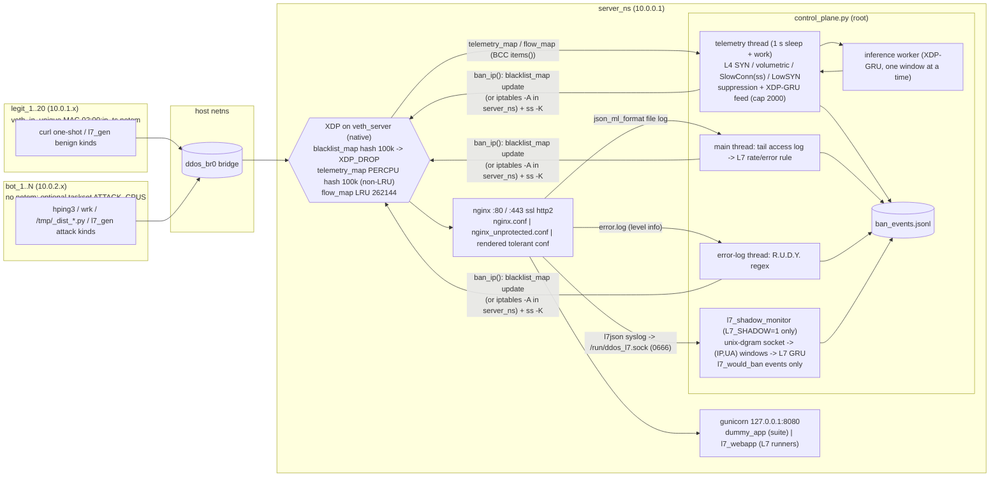

# Independent critical review — ML-assisted DDoS mitigation (XDP/eBPF + heuristics + GRU)

**Date:** 2026-10-19 (UTC). **Reviewer:** Claude (Opus 5.5), second independent review.
**Audited state:** `main` = `origin/main` = `3086e27`. The working tree equals `main` for every
tracked file. HEAD is `5611d8c` on `design/l7-sequence-benchmark`: one docs-only commit ahead,
whose single file is deleted in the working tree.
**Workspace:** `/root/project_analysis_v2/`: notes in `notes/`, measurements in `outputs/`,
helper scripts in `bin/`, private clone in `code_copy/`, command log in `commands.log`.

**Evidence tags.**
* **[FACT]** verified by me (file:line, command output, recomputation).
* **[INFERENCE]** reasoned from facts.
* **[CLAIMED]** stated in a project document and not re-verified by me.

Paths without a prefix are relative to the repository root
(`/home/artur/DDoS-mitigation/code`). `outputs/…`, `notes/…` and `bin/…` are under
`/root/project_analysis_v2/`.

**Ground rules kept.**
* Nothing was modified in the repository, in `/root/project_analysis/`, in the network
  configuration, namespaces, XDP, sysctl or iptables.
* No traffic was sent and no state-changing script was run.
* Everything executed ran in the private clone, as root inside an
  `unshare --mount --net --pid` sandbox (`bin/sandbox.sh`): throw-away `/tmp`, `/var/tmp`,
  `/var/log` and `/run/netns`, loopback interface only.
* The VM was powered off cleanly at 10:56:24 UTC (journal boot −1 ends in `systemd-poweroff`)
  and started again at 12:51:07 UTC, while the audit was in progress. I ran nothing that could
  do this. It cleared tmpfs `/tmp`, including my session scratchpad. All results had already
  been saved under `/root/project_analysis_v2/`.

---

## 1. Executive summary

**What the system is today [FACT].** One Python daemon (`control_plane.py`, 1,055 lines,
module-level, attaches XDP at import) with six deterministic engines and two optional learned
engines:
* L3/L4 rules on XDP per-source counters: SYN, volumetric, slow-connection (via `ss`),
  low-and-slow SYN;
* L7 rules on the Nginx access log: per-IP rate / error ratio, and a R.U.D.Y. error-log regex;
* the **XDP-fed GRU**, **on and ban-capable by default** (`XDP_GRU=1`, `control_plane.py:82`);
* the **L7 (Nginx-log) GRU**, shadow-only and **off by default** (`L7_SHADOW=0`, `:31`).

Enforcement uses an XDP blacklist, or iptables. The namespace testbed, harness and evaluation
tooling are mature and reproducible.

**Overall health.**
* *Evaluation pipeline engineering:* **good**. Every published analysis, verdict report,
  diagnosis and model reproduces **bit for bit** (§9.1). The ban-event log, the
  pre-registrations and the honest negative verdicts are real strengths.
* *Deployed detection code:* **weak and untested**. `control_plane.py` has 0 % behavioural test
  coverage and the XDP parser has no test. Many previously reported defects are still open
  (F-13, F-14, F-15 in the XDP program; F-17 to F-20 in the daemon). The fixes for two of them,
  the `ihl` check and the LRU telemetry map, sit on unmerged branches (§4, §5).
* *Evidence for thesis claims:* **thin**. Comparisons rest on 3 runs per mode, one attack type
  at one operating point. Slow-attack and volumetric-flood claims are untested. The ML results
  are negative, and **the L7 benchmark's "attacks" cause no measurable harm** (§6.2).

**Top 5 risks**

1. **The deployed default runs a ban-capable model with no true positives and one recorded
   false positive.** With `XDP_GRU=1`, the XDP-GRU banned exactly once across all 71 ban-event
   logs: a legitimate broadband client (10.0.1.6, p = 0.999), in an *unpublished* P1 smoke run
   (§8.1). **[FACT]**
2. **The L7 evaluation measures label classification, not mitigation.** **[FACT]**
   * The fast "sub-threshold attackers" leave benign success at 100 % and server latency
     unchanged (p50 2.0 ms with or without them, all 5 runs). The project's own admissibility
     rule requires measurable harm.
   * Evaluation seed 1 replays the training capture's per-client plans.
   * Every attacker runs at LAN speed while benign clients get netem. This confound matches
     the GRU's browser false positives exactly (§6.2).
3. **The GRU does not use sequence order.** **[FACT]**
   * Shuffling the requests inside every window leaves all P5c.4 decisions unchanged (20/20
     attackers, same benign IPs; probability correlation 0.99, §6.2.6).
   * "Sequence modelling earns its place" (P4/P5c.3) rests on one credential-stuffing IP
     counted as 6 User-Agent groups (§6.2.4).
4. **Statistical claims are over-stated.** **[FACT]**
   * With the run as the unit, none of the R3/R4 contrasts reaches α = 0.05 (paired-t
     p = 0.08–0.42). With three pairs, a sign-flip test cannot go below p = 0.25.
   * The published "95 % CIs" come from a 3-block bootstrap with only 10 distinct resamples.
   * The Fisher tests on pooled requests ignore clustering (§9.3).
5. **"Slow attacks are mitigated" is unsupported, and the tolerant profile silently disables
   it.**
   * S7/S8 use 8 and 10 sockets per bot, at SlowConn's threshold of 8. **[FACT]**
   * Nginx answers R.U.D.Y. with 413, so its engine can never fire. **[FACT]**
   * SlowConn's per-IP "idle bytes" test is trivially evaded. **[FACT]**
   * The tolerant profile (SlowConn 180) would miss both scenarios. **[INFERENCE from code]**
   * The promised security-cost table was never produced. **[FACT]**

**Top 5 recommendations**

1. Set `XDP_GRU=0` by default and remove the XDP-GRU from the ban path. Fix the Nginx
   syslog-sink coupling, which writes one `[warn]` per request while the shadow engine is off
   (§5.3). Both are small (S).
2. Re-scope the thesis's ML contribution as a **well-documented negative result** (§6.3): rules
   suffice in this testbed; the GRU here is order-free and fingerprint-prone. Present the
   reproducible evaluation methodology as a contribution.
3. Before submission:
   * run **≥ 10 paired blocks** at the knee, with run-level inference;
   * run the suite once under the tolerant profile (security cost) and once with realistic slow
     attacks;
   * publish the omitted runs (§15).
4. Add **behavioural tests of the deployed rules**: extract them into an importable module,
   test them with a fake clock, and test the XDP parser with `BPF_PROG_TEST_RUN` (§7.4).
5. If the GRU is to get a fair chance, use the **threat-driven redesign** of §11:
   * an expensive backend with measurable harm;
   * independent entities, with IP pools re-drawn per seed;
   * seed-disjoint training;
   * attackers behind the same netem as benign clients;
   * order-shuffle and HGB controls;
   * an arm with enforcement on.

   Do not use the "summary-matched" P5d design: it builds the advantage in (§11.8).

**What the thesis can claim right now [FACT unless noted]**

* The system bans the ten testbed attack instances in XDP mode within 1–4 polling intervals
  (≈ 0.5–4 s), with no deterministic false positives on the suite's curl-only benign clients
  (R2 plus one unpublished replicate).
* In XDP mode, banned flood traffic is dropped before the IP stack: 1.26–1.65 M pps (UDP, ACK,
  fragmentation) or 0.84–0.89 M pps (multi-vector) arrive and < 230 pps reach IP (R2, one
  run). The iptables comparison exists only in unpublished data.
* At one capacity-limited operating point, under a closed-loop HTTP flood, the daemon kept
  legitimate availability at 100 % in 9/9 runs while unprotected mode degraded in 9/9
  (sign test p = 0.002). The size of the effect is not estimated.
* Detection models fed from XDP flow telemetry learned tool fingerprints and never won a
  detection race (reproduced).
* The Nginx-fed GRU showed **no advantage** over simple per-(IP, UA) rate rules under a
  pre-registered protocol.
* **Not claimable:**
  * mitigation of slow attacks;
  * XDP > iptables for availability;
  * "rate limiting alone is harmful" in general;
  * "zero false positives" in general;
  * any GRU detection value.

---

## 2. Environment and state snapshot (2026-10-19, 08:40–12:55 UTC) [FACT]

| Item | Value |
|---|---|
| Host | KVM guest; 8 vCPU i7-10700F (1 thread/core); 9.2 GiB RAM; no swap; 77 G root LV (30 %) |
| OS / kernel | Ubuntu 26.04 LTS, 7.0.0-38-generic. Booted 07:02:18; powered off cleanly 10:56:24 (not by me); booted again 12:51:07. Journal persistent since 2026-10-03 (25 boots before today; 3 reboots on 2026-10-16 between L7 runs) |
| `/tmp` | tmpfs, 4.7 G: legacy `/tmp/*.csv` outputs vanish at every reboot |
| Clock | Etc/UTC, NTP-synchronised (chrony); the daemon and the harness share it |
| BPF stack | `python3-bpfcc`/`libbpfcc` 0.35.0, libbpf 1.6.3, bpftool 7.7.0, bpftrace 0.25; no `clang`/`cppcheck` binary |
| Nginx | 1.28.3 (http_v2, http_v3, ssl, realip, stub_status); systemd unit disabled and inactive |
| Traffic tools | curl 8.18 (nghttp2), wrk 4.1.0 (closed loop), hping3 3.0.0a2, iproute2 6.19, iptables 1.8.11 **nf_tables**. **Missing:** wrk2, vegeta, k6, locust, h2load, ab, slowhttptest |
| venv | Python 3.14.4, `include-system-site-packages = false`. `bcc` is a **hand copy** of the system `python3-bpfcc` 0.35.0 tree (no dist-info). `requirements.txt` pins `bcc==0.1.10`, which on PyPI is *"N-dim invertible BCC lattice"* (Will Sheffler), unrelated to eBPF. Required but unpinned: psutil 7.2.2, gunicorn 26.2.0, scipy 1.18.1, requests 2.34.2. No lightgbm (HGB comes from scikit-learn 1.9.0). pandas 3.0.6 is installed against a 3.0.5 pin |
| Runtime | No nginx, gunicorn, daemon, wrk or hping3 processes. No netns, no `ddos_br0`, no XDP or tc programs, no `/sys/fs/bpf` pins, no `/run/ddos_l7.sock`. Host iptables/nft empty. sysctl `tcp_syncookies=1`, `unix.max_dgram_qlen=512`, `somaxconn=4096` |
| TLS | `/etc/ssl/certs/nginx-selfsigned.crt` (CN=twojadomena.pl, valid to 2027-06-02) plus key (mode 0600, not printed). The cert is also hash-linked in `/etc/ssl/certs` (`a63c06ad.0`) |
| Old snapshot | `/home/artur/DDoS-mitigation/`, the repository's parent, holds Sep-6 copies of `control_plane.py`, `nginx.conf` and `xdp_ddos_filter.c`, plus two venvs. The repository venv was created from that parent venv |

**Git [FACT].**
* `main = origin/main = 3086e27`, so `main` is pushed. The earlier session's notes said it was
  not; that is out of date.
* All feature branches are merged except:
  * `chore/audit-cleanup` 3f94587 (2026-10-09): XDP `ihl < 5` check, label fixes, and removal of
    the out-of-scope `server/` tree;
  * `chore/audit-telemetry-lru` 2c2c71c (2026-10-09): `telemetry_map` → `lru_percpu_hash`
    (D4 / F-14);
  * `design/l7-sequence-benchmark` 5611d8c: the P5d plan.

  **The first two never reached `main`.**
* `xdp_ddos_filter.c` last changed in `2e93e0e` (2026-10-08).
* Reflog: one `reset HEAD~1` on 2026-10-13 08:25, re-splitting a mixed commit (benign), and a
  deleted branch `chore/audit-p2-lru-rps`.
* An extra worktree, `.claude/worktrees/determined-poitras-f0590d`, exists for a merged branch.

**Raw runs vs published runs (selective-publication check) [FACT, `notes/phase0_environment.md`]**

| Raw run | Published? | What it shows | Would it change a conclusion? |
|---|---|---|---|
| `/var/tmp/ddos_campaigns/20261013T143610Z_xdp` (full suite, defaults, `31058e0`, clean tree) | **no** (and absent from the earlier command log) | 10/10 scenarios, 5/5 banned, 0 FP. TTMs differ from R2: SYN median 0.96 s / max 1.97 vs 0.50; Frag 1.25 vs 0.49 | No for PASS/FP; **yes** for any "TTM ≈ x s" statement (run-to-run spread ×2) |
| `2026-10-13_R1_smoke` | numbers only, in addendum §N | instrument check | no |
| `/var/tmp/ddos_l7_smoke/20261014T152428Z` | **no** (mentioned in prose in the P1 README) | **the only XDP-GRU ban ever recorded, on legit 10.0.1.6** | **yes**: the only live evidence of the XDP-GRU's false-positive behaviour |
| `…/20261014T152342Z` (empty), `…/20261014T153217Z` | no | aborted run / clean repeat | no |
| `/var/tmp/ddos_l7_eval/20261016T075305Z` | no (disclosed in memory) | runner crash before traffic | no |
| `/root/project_analysis/campaigns/2026-10-12_{macfix_xdp, macfix_iptables, macfix_unprotected, macfix_nginxlimits, calib, knee_nginxtuned, f45}` | **no**; only `_knee` became `results/2026-10-12_exp2a-knee_prototype` | the evidence behind the addendum's default-point 4-mode comparison (pre-stack drop vs iptables/unprotected, Nginx CPU ×4, 100 % availability everywhere), the knee calibration, EXP-2b and the F-45 validation | not the conclusions, but these claims are **not reproducible from the repository** |

Every published L7 file is byte-identical to its raw original. Every published suite file is
identical too, except `console.log`, whose ANSI codes are stripped (§9.1).

---

## 3. Architecture (reconstructed from code and runtime)

### 3.1 Topology and components [FACT: `test_distributed_suite.py:416-821`, `control_plane.py`]



### 3.2 End-to-end data flows

| Flow | Path | Latency / bound [FACT] |
|---|---|---|
| Packets → L4 rules | XDP counters (cumulative per source) → `telemetry_map.items()` every poll → per-poll deltas, not divided by elapsed time (D5) → thresholds | first poll after onset; a poll is a 1-s sleep plus the loop's own work |
| Packets → XDP-GRU | `flow_map.items()` (full read) → first 2000 visited entries → for each advancing TCP flow, append 8 features to the source's 15-deque → `scaler.transform` → queue → GRU → p > 0.95 in 3 results (not 3 polls) → ban | ≥ 15 snapshots, then a drain at the next poll; paused for 15 s by volumetric suppression |
| Requests → L7 rate rule | JSON file log → `tail` (50 ms) → per-IP 10-s deque → rps = n / max(span, 1 s). Ban if rps > 50, or if error ratio > 0.8 and rps > 10 (503s excluded) | ≥ 5 requests; tens to hundreds of ms |
| Error log → R.U.D.Y. | "client timed out … while reading client request body … client: IP" ≥ 3 times in 60 s | never fires on the suite's R.U.D.Y. (413, §5.2) |
| Requests → L7 GRU | `access_log syslog:server=unix:/run/ddos_l7.sock` → datagram reader → `normalise` (URI/UA blake2b-32) → `(IP, ua_h)` window store (20 requests) → each poll, batch the dirty keys with ≥ 5 requests → p > threshold in 3 consecutive scored polls → `l7_would_ban` | ≥ 5 requests and ≥ 3 polls; never bans |

### 3.3 Deployed configuration vs evaluated configurations

**Deployed (no environment variables set).**
* Engines that can ban:
  * L4 SYN (> 200 per poll) and volumetric (> 5000 non-SYN packets per poll);
  * SlowConn (≥ 8 established connections, < 250 B, 3 polls) and LowSYN;
  * the L7 rate/error rule and the R.U.D.Y. regex;
  * **the XDP-GRU**.
* Nothing runs in shadow: the L7 engine is not started.
* Profile `default`.
* Nginx `nginx.conf`: 30 r/s, burst 100, `limit_conn` 50, 5-s timeouts, 64 KiB body,
  2 × 1 KiB header buffers.

| Campaign(s) | Daemon | Nginx | Backend | Operating point |
|---|---|---|---|---|
| R2 regression; EXP-2a, R3, R4 at the knee | deployed defaults; XDP-GRU on implicitly (the switch only appeared on 10-15) | `nginx.conf` / unprotected | `dummy_app` (one path) | default / knee |
| P1 smoke | L7_SHADOW=1, **XDP-GRU on** | `nginx.conf` | `dummy_app` | — |
| P2 smoke; P5 A–D; P5c.1 | L7_SHADOW=1, **XDP_GRU=0**, default profile | `nginx.conf` | `l7_webapp` 4×4 | — |
| P5c.2; P5c.4 | L7_SHADOW=1, XDP_GRU=0, **tolerant** (rate 108, SlowConn 180) | `nginx.conf` rendered at 82 r/s, burst 133 | `l7_webapp` | — |
| P3 / P5c.3 captures | no daemon | `nginx_l7capture.conf` (file log; tolerant-rendered at P5c.3) | `l7_webapp` | — |

**Consequences [INFERENCE].**
* Every L7-GRU result is for a configuration that is not deployed: XDP_GRU=0, a multi-path
  backend, and, for P5c, the tolerant thresholds.
* No run evaluates the deployed combination of the XDP-GRU and the L7 engine.
* The tolerant profile, under which "the dilemma" was measured, was never run against the ten
  suite scenarios.
* The availability results (R2–R4) do correspond to the deployed daemon, but against a trivial
  one-path backend.

### 3.4 Pipeline tables

**XDP-GRU: training vs inference**

| Aspect | Training (`capture_testbed_dataset.py` → `train_testbed_gru.py`, 2026-10-09) | Inference (`control_plane.py`) |
|---|---|---|
| XDP mode | generic (SKB), `:158` | native, `:158` |
| Unit | one per-flow snapshot per poll; ≤ 80 attack rows per poll, sampled unseeded (`:200`) | one per advancing flow per poll; first 2000 visited entries |
| Sequence | 15 snapshots within a source IP, stride 1, ≤ 800 per IP | 15-deque per IP; one submission per advancing flow |
| Benign traffic | curl one-shot only, 170 s, on the duplicate-MAC L2 | anything |
| Threshold | p ≥ 0.5 for the metrics (`:100`) | p > 0.95, 3 results |
| Gating | none | volumetric suppression (15 s) plus a flow-age gate after it; L7 bans arm neither |
| Long runs | — | F-45: entries are never deleted, so the feed starves after ≈ 6.5 min |

**L7-GRU: capture → training → shadow inference**

| Aspect | Capture (P5c.3) | Training (`ml/train_l7.py`) | Shadow inference (`l7_engine`) |
|---|---|---|---|
| Source | lossless l7json file | the same lines, through the same `l7_features` code | datagram socket (drops under bursts; not measured in P5/P5c) |
| Keying | — | (IP, ua_h) | (IP, ua_h) |
| Window | — | last 20 requests, stride 3 | last 20 requests, scored per poll if ≥ 5 |
| Features | — | 15 columns (`no_size_no_server_timing`) | the same, with shared `apply_scaling` |
| Threshold | — | 0.95 × 3 (policy metrics) | 0.95 in 3 consecutive scored polls |
| Load gating | a SYN flood mid-capture | — | suppression from the L4 volumetric state; age gate at 0.5 |
| Profile | tolerant | — | tolerant (P5c.4) |
| Netem | **benign clients only; attackers never shaped** | — | the same |

Train/serve consistency of the L7 line is excellent: shared code and deterministic replay
**[FACT]**. That of the XDP line is not.

### 3.5 Engine matrix: which engine bans which testbed attack (current code)

| Attack instance | Default profile | Tolerant profile | XDP-GRU | L7 GRU (shadow) |
|---|---|---|---|---|
| SYN flood (1000 SYN/s per bot) | L4 SYN | L4 SYN | paused (suppression) | — (no requests) |
| Low & slow SYN (10/s per bot) | L4 LowSYN (≈ 4 s) | the same | blind (hping3 window 64 → p ≈ 0.0003) | — |
| UDP / ACK / fragment floods | L4 volumetric | the same | UDP not fed; paused | — |
| HTTP flood, Yo-Yo (wrk, ≫ 108 rps per IP) | L7 rate (+ L4 SYN from connection churn) | L7 rate | loses the race | would flag |
| Slowloris (8 sockets, 5-s dribble) | L4 SlowConn (3.7 s) | **none** (8 < 180) [INFERENCE] | ≈ 16 s in replay | blind (R1) |
| "R.U.D.Y." (10 sockets, CL 1 000 000 → 413) | L4 SlowConn (3.6 s); `l7_rudy` never | **none** [INFERENCE] | ≈ 8 s in replay | blind |
| L7-track fast sub-threshold (11–25 rps sustained) | none | none | not evaluated | would-ban 20/20 |
| credstuff (401 at ~20 rps) | L7 error branch | L7 error branch | — | yes |
| L7-track slow families (6 sockets) | none | none | — | none |

---

## 4. Status of the earlier review (REPORT.md F-01 … F-44, addendum F-45, D1 … D15)

"Fixed in" names the commit on `main` that fixed it. "Verified how" is my check today.

| ID | Earlier claim (short) | Still true? | Fixed in | Verified how |
|---|---|---|---|---|
| F-01 | duplicate veth MAC (derived by udev from the name) dominates flood results | **fixed** | 51cc21c (D1) | explicit MAC at `test_distributed_suite.py:481`, assertion at `:808-816`; 0 duplicate-address kernel messages on every boot since 2026-10-12 (journal) |
| F-02 | the "during" window depends on the mode | **mitigated, opt-in** | efc5994 (`ATTACK_DURATION`) | the default is still historical (0); only R4 used equal exposure |
| F-03 | n = 3, SD bars, unweighted means | **still true** | — | every comparison campaign has 3 runs per mode; run-level re-analysis in §9.3 |
| F-04 | XDP-GRU evaluated on 2 attacker IPs at p ≥ 0.5 | **still true** (XDP line) | — | `train_testbed_gru.py:46-53,100` unchanged; the L7 trainer reports policy metrics with CIs, but its n is just as small |
| F-05 | shortcut features (request size, TCP window) | **still true** in the XDP line; size and server timing handled in L7 | — | `ml/diagnose_gru.py` re-run gives identical results; new L7 confounds in §6.2.5 |
| F-06 | GRU value unproven | **confirmed, and stronger** | — | 1 XDP-GRU ban in 71 event logs, and it is a false positive; L7 verdict "no advantage"; order-shuffle ablation (§6.2.6) |
| F-07 | daemon log deleted per scenario | **fixed** | efc5994 | `_archive_daemon_log` at `:589-605`; R2's `daemon.log` has 10 sections |
| F-08 | TTM floor from harness polling | **fixed** | efc5994 | event-based `TTM_Exact_*` columns in `scenario_results.csv` |
| F-09 | Nginx never restarted; orphan workers | **fixed** | 51cc21c (D2) | `:706-713`; no orphans and no netns left now |
| F-10 | slow attacks neutralised even when unprotected | **still true** | — | scripts unchanged (`:1560`, `:1603`, `:1611`); `nginx_unprotected.conf` keeps the 5-s timeouts and the 64 KiB body limit; EXP-6 never run |
| F-11 | daemon vs Nginx-limits attribution | **addressed** | efc5994 | `nginxlimits` mode is in every knee campaign |
| F-12 | load generators share the CPUs | **partially** | knee operating point | the knee pins the server to cpu0 and the attackers to cpus 1–7; the daemon, softirq processing and all default/L7 runs are unpinned; CPU_Total is host-wide |
| F-13 | XDP parser lacks IPv6/VLAN/ihl/doff/fragment handling | **still true** | — (the ihl check exists only on unmerged `chore/audit-cleanup`) | `xdp_ddos_filter.c:56-57,70-98` |
| F-14 | `telemetry_map` non-LRU; silent init failure | **still true** | — (fix on unmerged `chore/audit-telemetry-lru` 2c2c71c) | `:45,107` |
| F-15 | `flow_map` churn; full iteration every poll | **still true** | — | `:47`; BCC `items()` builds the full list first (`bcc/table.py`) |
| F-16 | global suppression blinds the GRU | **still true, plus a gap**: L7-rate bans never arm suppression or the flow-age gate | — | `control_plane.py:767-783` vs `:1032-1044`; this matches the timing of the only GRU ban (§8.1) |
| F-17 | rate deltas not time-normalised (D5) | **still true** | — | `:717,749-756`; `docs/EVALUATION.md:123-124` acknowledges it |
| F-18 | `ban_ip` not atomic; iptables duplicates; bans persist if the daemon is killed | **still true** | — | `:284-310`; `:320-340` holds the lock across `iptables -D`; the netlink XDP attachment survives SIGKILL, so the suite detaches it explicitly (`:692-695`) |
| F-19 | 503 excluded from the error ratio | **still true** | — | `:1001`; `nginx.conf` sets no `limit_req_status` |
| F-20 | the R.U.D.Y. detector never fires | **still true; root cause re-verified** | — | 10-09 error log: 330 "client intended to send too large body: 1000000 bytes" lines, 0 body timeouts; 0 `l7_rudy` bans among 529 bans |
| F-21 | wrong `bcc`, missing dependencies | **still true** | — | `requirements.txt:1`; PyPI JSON for `bcc==0.1.10`; venv `pip freeze` |
| F-22 | capture gaps (scratchpad path, SKB mode, 80-row cap, curl-only benign) | **partially** | f2d2e1b (D12 path) | the other gaps are unchanged; the model was never re-captured |
| F-23 | CIC pipeline leakage | **still true (legacy, unused)** | — | `GRU_ML_init.py` unchanged; the daemon does not load the CIC model |
| F-24 | provenance missing | **fixed for suite campaigns; partial for the L7 runners** | efc5994 | suite `provenance.json` records commit and dirty state; `ml/capture_l7.py:132-133,351` and `ml/eval_l7.py:254` record the commit only, without a dirty flag; smoke runs record nothing |
| F-25 | ping-based false-positive check | **fixed** | efc5994 | `FP_Source = "ban events"` in every scenario row |
| F-26 | PASS logic carries no availability meaning | **still true** | — | `:1344-1347` (≥ 80 % banned + post-attack curl) |
| F-27 | log volume under flood | **still true, and worse** | — | two access logs per request, error lines per rejection, plus a syslog-failure `[warn]` per failed datagram (§5.3) |
| F-28 | 1 KiB header buffers, 64 KiB body limit | **still true** | — | `nginx.conf:65-66` |
| F-29 | no back-pressure, unbatched inference | **still true** | — | unbounded queues at `:247-248`; one window per call |
| F-30 | "3 consecutive" hits can come from one poll | **still true** | — | `:878-909` submits once per advancing flow |
| F-31 | metrics scope | **partially fixed** | e899b1a and others | `RAM_Total_MB` is system-wide used memory; CPU is host-wide; one sample per phase |
| F-32 | module-level daemon | **still true** | — | XDP attached at import (`:155-158`); 0 % coverage |
| F-33 | logrotate during a campaign | **still possible** | — | `/etc/logrotate.d/nginx` runs daily; `logrotate.timer` last ran at 07:02:51, 33 s after the boot (a catch-up run after a boot is plausible) |
| F-34 | ports in network byte order in the capture CSV | **still true** | — | capture script unchanged |
| F-35 | raw rows lack the client IP | **fixed** | efc5994 | `availability_raw.csv` has `Client_IP` and `T_Start` |
| F-36 | stale docstrings | **still true** | — | `test_distributed_suite.py:45,47` ("…40", "…10"), `:1434-1436` ("GRU ML target"), `control_plane.py:281` ("active on hardware") |
| F-37 | legacy files | **still true** | — | `merge_datasets.py`, `test_mitigation_suite.py`, `setup.sh`, root-level `slowloris.py` and `rudy_script.py`, CIC/legacy models |
| F-38 | root everywhere; pickle of a user-writable file; scripts run from `/tmp` | **still true, plus new surfaces** | — | joblib at `:166`; `/tmp/_dist_*.py` executed as root (`:1558`, `:1601`, `:1645`). New: socket 0666; capture log 0666 (`ml/capture_l7.py:219`); the HGB pickle is "verified" against a hash stored beside it (`ml/train_l7.py:479-488`) |
| F-39 | lint findings | **partially fixed** | — | ruff 0.17.1: 119 default findings, all in older or legacy files; the L7/eval/ml/tests code is clean |
| F-40 | feature formula duplicated (capture vs daemon) | **still true** | — | no shared module and no parity test |
| F-41 | page_pool stalls at teardown | **still true** | — | journal 2026-10-13 14:47–14:58: `page_pool_release_retry() stalled pool shutdown` |
| F-42 | testbed is veth-only | **still true** | — | — |
| F-43 | SYN-cookie toggle is a no-op | **still true** | — | `:914-928`: the netns default is already 1, and the value is never restored |
| F-44 | `torch.load` without `weights_only` | **mitigated by the library default** | — | torch 2.14 defaults to `weights_only=True` (`torch/serialization.py:77`); not explicit at `:175`, but explicit in `l7_scorer.py:120` and `ml/diagnose_gru.py:84` |
| F-45 | GRU feed stall delays L4 bans | **stall fixed; starvation still open** | 51cc21c | the cap at `:876-881` still counts visited entries; entries are never deleted; `items()` still reads the whole map |

**D-patches (status on `main`):**
* **Applied:** D1 (unique MAC), D2 (Nginx restart), D7 (ban events), D9 (equal exposure, ground
  truth, provenance; exposure is opt-in), D12 (capture scratchpad path), D13 (`.gitignore`).
* **Partially applied:** D3 (only the `ihl` check exists, on an unmerged branch); D10 (the
  fields exist in `l7json`, not in the file log the rule reads; no `limit_req_log_level`).
* **Not applied:** D4 (LRU telemetry map; it sits on unmerged `chore/audit-telemetry-lru`), D5,
  D6, D8 (the rule reads a log without the `limit_req` field), D11, D14, D15 (XDP trainer).

### 4.1 Earlier claims that are wrong, unsupported or over-stated

1. **"Sequence modelling earns its place (GRU beats HGB)"** (P4 status in
   `docs/L7_GRU_DESIGN.md`) and **"GRU 7/8 held-out groups vs HGB 1/8"**
   (`results/2026-10-16_l7-p5c3-train/README.md`). **[FACT]**
   * The whole difference is `credstuff`: one attacker IP whose generator rotates the
     User-Agent on every request (`ml/l7_gen.py:302`), so it counts as 6 (IP, UA) groups.
   * P4: 6/6 vs 5/6 groups. P5c.3: 6/6 vs 0/6.
   * In the online comparison set, which excludes `credstuff`, the two models tie.
   * On the P5c.4 data the GRU does not use request order at all (§6.2.6).
2. **"The stalled-flow false positive … reproduced live"** (P1 README): **unsupported
   [FACT/INFERENCE]**.
   * The false ban came 56 s after the HTTP burst was banned, far beyond curl's 10-s max-time.
   * The client was *broadband*, i.e. no loss.
   * The ban event carries no window, so the mechanism cannot be shown.
3. **Ingest cost "~200 k lines/s/core (5 µs/line)"** (`docs/L7_GRU_DESIGN.md` §4.4).
   **[FACT, `outputs/bench_real_l7.txt`]**
   * The benchmark measures a synthetic parser, not the deployed code.
   * The real path (`parse_l7_line` + `normalise` + window store) costs 16.3 µs/line,
     ≈ 61 k lines/s/core.
   * The claimed 6× head-room over the 31 k lines/s peak is therefore ≈ 2×.
4. **"A 6-socket Slowloris that the default SlowConn caught"** (the security-cost example,
   `docs/L7_GRU_DESIGN.md:1214-1216`): wrong, since 6 < 8. In P5 the L7 track's 6-socket slow
   families were caught by nothing. The promised security-cost table does not exist. **[FACT]**
5. **"The dilemma, measured"** (P5c.4 README). **[FACT/INFERENCE]**
   * On the evasion side it is true by construction: attack rates were calibrated below
     50 rps at P3, and the tolerant threshold is 108.
   * It holds only for per-IP peak and connection-count rules. Per-(IP, UA) sustained-rate
     rules caught 20/20 at 2 % benign.
6. **"One browser client in 4 of 5 runs"** (P5c.4 README) is in fact two different IPs
   (10.0.1.16 three times, 10.0.1.15 once), each flagged only with the `perfect` profile.
   **[FACT]**
7. **"95 % CI [+12.3, +32.9]"** (R3, daemon vs unprotected) and similar intervals. **[FACT]**
   * These come from a 3-block bootstrap; they are not 95 % intervals.
   * The run-level t-interval is [−5.9, +47.9] (§9.3).
   * The R3 README does call them "indicative"; the addendum's and EVALUATION.md's
     "significance" language should say the same.
8. **"Every run is reported"** (the integrity rules of §7.2/§7.3). **[FACT]**
   * True for the P5 and P5c runs.
   * Not true for P1: 2 completed runs are unpublished, and one of them holds the GRU false
     positive.
   * Not true for the 2026-10-12 EXP-1 campaigns behind several addendum claims.
9. **Benign-kind conformance was pre-registered (§7.2 rule 5) but not applied in P5c.**
   `api_bulk`, specified at 15–20 rps, ran at 2.5–4.4 rps in 4 of 5 runs (§6.2.3). **[FACT]**
10. **Admissibility rule (b), "causes measurable harm"** (`docs/L7_GRU_DESIGN.md:612-617`), was
    never measured. Measured now, the harm is nil (§6.2.2). **[FACT]**
11. **Status blocks are stale.** `docs/L7_GRU_DESIGN.md:3` is dated 2026-10-15 and still says
    "Two decisions precede P5c.2/P5c.3"; the P5c.2–P5c.4 outcomes appear only further down. The
    earlier session's notes said `main` was not pushed; it is (`origin/main` = `3086e27`).
    **[FACT]**

---

## 5. Component analysis

### 5.1 XDP program (`xdp_ddos_filter.c`, 148 lines, unchanged since `2e93e0e`)

* **Correctness [FACT].**
  * Only IPv4 is handled (`:56-57`). IPv6 and 802.1Q frames bypass both the blacklist and the
    counters.
  * There is no `ihl ≥ 5` check (`:71`) and no `doff` check (`:84`). `doff < 5`
    over-estimates the payload.
  * There is no fragment check, so non-first fragments are parsed as L4 and leave garbage-port
    entries in `flow_map`.
  * `tot_len` is trusted (`:110`), so a forged length inflates `byte_count`. SlowConn's
    "idle" test reads those bytes (§5.2).
* **Robustness under attack [FACT].**
  * `telemetry_map` is a non-LRU per-CPU hash of 100 k entries (`:45`). When it is full,
    `lookup_or_try_init` returns NULL and new sources go uncounted (F-14).
  * `flow_map` is LRU (262 144 entries), and the daemon never deletes from it (F-15, F-45).
* **Stranded fixes.**
  * `chore/audit-cleanup` 3f94587 adds `if (ip->ihl < 5) return XDP_PASS;` after the
    blacklist check. **[FACT]**
  * `chore/audit-telemetry-lru` 2c2c71c turns `telemetry_map` into an `lru_percpu_hash`.
    **[FACT]**
  * Both commit messages say "verified: clang-compiles and passes the verifier". **[CLAIMED]**
  * Neither commit is on `main`. **[FACT]**
* **Not verifiable without approval.** A verifier or compile check needs a BPF program load.
  There is no clang binary, and BCC loads into the kernel, which counts as a kernel state
  change.

```diff
--- a/xdp_ddos_filter.c   (merge the two stranded commits, then add the remaining D3 checks)
-BPF_PERCPU_HASH(telemetry_map, u32, struct telemetry_data, 100000);
+BPF_TABLE("lru_percpu_hash", u32, struct telemetry_data, telemetry_map, 100000);
@@
+    if (ip->ihl < 5) return XDP_PASS;
+    if (ip->frag_off & bpf_htons(0x3FFF))            /* MF or offset: count, don't parse L4 */
+        have_l4 = 0;
@@  if (proto == IPPROTO_TCP) { ...
+            if (tcp->doff < 5) return XDP_PASS;
```

### 5.2 Control plane (`control_plane.py`)

| Concern | Finding | Evidence |
|---|---|---|
| Structure | Module-level script: the BPF compile and attach, the model load and the threads all run at import. It cannot be unit-tested and has 0 % coverage | `:155-158`, `outputs/coverage.txt` |
| Paths | `BPF_SOURCE_FILE` and `GRU_CONFIG_PATH` are relative. The daemon starts only when cwd is the repository, and the suite inherits the caller's cwd | `:24`, `:55` |
| Time normalisation (D5) | Per-poll deltas are compared with per-second thresholds. The loop's own work (`ss`, and `items()` taking up to ~1 s at 262 k entries) inflates the "rates" | `:717`, `:749-756` |
| Ban atomicity (F-18) | Check-then-act across three threads, so iptables rules can be duplicated. `unblock_expired_bans` runs `iptables -D` while holding `banned_ips_lock` | `:284-310`, `:320-340`, `:993`, `:1035` |
| Error ratio (F-19) | Status 503 is excluded, yet `limit_req` rejects with 503 | `:1001` |
| R.U.D.Y. (F-20) | The regex needs a body timeout, but the suite's R.U.D.Y. gets a 413 before its body is read | `:462-464`; error-log counts in §4 |
| **SlowConn design** | "Idle" means **per-IP aggregate** ingress bytes < 250 per poll, for 3 polls in a row. Any steady ≥ 250 B/s from the same IP resets the streak for good: staggered keep-alive headers across ≳ 60 sockets, or one extra request per second. The suite's S7/S8 (8 or 10 sockets, synchronous dribble every 5 or 7 s) sit exactly at the rule's operating point | `:792-805`; suite `:1560`, `:1603` |
| Low-and-slow SYN | Sound for the hping3 instance, which never completes a handshake. A bot that completes one handshake every 15 s is exempt | `:813-830` |
| XDP-GRU feed | `items()` reads the whole map; the cap counts 2000 visited entries; one submission per advancing flow (F-30); the queue is unbounded (F-29); results are drained at the next poll | `:876-909`, `:247` |
| Suppression | Armed only by L4 SYN/volumetric bans or global SYN/pps. **L7-rate bans arm nothing**, so after an HTTP flood the XDP-GRU scores stalled flows with no flow-age gate | `:767-783`, `:855-864` vs `:1032-1044` |
| Profiles | `TOLERANT_OVERRIDES` changes only the rate rule (108) and SlowConn (180). The suite has no matching Nginx profile; only the L7 runners render one | `:141-146`; `render_limits` in `ml/capture_l7.py` |
| SYN cookies (F-43) | Sets `tcp_syncookies=1` inside `server_ns`, where it is already 1. "Flag reset" restores nothing | `:914-928` |
| Model loading | `joblib.load` of a user-writable scaler as root (`:166`). `torch.load` relies on the torch ≥ 2.6 default `weights_only=True` (`:175`) | — |
| Observability | 43 `print()` calls; `daemon.log` has no timestamps. Ban events carry value and threshold, but the GRU event has no window or flow IDs | `ban_events.py`; §8 |

```diff
--- a/control_plane.py
-XDP_GRU = os.environ.get("XDP_GRU", "1") == "1"
+# Off by default: no true positive in any recorded run, one false positive (audit 2026-10-19).
+XDP_GRU = os.environ.get("XDP_GRU", "0") == "1"
@@ def l3_l4_telemetry_monitor():
+    last = time.monotonic()
     while not stop_event.is_set():
         time.sleep(L4_POLL_INTERVAL)
+        now_m = time.monotonic(); dt = max(now_m - last, 1e-3); last = now_m       # D5
@@
-            if d_syn > SYN_FLOOD_THRESHOLD and not GRU_ONLY:
+            syn_rate, pkt_rate = d_syn / dt, (d_pkts - d_syn) / dt
+            if syn_rate > SYN_FLOOD_THRESHOLD and not GRU_ONLY:
@@  # SlowConn: count idle connections per IP instead of per-IP aggregate bytes
-            if conns >= SLOWCONN_CONN_THRESHOLD and d_bytes < SLOWCONN_IDLE_BYTES and not GRU_ONLY:
+            idle = idle_conns_by_ip.get(ip_str, 0)  # `ss -tani`: lastrcv > SLOWCONN_IDLE_S, no complete request
+            if idle >= SLOWCONN_CONN_THRESHOLD and not GRU_ONLY:
@@  (main loop, D8; needs "lreq" in the file log format)
-            is_error = status >= 400 and status != 503
+            is_error = (status >= 400 and status != 503) or log_data.get("lreq") == "REJECTED"
```

### 5.3 L7 ingestion and shadow engine

* **Parser robustness [FACT].**
  * `parse_l7_line` parses from the first `{`; a JSON error yields `None`.
  * A truncated or malformed datagram fails JSON parsing and is counted as a parse error (as
    `truncated` when it opens a JSON object without closing it). Nginx caps its own syslog
    line far below the 64 KiB receive size (comment at `l7_ingest.py:46`); a 900-B User-Agent
    passed intact in P1.
  * Every published L7 run shows 0 parse errors and 0 truncations (§8.3).
* **Socket permissions [FACT].**
  * `/run/ddos_l7.sock` is `chmod 0o666` (`l7_ingest.py:45`, `:216-218`), and `normalise`
    accepts any `"ip"` string (`:118-120`).
  * Any local process can therefore forge log lines for any IP.
  * Harmless while the engine is shadow-only; **a ban-injection primitive once it is
    promoted**.
* **Nginx when the socket is absent, i.e. the deployed default.**
  * `nginx.conf:58` always logs to the socket, but `L7_SHADOW=0` by default, so nothing binds
    it. **[FACT]**
  * Nginx writes `[warn] send() to syslog failed while logging request` for each failed
    datagram: `error.log.3.gz` has 868 such lines within one second (2026-10-14 15:38:51, the
    P1 flood burst), and 6–9 at each daemon shutdown on 10-16. **[FACT]**
  * With no socket bound, every request fails, so an HTTP flood means thousands of error-log
    lines per second. The R.U.D.Y. thread regex-scans each of them. **[INFERENCE]**
  * Never measured: R2–R4 predate P1. **[FACT]**
* **Keying and evasion [FACT, `outputs/bench_real_l7.txt`].**
  * Windows are keyed by (IP, UA hash) and scored only once they hold ≥ 5 records
    (`l7_engine.py:35,124`).
  * With the UA rotated on every request, 100 k requests give 100 k keys and **0 windows
    scored**. The GRU and every per-(IP, UA) baseline are evaded completely.
  * There is no key cap, and a key costs ≈ 2 KiB (200 k keys ≈ 390 MiB RSS).
  * A rotation flood distributed below the per-IP limits is exactly the threat the engine is
    meant to address.
* **Gating.** Suppression follows only the L3/L4 volumetric state (`control_plane.py:574`). The
  age gate skips windows where more than half the requests predate the trust point. An L7
  flood never suppresses the L7 engine; that is by design and acceptable in shadow mode.
* **Cost [FACT].**
  * Real ingest: 16.3 µs/line, ≈ 61 k lines/s/core.
  * Poll: ≈ 160 µs per scored window at 64–150 windows (the design doc says 110–125 µs).
* **Memory bounds.** Idle keys are evicted after 60 s, checked every 5 s of poll clock.
  Otherwise memory is unbounded (see keying).

```diff
--- a/l7_ingest.py   (accept datagrams only from the nginx worker uid; mode 0660 + group)
-DEFAULT_SOCKET_MODE = 0o666
+DEFAULT_SOCKET_MODE = 0o660          # chgrp to the nginx worker group after bind
@@ class SyslogDatagramReader.__init__
+        self.sock.setsockopt(socket.SOL_SOCKET, socket.SO_PASSCRED, 1)
@@ def messages(...)
-                data = self.sock.recv(_RECV_SIZE)
+                data, anc, _, _ = self.sock.recvmsg(_RECV_SIZE, socket.CMSG_SPACE(12))
+                if not _from_uid(anc, self.allowed_uid):     # SCM_CREDENTIALS pid/uid/gid
+                    self.rejected += 1
+                    continue
--- a/l7_engine.py   (bound the state; rotation must not hide traffic)
+MAX_KEYS = 50_000      # LRU over (ip, ua_h); overflow folds into an (ip, "*") aggregate key
--- a/nginx.conf     (decouple the default from the shadow engine)
-    access_log syslog:server=unix:/run/ddos_l7.sock,nohostname,tag=l7 l7json;
+    include /etc/ddos/l7_sink.conf;      # empty unless L7_SHADOW=1 (written by the runner)
```

### 5.4 Nginx configurations

* `nginx.conf` and `nginx_unprotected.conf` are identical except for
  `limit_req_zone`/`limit_req` and `limit_conn_zone`/`limit_conn` (diff in
  `notes/phase3_implementation.md`). **[FACT]**
* The unprotected baseline keeps the 5-s header and body timeouts, the 64 KiB body cap and the
  2 × 1 KiB header buffers. The "unprotected" server is therefore already hardened against slow
  attacks (F-10). Real browsers with cookies over 1 KiB would get 400s, which the L7 rule counts
  as errors (F-28). **[FACT]**
* `nginx_l7capture.conf` = the request handling of `nginx.conf` + a file log + `l7_webapp`.
  **[FACT]**
* P5c.2 and P5c.4 evaluated `nginx.conf` rendered at `rate=82r/s burst=133`, not the deployed
  30/100 (`results/2026-10-16_l7-p5c4-eval/runA1/nginx_tolerant.conf`). **[FACT]**
* There is no `limit_req_status` (so rejections are 503), no `limit_req_log_level`, and the
  error log runs at `info`. Each rejection writes an access line and an `[error] limiting
  requests` line, plus a syslog warning when no socket is bound (F-27). **[FACT]**

### 5.5 Harness and evaluation tooling

* **Status of the harness findings:** F-01, F-07, F-08, F-09, F-25 and F-35 are closed; F-02 is
  opt-in; F-26, F-31 and F-12 (partially) remain open (§4). **[FACT]**
* **Suite runs are well guarded.** `eval/run_campaign.py` refuses dirty trees (`:167-170`) and
  leftover namespaces. Their `provenance.json` is complete: commit, branch, dirty state,
  settings, profile plan, host, input SHA-256.
* **The L7 runners bypass that machinery** (`ml/capture_l7.py`, `ml/eval_l7.py`,
  `ml/smoke_l7.py`). **[FACT]**
  * They record the commit only, with no dirty flag, and never refuse to run. Smoke runs record
    nothing at all.
  * In the eval `summary.json`, `model_sha256` is actually the hash of `config.json`
    (`ml/eval_l7.py:255`).
  * The package's weights hash still closes the chain. I verified it for P5 run B, whose model
    came from another session's tmpfs scratchpad.
* **Legacy outputs are still written** to `/tmp/availability_*.csv`,
  `/tmp/mitigation_performance.csv` and `/tmp/metrics_*.csv`
  (`test_distributed_suite.py:247`, `:1131-1132`). Their only reader is `plot_availability.py`,
  and `/tmp` is tmpfs. **[FACT]**
* **Side effects of a run.** The harness overwrites `dummy_app.py` in the repository on every run
  (same content), and writes attack scripts to fixed `/tmp/_dist_*` paths that it executes as
  root (F-38). **[FACT]**

### 5.6 General

* **Lint (ruff 0.17.1 defaults) [FACT, `outputs/ruff_default.txt`].**
  * 119 findings: suite 59, `control_plane.py` 7, `rudy_script.py` 9, `GRU_ML_init.py` 9,
    `slowloris.py` 8, the rest in legacy files.
  * None in `ml/`, `eval/`, `tests/`, `l7_*.py`, `ban_events.py` or `bench/`.
* **Extended rule set (S, B, SIM, PL…).** 1645 findings, 1053 of them line length.
  Security-relevant ones:
  * fixed `/tmp` paths that are executed as root;
  * `0o666` chmods;
  * a pickle load;
  * `verify=False` in the generator (expected against a self-signed testbed certificate).
* **Duplication [FACT].**
  * `read_events` is implemented four times (`ban_events.py`, `ml/eval_l7.py`,
    `ml/p5c_baseline_report.py`, `ml/smoke_l7.py`).
  * There are four SHA-256 helpers.
  * The XDP feature formula exists twice (F-40).
* **Security posture.** Everything runs as root.
  * Root loads user-writable pickles (the scaler, the HGB baseline) and executes scripts from
    `/tmp`.
  * The L7 socket and the capture log are world-writable.

  Acceptable in a lab, but it must be listed as a limitation in the thesis.

---

## 6. ML audit

### 6.1 XDP-fed GRU (on by default)

**The earlier diagnosis is verified [FACT].**
* `ml/diagnose_gru.py`, re-run in the sandbox (21 s), gives `replay`, `probes` and `race`
  identical to `ml/diagnosis/`. Only the run census grew, from 19 to 33 published runs
  (`outputs/diagnose_gru_rerun.txt`).
* `ml/counterfactuals.py`, re-run (6 min 20 s), gives `counterfactuals.md` and `.json`
  **byte-identical**. Its trainer replica is bit-identical to the deployed weights.
* So these findings stand:
  * it loses every race: earliest GRU ban 2 / 16 / 8 s vs heuristic 0.55 / 3.72 / 3.57 s for
    HTTP flood / Slowloris / R.U.D.Y.;
  * floods pause it;
  * hping3 window-64 flows score p ≈ 0.0003, and UDP is never fed;
  * the request-size shortcut (held-out R.U.D.Y. 19–29 % → 100 % when only the size is
    edited);
  * a CIC AUC that depends on how benign samples are drawn;
  * the F-45 feed starvation, with the code unchanged.

**Live record [FACT, `outputs/events_census.txt`].**
* There is exactly one XDP-GRU ban in all 71 ban-event logs, published and raw. It is a
  **false positive**: legit 10.0.1.6, p = 0.999, hits = 3, in the unpublished P1 smoke run
  `20261014T152428Z` (§8.1).
* There are 0 true positives: 0 GRU bans of a bot in ≈ 390 bot-scenarios (addendum) and in
  every later run.
* The model was trained on 2026-10-09 (`b1f1ff0`) from a 170-s curl-only capture on the
  duplicate-MAC L2, with 2 attacker IPs in its test split.

**Should `XDP_GRU` still default to 1? No.**
* *Risk estimate [FACT for the exposure sums; INFERENCE for the rate].*
  * Legit clients were exposed to a live XDP-GRU for ≈ 15.5 client-hours. That sums whole-run
    wall time × 20 clients, so it is an upper bound on true exposure. The parts are:
    R2 3.25, R3 2.02, R4 2.93, the unpublished full-suite replicate 3.53, the R1 smoke 0.87,
    the three completed P1 smokes 0.9, and the six EXP-2a daemon runs ≈ 2 (estimated; the
    imported runs carry no times).
  * One false ban in that time gives ≈ 0.065 false bans per client-hour, and since the exposure
    is an upper bound the true rate is at least that. The exact Poisson 95 % interval is
    ≈ 0.002–0.36.
* *Production impact.* A site with N concurrent clients would expect on the order of
  0.065 × N wrongful 300-s blacklistings per hour, with nothing gained in detection.
* *Unmonitored failure modes [FACT]:* L7 floods do not arm the flood suppression or flow-age
  gate, and long-running daemons starve the feed.
* *Recommendation:* `XDP_GRU=0` by default; keep the code only as a documented experiment
  (diff in §5.2).

### 6.2 L7 GRU track (P1–P5c.4), audited as a paper

#### 6.2.1 Pre-registration integrity [FACT, `outputs/l7_commit_timeline.txt`]

| Rule / artefact | Committed | Data it judges | In order? |
|---|---|---|---|
| P5 run plan + pass rule (H1, H1b static sweep) | 6a03cdf, 10-15 12:36 | P5 runs 10-16 08:02–08:33 | yes |
| P5 aggregator `ml/p5_report.py` | ea9e9c8, 10-16 07:55 | P5 runs | yes |
| P5b pre-registration (§7.2) | 09f58ca 09:04; amendments 125e3a8 09:41 | none (P5b superseded) | yes |
| Baselines B0–B4 (`ml/l7_baselines.py`) | 5d1fd16 09:54 | P5c.4 | yes |
| Verdict code `ml/p5b_report.py` | 241e927 09:56, **never modified afterwards** | P5c.4 | yes |
| P5c pre-registration (§7.3, incl. "× 1.3, not retuned") | 946e301 10:35 | P5c.1–P5c.4 | yes, but written *after* the P5b.0 gate simulation result (40541e4, 09:58) |
| Recalibration-input amendment (gate's simulated fastest-profile worst case) | ea189bd 13:46 | P5c.2–P5c.4 | written after P5c.1 (benign-only data, GRU shadow scores visible) |
| R17 handling (server-timing group; exact `server_load` probe) | fdff8dd 13:49, 38fd6ab 14:07 | P5c.3–P5c.4 | written after P5c.1 |
| Tolerant profile frozen | 1ead083 14:11, 539c4d4 14:12 | P5c.2 14:36, P5c.3 15:00, P5c.4 15:18 | yes |
| Variant restriction to the `no_size` family | d8bcf90 15:13 | P5c.4 15:18–16:01 | written after the five-variant training run, before evaluation |

**Post-hoc decisions and the direction of their bias:**

1. **P5 → P5b.**
   * *What happened:* new benign kinds were designed after a negative verdict, with the
     explicit aim of creating a rate overlap (`docs/L7_GRU_DESIGN.md` §7.2: "the hypothesis is
     explicitly conditional on that overlap").
   * *Bias:* towards a GRU-favourable test. Mitigated by B1–B4 and by pre-registration.
2. **P5b → P5c pivot** after the gate simulation: the deployed rules were relaxed.
   * *Effect:* the deterministic engine must miss the ≤ 45-rps attackers by construction
     (108 > 45).
   * *Bias:* favours the GRU over the deterministic engine; neutral against B2–B4. It biases
     the *framing* ("the dilemma, measured").
3. **Recalibration input** changed from the live profile to the worst case over 20 simulated
   seeds.
   * *Effect:* higher, more permissive thresholds.
   * *Bias:* same direction as 2.
4. **R17 fix** made after seeing GRU benign false positives.
   * *Effect:* removes a load shortcut and lowers GRU false positives.
   * *Bias:* GRU-favourable, but methodologically correct.
5. **Variant override:** outcome-neutral offline. All five variants detect 7/8 held-out groups
   (same families), have 0 FP per client-hour (`no_size`: 0.59), and all flag `api_bulk`
   (`results/2026-10-16_l7-p5c3-train/all_variants/l7_metrics.json`).
6. **Held-out benign kind `api_bulk`** (pre-registered 09:41).
   * *Bias:* GRU-unfavourable by design.
   * *Why:* it is generated by the same arrival process as the attacks (§6.2.5), so a
     behaviour model that never saw it will flag it.
7. **Not applied:** the conformance check of benign kinds (§7.2 rule 5 / P5b.1 gate), see
   §6.2.3.

*Net:* the negative verdict is not an artefact of bias against the GRU. Decisions 1–4 leaned
towards it. The "dilemma" framing, however, is partly constructed.

#### 6.2.2 Do the L7 "attacks" cause harm? No [FACT, `outputs/l7_attack_harm.txt`]

* The admissibility rule requires each scenario to "cause a measurable harm — degraded legit
  availability/latency, or real backend cost" (`docs/L7_GRU_DESIGN.md:612-617`). No L7
  campaign measured this.
* I measured it from the published `l7_record.jsonl.gz` of P5c.4, comparing benign requests
  while ≥ 1 fast attacker was active against requests when none was (SYN-flood windows
  excluded).

| Run | Benign with attackers active: n, p50 / p95 / p99 server time, success | Benign without attackers: n, p50 / p95 / p99, success |
|---|---|---|
| A1 | 10033, 2.0 / 27 / 74 ms, 100 % | 5675, 2.0 / 32 / 77 ms, 100 % |
| A2 | 7005, 2.0 / 22 / 306 ms, 100 % | 8381, 2.0 / 42 / 272 ms, 100 % |
| A3 | 4070, 2.0 / 15 / 54 ms, 100 % | 11004, 2.0 / 12 / 51 ms, 100 % |
| A4 | 7641, 2.0 / 10 / 45 ms, 100 % | 10432, 2.0 / 13 / 49 ms, 100 % |
| A5 | 7002, 2.0 / 13 / 46 ms, 100 % | 7389, 2.0 / 20 / 72 ms, 100 % |

**Why they are harmless.** The attack generator (`ml/l7_gen.py:260-277`) is one keep-alive
`requests.Session`. It waits for each response, then sleeps Exp(1/rps). That makes it
closed-loop and self-throttling, so its realised rate is about half the nominal one (§6.2.3).
Against a 4 × 4-worker app serving 2-ms responses it costs nothing.

**Consequence.** By the project's own rule these scenarios are not admissible threats. The L7
evaluation shows that the GRU can classify a synthetic "attacker" label, not that it mitigates
anything.

#### 6.2.3 Statistical units, independence and conformance [FACT]

* **"20 attackers"** is the same 4 IPs and roles in each of 5 seeds: 10.0.2.1
  `subthreshold_flood` ("20 rps"), 10.0.2.2 `subthreshold_flood` ("45 rps"), 10.0.2.3
  `scraper`, 10.0.2.6 `padded_flood` (held out).
  * Attackers have **no netem in any run** (`profile: None`).
  * Seeds change only timing and schedule.
  * 3 of the 4 roles are *trained* families.
  * Per role, the GRU, B2, B3 and B4 each catch 4/4 (Clopper-Pearson 95 % [0.40, 1]).
* **"100 benign IPs"** is the same 20 IP-to-kind roles in each of 5 seeds; netem is redrawn per
  seed for benign clients only.
* **Seed reuse (train/test overlap).** `ml/l7_traffic.py:288-331` draws per-client seeds from
  `Random(seed)` before anything duration-dependent. Consequences:
  * The P5c.3 training capture (seed 1, 600 s) and P5c.4 run A1 (seed 1, 360 s) have an
    identical `ip_map` (kind, netem, family for all 29 IPs) and identical attacker spans (for
    example 10.0.2.1: 66.8 s in both).
  * Run A1 therefore replays the training plans of the 12 `benign_train` IPs and of the trained
    attackers.
  * The same holds for P3 (seed 1) against P5 runs A/B/C.
* **Realised rates** (maximum 60-s and 1-s windows, from the recordings,
  `outputs/p5c4_rates.txt`):
  * flood "20": 11.2–14.5 rps sustained (1-s peak 24–28);
  * flood "45": 21.7–24.5 rps (peak 36–40);
  * scraper: 14.7–20.0 rps;
  * padded: 13.6–18.2 rps.
* **Conformance failure.** `api_bulk`, the pre-registered 15–20 rps "hard negative", ran at
  **2.5–4.4 rps in 4 of 5 runs**, because mobile netem throttles a sequential client. It reached
  11.5 rps in A4 (broadband), the only run in which the rate baselines flagged it.
* **Per-role view of the benign flags** (`outputs/p5c4_roles.txt`):

| Detector | Benign flags (of 100 IP-runs) | Which roles |
|---|---|---|
| GRU | 9 | `api_bulk` 5/5; 60-asset `browser_page` exactly when its netem was `perfect` (10.0.1.16 in A1/A2/A5, 10.0.1.15 in A3): 4/4 such cases, 0/6 otherwise |
| B2 (per-(IP, UA) mean over 60 s > 10) | 2 | `cgnat_browsers`-24 (A2), `api_bulk` (A4) |
| B3 (per-(IP, UA) token bucket r=10, b=100) | 2 | same as B2 |
| B4 (HGB, p > 0.99 × 3, oracle-tuned) | 2 | `api_bulk` (A4), `browser_page` 10.0.1.16 (A5); 3 at the deployed 0.95 × 3 |

* Excluding `api_bulk`, the GRU has 4/80 benign flags (5.0 %) against 1/80 for B2, B3 and B4.
* The verdict "no advantage" survives every unit of analysis. The effective n, however, is 4
  attacker roles and 20 benign roles, not 20 and 100. McNemar on pooled IP-runs treats
  correlated replicates as independent.

#### 6.2.4 The HGB discrepancy (offline 1/8 vs online 20/20) is explained [FACT]

* **What the offline held-out set is.** 8 (IP, UA) *groups*: `credstuff` 6, `padded_flood` 1,
  `slowread` 1.
  * The 6 `credstuff` groups are **one attacker IP**: `attack_credstuff` draws a new
    User-Agent for every request (`ml/l7_gen.py:302`).
  * GRU 7/8 = `credstuff` 6/6 + `padded_flood` 1/1. HGB 1/8 = `padded_flood` 1/1 + `credstuff`
    0/6.
  * Both miss `slowread` (`results/2026-10-16_l7-p5c3-train/l7_metrics.json`).
* **What the online comparison set is.** It excludes `credstuff`, which the deterministic
  error-ratio branch bans, and is 3/4 trained families. The two models therefore tie.
* **Other differences.** B4's threshold is oracle-tuned on the evaluation runs (0.99 × 3),
  whereas offline uses a fixed 0.95 × 3. Units differ too: groups offline, IPs online.
* **No leakage and no bug.** The discrepancy is a difference in evaluation sets.
* **But the claims built on it are overstated:**
  * "GRU 7/8 vs HGB 1/8" rests on one held-out attacker IP;
  * P4's "GRU 7/8 at 0 FP beats HGB 6/8 at 4.9 FP/h" is one `credstuff` UA group plus an HGB
    benign FP.

#### 6.2.5 Shortcuts and confounds the probe battery does not cover

The probe battery covers UA swap, URI bijection, time offset, request padding, IAT jitter and
server load. Size and server timing were removed. Remaining confounds:

1. **Netem confound [FACT; effect INFERENCE].**
   * In P3, in P5c.3 and in every evaluation run, attackers have no netem while benign clients
     are spread over `perfect`, `broadband`, `mobile_3g` and `mobile_bad`.
   * For closed-loop clients the inter-arrival time ≈ sleep + RTT, so "LAN timing" ≈
     "attacker" in the training data.
   * The GRU's browser false positives happen only on `perfect` (4/4 vs 0/6).
   * No probe tests RTT/netem invariance.
2. **Connection reuse** (`log_creq`, `new_conn`). Attackers use one keep-alive session; benign
   kinds differ by client implementation (one-shot curl, 6 persistent browser connections).
   This is a client-stack fingerprint, and it is not probed.
3. **URI repeat** is tied to the generators' path lists. The `mixed` list has ≈ 110 paths, so
   repeats are frequent within 20 requests. The scraper draws from 2 × 10⁶ paths and never
   repeats. Benign browser plans fetch distinct, cached assets. Not probed.
4. **Status mix** is defined by the app per route (`l7_webapp.route_status`; `/login` → 401),
   so status encodes the endpoint the attacker family hits.
5. **`lreq_limited`** feeds Nginx's `limit_req` verdict, a rule output, into the model.
6. Validation loss of the variants that keep size or server timing is 0.002–0.007, against
   0.17–0.20 for those without. Those features make the validation set almost separable: a
   strong testbed-specific signal, rightly removed.

#### 6.2.6 Does the GRU use order? No [FACT, `bin/order_ablation.py`, `outputs/order_ablation.txt`]

**Method.** Each P5c.4 recording is replayed through the published P5c.3 package three times:
* as recorded;
* with the valid rows of every scored window permuted at random (same per-request features,
  order destroyed);
* with those rows reversed.

**Result.**
* The as-recorded replay reproduces the live would-ban sets.
* **With shuffled order, the decisions are identical in all 6 runs**: 20/20 comparison
  attackers and the same benign IPs (11 flags including the soak).
* Per-window probabilities correlate at 0.988–0.994 between recorded and shuffled order, and
  the share of windows above 0.95 is unchanged (0.116–0.127 vs 0.117–0.127).
* Reversed order: 20/20 attackers and 9 benign flags, i.e. two *fewer* false positives.

**Reading.** The order gain is ≈ 0: on this data the GRU is an order-free classifier of window
marginals. This settles the earlier session's "learning vs sequence" question for the published
data. Sequence modelling contributes nothing here.

#### 6.2.7 Circularity and realism

* **One author for everything [FACT].** The same process designed the benign kinds, the
  attacks, the thresholds, the features, the model and the verdict.
* **External grounding is aggregate and partly unverified (the doc says so itself):**
  * Web Almanac 2024 (requests per page);
  * Chromium UA reduction;
  * Breslau et al. Zipf α (range unchecked);
  * TPC-W think time (unchecked);
  * browser shares via a secondary source;
  * an assumed CGN users-per-address ratio.
* **What is missing:**
  * real traces;
  * a real browser: no HTTP/2 multiplexing, no JavaScript, no conditional requests;
  * real bot tooling.
* **The attacks themselves:** stationary closed-loop GETs from one session, a fixed UA, random
  path choice, no navigation semantics, never shaped by netem.
* **Hard negatives:** the "hard negative" API client is a copy of the attack process
  (`docs/L7_GRU_DESIGN.md:917`: "as `attack_rate_get`").
* **Data size:**
  * the training capture has 31,623 lines;
  * 9 attacker IPs, with 1–2 per trained family;
  * 20 benign IPs, split 12 / 3 / 4 / 1 (train / val / test / held-out);
  * windows overlap at stride 3 (5923 train, 763 val).

#### 6.2.8 Coverage gaps the track declared, and their status

* **R1, slow abuse invisible in the access log [FACT].**
  * Slow families log ~6 lines each.
  * Under the tolerant profile, SlowConn (180) also stops covering the suite's 8- and 10-socket
    instances [INFERENCE from code].
  * The promised security-cost table was never produced [FACT].
* **R16, held-out API client [FACT].** Flagged in 5/5 runs. Expected, since it is an attack-process
  clone.
* **R17, load-dependent timing [FACT].** Handled by removing the server-timing features and
  adding an exact load probe; verified PASS.

#### 6.2.9 Why the GRU did not win

**Attacker side [FACT].**
* Every fast attacker is one (IP, UA) key sustaining 11–25 rps for 40–70 s, with i.i.d. path
  choice and no netem.
* A per-key sustained-rate rule (B2: mean over 60 s > 10) separates them.

**Benign side [FACT].**
* High-rate benign kinds are either bursty (a 60-asset view = 61 requests within ≈ 1 s on LAN,
  then think time: 60-s mean 2–4 rps) or spread over several UAs (CGNAT pools).
* A 60-s per-key view sees the think time and the UA split.

**Model side [FACT/INFERENCE].**
* The window holds 20 requests, fewer than one cold 60-asset view (61). A LAN-speed page load
  therefore fills three windows of pure burst, indistinguishable from a flood segment. That
  explains the `perfect`-netem false positives.
* The shuffle ablation shows the model reads window marginals, not order.
* There are 4 attacker roles with no adversarial variation, so the training data holds no
  sequence-specific signal to learn.

**Answer to "limited by what?"** By the **workload**: harmless, stationary, rate-separable
attackers with a netem confound. Then by **window length**, then by **data size**. Model
capacity and calibration are secondary.

### 6.3 What the thesis can honestly say about ML today

* **The scientifically correct framing [INFERENCE]** is a negative result with a precise scope:
  > In a controlled testbed, neither an XDP-flow-fed nor an Nginx-log-fed GRU added detection
  > value over deterministic rules. The XDP-fed model learned tool and TCP-stack fingerprints
  > and was always slower than the heuristics. The log-fed model matched per-(IP, UA)
  > sustained-rate rules only at a higher benign cost, and its decisions did not depend on
  > request order. A learned model is unnecessary for the threat classes this testbed contains.
* **Not** "a niche was found". Every pre-registered niche test (P5, P5c) and every sequence test
  is negative.
* **What can still change this** is a testbed whose threats are not separable per key by rate
  and which cause measurable harm (§11). The thesis may present that as future work, or as the
  final experiment if time allows (MVP, §11.7).

---

## 7. Testing assessment

### 7.1 Test run [FACT, `outputs/unittest_full.txt`]

* **Command:** `./venv/bin/python -m unittest discover -s tests -v`, run in the copy as root
  inside the isolated sandbox (loopback only).
* **Result:** 219 tests, 219 ok, 0 failures, 0 errors, 0 skipped, in 38.3 s.
* **Requirements:** no network and no data outside the repository. The only side output, "launched
  scraper from 10.0.2.1", comes from a fake runner in `tests/test_l7_eval.py:129`.

### 7.2 What the 219 tests protect

| Class | Files (tests) | n |
|---|---|---|
| Behavioural tests of code that runs in the **deployed** daemon | `test_ban_events` | 13 |
| Behavioural tests of the L7 shadow path (off by default) | `test_l7_ingest` 16, `test_l7_engine` 11, `test_l7_features` 14, `test_l7_scorer` 8 | 49 |
| Static / contract (AST or source substrings; never execute the logic) | `test_control_plane_contract` 10, `test_capture_static` 2, parts of CalibrationTest / LimitsMatchSourceTest / TolerantProfileTest, CaptureScriptContractTest | ≈ 20 |
| Evaluation tooling (analysis, verdicts, gates, generator plans, trainer, replay, probes) | `test_campaign_analysis` 14, `test_l7_baselines` 6, `test_l7_capture` 27, `test_l7_eval` 10, `test_l7_overlap` 26, `test_l7_replay_probes` 13, `test_l7_train` 12, `test_p5b_report` 11, `test_p5c_baseline_report` 5, `test_smoke_p2_analysis` 1, `test_suite_harness` 20 | ≈ 137 |
| Pinned numbers | `Exp2aReferenceTest` (published availability %, n, Fisher p 0.00295 / 1.21e-13, p50/p95, Nginx CPU, PPS, TTM medians, `gru_bans == 0`), `test_seed_zero_plan_is_pinned`, TolerantProfileTest (108 / 180 / 82 / 133), CalibrationTest (50 / 8 / 3, `rate=30r/s`) | ≈ 12 |

The classes overlap: contract and pinned-number tests also live inside the tooling files, so
the rows do not sum to 219.

* **Tests that would pass on a broken system [FACT].**
  * Any semantic regression in the daemon's rules passes as long as the asserted source strings
    stay intact, e.g. `"rps = len(entries) / max(window_duration, 1.0)"` in
    `tests/test_l7_overlap.py:130-150`.
  * The L7 rate rule and SlowConn are tested only as **replicas**
    (`ml/l7_admissibility.py`, MechanismReplicaTest).
* **Tests that hard-code experimental results.** `Exp2aReferenceTest` enshrines the published
  EXP-2a numbers, including a pooled Fisher p. A corrected analysis (run-level inference, §9.3)
  would "fail" it. Treat it as a reproduction pin, not as validation.

### 7.3 Coverage [FACT, `outputs/coverage.txt`, coverage 7.16.2]

| File | Coverage |
|---|---|
| `control_plane.py` | **0 % (568 statements)** |
| `xdp_ddos_filter.c` | no test |
| `capture_testbed_dataset.py` / `train_testbed_gru.py` (the deployed model's pipeline) | **0 %** |
| `test_distributed_suite.py` | 22 % |
| `ban_events.py` | 96 % |
| `l7_engine` / `l7_features` / `l7_ingest` / `l7_scorer` | 98 / 99 / 89 / 92 % |
| `ml/l7_admissibility.py`, `ml/train_l7.py`, `eval/campaign.py` | 99 / 91 / 93 % |
| **Total** | **46 %** |

Coverage is inverted relative to risk. Every gap listed in REPORT.md §6.2 is still missing:
the XDP parser, L4 rules on a fake clock, ban/unban/TTL, the access-log rule, the R.U.D.Y.
regex, and capture↔inference feature parity.

### 7.4 Proposed test plan (none of it run)

1. **Refactor for testability (M).** Move the rule logic out of `control_plane.py` into
   `detect_rules.py`: pure functions over a telemetry snapshot, a `(ts, status)` deque and an
   `ss` table, with an injected clock. The daemon keeps only the wiring. Then add:
   * `tests/test_l4_rules.py`: SYN, volumetric, SlowConn and LowSYN with a fake clock, a dt
     normalisation case (D5), and evasion cases (staggered dribble ≥ 250 B/s, one handshake
     every 15 s);
   * `tests/test_l7_rule.py`: burst clamp, the error branch with 503/429/`REJECTED`, and window
     eviction;
   * `tests/test_ban_ttl.py`: a fake BPF map dict, idempotent ban, TTL expiry, iptables argv
     with no duplicates;
   * `tests/test_rudy_regex.py`: real Nginx 1.28 error-log fixture lines (body timeout, 413,
     header timeout).

   Run with `./venv/bin/python -m unittest discover -s tests -v` (no root, no network).
2. **Feature parity (S).** A shared `xdp_features.py` used by both the capture and the daemon,
   plus a golden-vector test (F-40).
3. **XDP parser under `BPF_PROG_TEST_RUN` (S; needs root and approval).** It loads the program
   but does not attach it and sends no traffic. `tests/root/test_xdp_parser.py` feeds crafted
   frames (IPv4 SYN, ihl < 5, doff < 5, non-first fragment, VLAN, IPv6, forged `tot_len`) and
   asserts verdicts and map deltas. Command:
   `sudo ./venv/bin/python -m unittest tests/root/test_xdp_parser.py`. See §15 EXP-E.
4. **Suite level (VM, approval).** All 10 scenarios × 3 runs in XDP mode at defaults after each
   detection change (`sudo python3 eval/run_campaign.py --modes xdp --runs 3`, ≈ 35 min), and a
   1-h soak with the deployed daemon to measure benign false positives per client-hour and F-45
   starvation.

---

## 8. Logs and runtime health

### 8.1 Ban-event census [FACT, `outputs/events_census.txt`]

**Totals over 71 logs** (published and raw):

| Event kind | Count |
|---|---|
| `start` | 93 |
| ban, of which `l7_rate` | 369 |
| ban, `l4_volumetric` | 59 |
| ban, `l4_syn` | 51 |
| ban, `l4_slowconn` | 34 |
| ban, `l4_lowsyn` | 15 |
| ban, `gru` | **1** |
| ban, `l7_rudy` | **0** |
| `suppress_on` / `suppress_off` pairs | 38 |
| `gru_suppressed` | 0 |
| `l7_would_ban` | 416 |
| `unban` | 2 |

**Legit bans:**
* the three P5c.1 benign-only demonstration bans under the default rules, intended by design
  (60-asset page at 51 rps; CGNAT gateways with 12 and 54 idle connections);
* **the single GRU ban.**

**Reconstructing the GRU false ban** (raw `/var/tmp/ddos_l7_smoke/20261014T152428Z`):
* *Timeline:* daemon start; the four `wrk` bots banned by `l7_rate` at +70.6 to +71.3 s; no
  `suppress_on` at any point; legit **10.0.1.6** banned by `gru` at **+127.2 s** (p 0.999013,
  hits 3).
* *The client:* recomputing `profile_plan(6, PROFILE_SEED=0)` gives
  `mobile_3g, mobile_3g, broadband, perfect, broadband, broadband`, so 10.0.1.6 was a
  **broadband** client with no loss.
* *Inference:* the ban came 56 s after the flood, beyond any stall of a curl-limited flow. The
  event holds only p and hits, so the cause **cannot be reconstructed from the logs**.

### 8.2 Daemon, console, Nginx and kernel logs [FACT]

* **Daemon and console.** No tracebacks, inference or loop errors, socket-bind failures or
  readiness failures in any published or raw run. The "FAIL" rows belong to the no-daemon modes,
  by design of the PASS rule.
* **Nginx.**
  * Rotated daily (14 generations); the suite truncates the logs per scenario.
  * The 10-09 capture log contains ~5.8 M "limiting requests" lines, 330 "too large body" and
    548 header timeouts.
  * Syslog-socket failure warnings occur in bursts (868 within one second during the P1 burst).
  * `/var/log/ddos/`, the daemon's default `BAN_EVENTS` location, does not exist; the harnesses
    always override it.
* **Kernel journal.**
  * 2026-10-11 (duplicate-MAC era): 90 duplicate-address messages and 42 page_pool stalls.
  * Since 2026-10-12: no duplicate-address messages.
  * The page_pool stall recurred on 2026-10-13, 14:47–14:58, after the unpublished run's teardown
    (F-41).
  * No OOM, BUG/WARNING or verifier messages on any boot.

### 8.3 L7 ingest health [FACT]

* Every published L7 run has `received == parsed`, 0 parse errors and 0 truncations.
* Socket drops cannot be observed by the receiver. Only P1 measured them against the file sink.
  The evaluation runs do not keep the access log, so "no drops" in P5/P5c is unverified.
* In the P5c.4 soak (run C): 7359 windows, 538 above threshold, and 6 would-bans on 2 benign IPs.

### 8.4 Can an incident be reconstructed from the logs alone?

* **Configuration: yes.** The start event carries the model, scaler and XDP SHA-256, thresholds,
  profile, `xdp_gru`, `l7_shadow` and the L7 model path.
* **Decision inputs: only partly.**
  * Deterministic bans log value and threshold, though the value is not normalised (D5).
  * GRU bans log p and hits only: no window, flows or features.
  * L7 would-bans are fully reconstructable when `L7_RECORD` is on (replay was exact).
* **Clock alignment: fine.** The daemon and harness `t_wall` share the VM clock, and `t_mono_ns`
  is host-wide.

---

## 9. Results and statistics assessment

### 9.1 Integrity and reproducibility [FACT]

| Check | Result | Evidence |
|---|---|---|
| `sha256sum -c SHA256SUMS`, every campaign (in the copy) | **14/14 pass**; every file of each campaign is listed. `2026-10-11_superseded-dup-mac` has no SHA256SUMS | `outputs/sha256_checks.txt`, `outputs/pub_vs_raw.txt` |
| Published vs raw data stores | L7 run files byte-identical to `/var/tmp/ddos_l7_*`: `ban_events`, `summary`, `manifest`, `baselines`, `daemon.log`, `l7_record` (decompressed), `nginx_tolerant.conf`. P3 and P5c.3 capture logs and manifests identical. R2–R4 identical except `console.log`, which has ANSI stripped by `eval/publish_campaign.py:31,81-83` (documented) | `outputs/pub_vs_raw.txt` |
| Re-analysis determinism | `analyze_campaign.py` + `plot_campaign.py` on all 4 suite campaigns rewrote every analysis file (mtime-checked); `git status` stays clean, so **byte-identical** | `outputs/reanalysis_determinism.txt` |
| L7 verdict reports, re-run with the README commands | `p5_report.{json,md}`, P5c.2 `report.{json,md}`, `p5c4_report.{json,md}` and `p5c1_report.md` **identical**. `p5c1_report.json` gains one key (`"heuristics": "default"`) that the tool learned after publication | `outputs/reports_rerun.txt` |
| P5c.3 retrain (seed 0, 25 epochs, 2 variants, 80 s CPU) | `model.pth` 7f6040a5… and `baseline_hgb.pkl` 149af27f… **identical**; `l7_metrics.json` identical except the dataset path | `outputs/retrain_p5c3.txt` |
| XDP-GRU diagnosis and counterfactuals | identical; only the census grew | §6.1 |
| Provenance | suite campaigns: commit + branch + dirty = clean, commits are ancestors of `main`. L7 runs: commit only (all ancestors of `main`), no dirty flag; smoke runs: none | `outputs/l7_raw_prov.txt` |

**Reproducibility verdict.** Excellent for everything that is published: data, analysis,
verdicts and models regenerate bit for bit. Limited by:
1. the unpublished campaigns behind some addendum claims (§2);
2. L7 provenance without a dirty flag;
3. the XDP-GRU's training data (`training_data/testbed_flows.csv`) and the CIC data, which are
   not in `results/`, so the deployed model cannot be rebuilt from the repository alone.

### 9.2 Claim-by-claim audit of the campaign READMEs (summary) [FACT]

* **R2** (`2026-10-13_regression-default-full-suite`).
  * Every table value matches `scenario_results.csv`.
  * It is a single run; the unpublished replicate shows TTM spreads of up to ×2.5.
* **R3, R4.**
  * Availability, Δ, Fisher p, latency and TTM values all match `analysis/`.
  * The R3 README calls its intervals "indicative". The intervals are not valid 95 % CIs (§9.3).
* **EXP-2a prototype.** Values match; imported from the prototype harness with approximations
  recorded in provenance.
* **P1 smoke.**
  * The transport numbers match `summary.json`.
  * Only 1 of 3 completed runs is published.
  * The "stalled-flow FP reproduced live" attribution is unsupported (§8.1).
* **P2, P3, P4.**
  * The numbers match.
  * P4's "sequence modelling earns its place" is overstated (§6.2.4).
* **P5.**
  * The report reproduces.
  * The index line "GRU flagged all … at 0 benign FP" holds for the candidate's runs A/C/D;
    run B (the with-size model) had 1 benign FP, as its README states.
* **P5c.1–P5c.4.**
  * Reports reproduce.
  * P5c.4 README: "one browser client in 4/5" is two IPs; "the dilemma, measured" is partly by
    construction; no security-cost table; harm never checked.
* **`results/README.md`** agrees with each campaign README.

### 9.3 Knee campaigns (EXP-2a, R3, R4): statistics recomputed at the run level [FACT, `outputs/knee_stats.txt`]

Per-run "during" success comes from the published `analysis/availability.csv`. Blocks are in
seed order; EXP-2a is unpaired.

| Campaign | Contrast | Run differences (pp) | Mean | Run-level 95 % t-CI | Paired t p | Exact sign-flip p |
|---|---|---|---|---|---|---|
| EXP-2a | daemon − unprotected | 11, 13, 7 | +10.3 | [+2.7, +17.9] | 0.028 | 0.25 |
| EXP-2a | limits − unprotected | −36, −34, −42 | −37.3 | [−47.7, −27.0] | 0.004 | 0.25 |
| R3 | daemon − unprotected | 33, 12, 18 | +21.0 | [−5.9, +47.9] | 0.078 | 0.25 |
| R3 | limits − unprotected | 6, −10, −15 | −6.3 | [−33.6, +20.9] | 0.42 | 0.50 |
| R4 (equal 31-s exposure) | daemon − unprotected | 40, 8, 36 | +28.0 | [−15.3, +71.3] | 0.11 | 0.25 |
| R4 | limits − unprotected | −27, −58, −20 | −35.0 | [−85.2, +15.2] | 0.096 | 0.25 |

* **The published bootstrap "CIs" are not valid 95 % intervals.** With 3 blocks there are only
  10 distinct resamples, so the bootstrap reproduces roughly the range of the block means. For
  example, R3 daemon reports [+12.3, +32.9] against a run-level t-interval of [−5.9, +47.9].
  With 3 pairs, the smallest attainable two-sided sign-flip p is 0.25.
* **The pooled Fisher test is invalid as inference.** It treats about 100–750 requests as
  independent, yet unprotected per-run success varies from 60 to 92 % within one campaign.
  P-values such as 1.2e-13 are meaningless.
* **Robust: the direction.** The daemon beat unprotected in **9/9** runs across the three
  campaigns (one-sided sign test p = 0.002). Daemon modes were at 100 % in every run.
* **Is 100 % a ceiling effect?** It is a ceiling, but not an exposure artefact: in R4, with
  equal 31-s exposure, the daemon still served 100 % at 1–2 ms. The size of the advantage is
  not estimated; its run-level CIs span 0 to 70 pp.
* **"Rate limiting alone is worse than unprotected"** (−37 / −6 / −35 pp) is directionally
  consistent but **not significant at the run level** in R3 or R4. It is specific to a
  closed-loop `wrk` attacker; the open-loop test was never run.
* **Sample size.** For 80 % power at α = 0.05: an R3-sized effect (−6 pp, SD 11) needs ≈ 26
  paired blocks; R4-sized effects need ≈ 5.
* **Generality.** One attack type (an HTTP flood whose 10 bots each run far above the
  50-rps per-IP rule), one operating point (1 gunicorn worker on cpu0), and a trivial backend.

### 9.4 Volumetric floods

* **No published cross-mode result in the current harness [FACT].**
  * R2 is one XDP run at the default, over-provisioned operating point. There, every bot is
    banned within ≈ 0.5–1 s, and after the bans 1.26–1.65 M pps (UDP, ACK, fragmentation) or
    0.84–0.89 M pps (multi-vector) reach `veth_server` while 54–227 pps reach the IP layer:
    `PreStack_Dropped` ≈ PPS (`metrics.csv`).
  * The iptables, unprotected and limits-only comparison (EXP-1b/1c, 3 runs per mode, prototype
    harness) exists only in `/root/project_analysis/campaigns`. There, availability was 100 % in
    every mode and iptables/unprotected passed 1.07–1.44 M pps into IP [CLAIMED in the addendum,
    data not re-analysed].
* **No CPU-bound operating point was ever calibrated for floods** (`docs/EVALUATION.md:69-70`).
  During floods CPU_Total is 62–69 % while the daemon uses ≈ 0–10 %, so the generators dominate
  (F-12). **[FACT]**
* **veth semantics [INFERENCE].** A veth frame's receive work runs in the sender's context. With
  `ATTACK_CPUS` pinning, the flood's packet processing, including an iptables DROP, is charged to
  the attacker CPUs. XDP-vs-iptables CPU comparisons on veth therefore do not transfer to a
  physical NIC (F-42).
* **What the thesis can claim.**
  * In XDP mode, banned flood packets are discarded before the IP stack (R2).
  * XDP bans take effect 0.1–0.2 s sooner than iptables bans (knee R3/R4: 0.20 vs 0.34 s, 0.19 vs
    0.36 s), because an iptables ban runs a subprocess.
  * At the knee, XDP's perfect-client p95 is lower in two of three campaigns: 147 vs 418 ms in
    EXP-2a and 156 vs 357 ms in R3. In R4 the two are equal (1.9 vs 1.8 ms).
* **What it cannot claim:** any availability or latency advantage of XDP over iptables or
  unprotected under volumetric floods.

### 9.5 Shared host, TTM and clocks

* **CPU pinning [FACT].**
  * The knee pins nginx and gunicorn to cpu0 and the bots to cpus 1–7; the daemon is unpinned.
  * The default operating point and every L7 run use no pinning.
  * Softirq and XDP processing are never isolated.
* **TTM [FACT].** Event TTM = the first `ban` event's `t_wall` minus the harness's attack start,
  on the same VM clock.
  * *L4 floods* are banned at the first 1-s poll after onset, so the median ≈ 0.5 s reflects the
    phase of the poll. The two default runs disagree: SYN 0.50 vs 0.96 s (max 1.97); Frag 0.49
    vs 1.25 s.
  * *SlowConn* needs ≥ 3 polls (3.6–3.7 s) and *LowSYN* ≥ 4 (3.95–3.98 s).
  * *The L7 rate rule* takes 0.2–0.8 s: a 50-ms tail plus the 5-request minimum.
  * The harness TTM over-estimates by ≈ 0.5 s [CLAIMED, addendum §D].
* **Wording for the thesis.** Use "detected within one to four 1-s polling intervals depending on
  the rule", not "TTM ≈ x s".

### 9.6 Thesis-claim audit

| Claim | Where it could be used | Supporting evidence | Verdict | What would settle it |
|---|---|---|---|---|
| "XDP mitigates all 10 attack types" | results chapter | R2 + one unpublished replicate: 5/5 banned in all 10 scenarios at the default operating point. The engines are the L4/L7 rules (XDP only enforces). No harm is shown at that operating point. Slow attacks sit at the detector's threshold; R.U.D.Y. is 413'd | **Supported only as** "the rule set bans the 10 testbed instances, enforced in XDP" | ≥ 5 runs; attack variants away from the calibration point; harm at a calibrated knee |
| "XDP outperforms iptables" | comparison chapter | Same availability (100/100). XDP bans 0.1–0.2 s sooner and has lower p95 in 2 of 3 knee campaigns. Pre-stack drop is shown for XDP only (R2); the iptables comparison is unpublished | **Partially supported** (enforcement latency, stack offload); availability: **no difference** | publish EXP-1b-style flood runs in the current harness; a physical NIC |
| "The daemon preserves availability under attack" | headline | knee HTTP flood: 100 % vs 60–93 % unprotected, 9/9 runs | **Supported for one scenario at one operating point**; direction robust, size not estimated | ≥ 10 paired blocks; further attacks at calibrated knees |
| "Rate limiting alone is harmful" | discussion | −37 / −6 / −35 pp; not significant at the run level in R3/R4; closed-loop attacker only | **Inconclusive** | open-loop generator; ≥ 26 paired blocks |
| "Zero false positives" | headline | 0 deterministic FPs on the suite's curl-only benign clients. The only GRU ban is an FP (unpublished). The default rules ban realistic benign clients (P5c.1) | **Contradicted as a general claim**; true only for the suite's benign mix | realistic benign mix + soak, reported per client-hour |
| "TTM ≈ x s" | results | quantised by the 1-s poll; run-to-run spread ×2 | **Supported only as bounds per rule** | distribution over ≥ 10 runs |
| "The GRU adds detection value" (XDP-fed) | ML chapter | 0 true positives, 1 FP; fingerprint learning; always too slow | **Contradicted** | — |
| "The GRU adds detection value" (L7) | ML chapter | no advantage (P5, P5c.4); order-free (§6.2.6); harmless attack set | **Not supported** | the §11 benchmark |
| "Static thresholds face a collateral-damage-vs-evasion dilemma" | motivation | the benign side is measured for **per-IP peak / connection-count** rules (60-asset LAN burst; CGNAT under SlowConn). The evasion side is true by construction. Per-(IP, UA) sustained rules escape it (20/20 at 2 % benign) | **Partially supported; must be scoped** to per-IP peak rules | a threat class where per-key sustained rules also fail (§11) |
| "Slow attacks are mitigated" | results | S7/S8 at the threshold (8/10 sockets ≥ 8); R.U.D.Y. 413'd by Nginx; unprotected unaffected (F-10); tolerant profile misses both [INFERENCE]; the 6-socket L7-track slow families were caught by nothing | **Not supported** | realistic slow attacks (§15 EXP-B) + adaptive variants + tolerant-profile run |

---

## 10. Open question: should the production GRU be fed from XDP telemetry or Nginx logs, or neither?

### 10.1 Facts

**History [FACT].**
* `2229aa7` (2026-09-05) fed the GRU from Nginx log fields mapped onto CIC-IDS2017 flow
  features: `request_time × 1e6` as "Flow Duration", `bytes_sent` as "Bwd Packets Length
  Total". Per-request log fields were standing in for completed-flow statistics, a
  train/serve mismatch.
* `ff0d546` moved to XDP. The stated motive was "consistency of training data with runtime
  data" (`todo.txt` item 1).
* REPORT.md §9 recommended moving back to Nginx request sequences (≈ 70 % confidence).
* The L7 track then built that and found **no advantage** (P5, P5c.4).
* Production still defaults to the XDP-fed GRU.

| | XDP-fed GRU | Nginx-fed (L7) GRU |
|---|---|---|
| Trained on | `training_data/testbed_flows.csv`: 8 per-flow forward features from `flow_map` snapshots, sequences of 15 per source IP. 170-s capture, curl-only benign, duplicate-MAC L2, 1 IP per attack family/intensity (2026-10-09) | P5c.3 capture: 31,623 `l7json` lines; (IP, UA) windows of 20 requests, 15 features (size and server timing removed); 20 benign IPs, 9 attacker IPs |
| Consumes at inference | flows that advanced in each 1-s poll (TCP only), first 2000 visited `flow_map` entries, per-IP 15-deques | `l7json` datagrams; dirty keys with ≥ 5 requests, scored per poll |
| Deployed today | **yes, can ban** (`XDP_GRU=1`) | **no** (`L7_SHADOW=0`; shadow-only even when on) |
| Classes it could own, given the other engines | in principle connection-level slow abuse. In practice SlowConn owns it and the GRU loses the race (16 s vs 3.7 s). Floods belong to L4; L7 floods to the rate rule | in principle per-request application abuse below per-key rate rules. In this testbed nothing that a per-(IP, UA) sustained-rate rule does not also catch |
| Record | 0 true positives, 1 false positive; fingerprints (request size, TCP window) | 20/20 attackers at 9 % benign flags vs rules at 2 %; order-free (§6.2.6) |

### 10.2 Comparison

| Criterion | XDP telemetry | Nginx logs |
|---|---|---|
| Train/serve consistency | Nominally the same features. In practice they diverge: SKB vs native XDP, 80-row sampling, F-45 starvation in long runs, suppression changes what is fed **[FACT]** | **Excellent**: shared `l7_features`, exact replay **[FACT]** |
| Coverage: L3/L4 floods | sees them, but rules suffice and are faster | never sees them (they never reach Nginx) |
| Coverage: slow abuse | sees connection state per flow | nearly blind: ~1 log line per connection at timeout (R1) **[FACT]** |
| Coverage: TLS / HTTP/2 semantics | sees only encrypted segments. With HTTP/2 one flow carries many requests, so per-request structure is invisible **[INFERENCE]** | sees decrypted requests at TLS termination: method, URI, status, timing, connection reuse **[FACT]** |
| Coverage: application-logic abuse (logins, search, scraping, inventory) | not observable | observable |
| Detection latency vs heuristics | ≥ 15 snapshots + 3 hits + drain; always slower **[FACT]** | ≥ 5 requests + 3 scored polls; slower than floods' rules, fine for sub-threshold abuse (minutes) **[INFERENCE]** |
| Fidelity under attack | `telemetry_map` fills (F-14), `flow_map` churns (F-15), `items()` ≈ 1 s at 262 k **[FACT]** | datagram drops under bursts (≈ 40 % in the P1 burst; `max_dgram_qlen` 512); file sink lossless; one `[warn]` per failed send **[FACT]** |
| FP / evasion robustness | TCP-stack and tool fingerprints; per-IP sequences mix NATed users; flood-stalled flows look like attacks **[FACT]** | (IP, UA) keying helps NAT only if UAs differ; per-request UA rotation evades it completely; netem and connection-reuse confounds (§6.2.5) **[FACT]** |
| Overhead | whole-map reads every poll; GIL contention; unbounded queue | ≈ 16 µs/line ingest + ≈ 160 µs per scored window; one extra Nginx log sink **[FACT]** |
| Detection ↔ enforcement | per IP → XDP drop | per (IP, UA) → XDP drop *of the whole IP*: collateral for CGNAT. Better enforced per key at L7 (throttle/challenge) **[INFERENCE]** |

### 10.3 The third option ("neither") and a hybrid

**"Neither": no learned model in the ban path.**
* *L3/L4:* the existing XDP threshold rules, with D3/D4/D5 applied.
* *L7:* deterministic **per-key** rules:
  * sustained-rate and token bucket per (IP, UA), and per session once a session cookie exists;
  * an error-ratio rule per endpoint class that counts `limit_req` rejections (D8);
  * **cost-weighted budgets** for expensive endpoints (login, search, export);
  * a population-level rule for distributed abuse (e.g. global 401 rate on `/login`, or new-key
    arrival rate per endpoint).
* *Enforcement:* graded. Throttle or challenge per key at L7 first; drop the IP in XDP only for
  per-IP volumetric abuse or repeated high-confidence violations.
* *Evidence:* B2 and B3 caught 20/20 at 2 % benign where the GRU flagged 9 % (P5c.4). They are
  explainable, cheap and need no training data. **[FACT]**
* *Known weaknesses:* UA rotation (shared with the GRU), distributed low-rate abuse (shared with
  every per-key detector), and human-mimicking navigation.

**Hybrid: XDP connection features fused with Nginx request features.**
* *Join key:* Nginx logs `$remote_addr`, `$remote_port` and `$connection` (`l7json` fields `ip`,
  `port`, `conn`). `flow_map` keys include `src_ip` and `src_port`. So each request can be joined
  to its TCP flow on **(ip, port)** within the flow's lifetime. Both sides see the same port: the
  server-side view is after any client NAT.
* *Time alignment:* XDP uses `bpf_ktime_get_ns()` (CLOCK_MONOTONIC); Nginx `$msec` is wall clock.
  The daemon can take one offset sample (`time.time() − time.monotonic()`) per poll, since both
  run on one host.
* *Caveats:* HTTP/2 multiplexing (one flow, many requests: aggregate per connection); flows
  evicted by the LRU before their request is logged; connections that never produce a log line
  (exactly the slow-abuse case), which need a connection-only branch fed from `ss`/XDP.
* *Fit:* the natural design for slow-connection abuse (§11, T5). It is new engineering and it is
  future work.

### 10.4 Recommendation (independent)

1. **Production ban path: neither.** Deterministic L3/L4 rules in XDP plus deterministic
   per-key, cost-aware L7 rules, with graded enforcement. **Confidence ≈ 80 %.**
2. **Retire the XDP-fed GRU now.** Its record is 0 true positives and 1 false positive; it
   learned fingerprints; its training data is invalid (duplicate-MAC, curl-only); its feed starves
   in long runs. **Confidence ≈ 90 %.**
3. **If the thesis keeps a learned model,** feed it from **Nginx (L7)** at TLS termination. Run it
   advisory or shadow, scoped to the classes in §11 where per-key rules fail structurally
   (human-mimicking navigation, multi-step application abuse). Add the hybrid connection branch
   only for slow abuse. **Confidence ≈ 65 %** that any eventual value would come from L7 or a
   hybrid rather than from XDP flows.

**Conditions that would change the answer:**
* *TLS passthrough or an L4 load balancer in front:* Nginx no longer sees plaintext, so L7 input
  is unavailable. Only connection-level features (XDP/`ss`) remain, and rules plus a
  connection-level model become the only options.
* *HTTP/3/QUIC:* XDP sees encrypted UDP; L7 at the terminating proxy still works.
* *Scale:* at 10⁵–10⁶ active keys, per-key state memory (≈ 2 KiB/key measured), log volume and
  inference cost dominate. Rules scale better; a model would need sampling or aggregation.
* *Traffic mix dominated by CGNAT and mobile clients:* IP-level bans become costly, so L7
  per-key enforcement becomes mandatory whatever the detector.

### 10.5 Code defaults to change now

| Switch | Now | Proposed | Reason |
|---|---|---|---|
| `XDP_GRU` | `1` | **`0`** | no true positive; 1 false positive; fingerprint-prone; F-45 starvation; invalid training capture |
| `L7_SHADOW` | `0` | keep `0`, but **remove the syslog `access_log` from the default `nginx.conf`** (an include written only when `L7_SHADOW=1`), or have the daemon always bind and drain the socket | today the default emits one `[warn]` per request into `error.log` (§5.3) |
| `HEURISTIC_PROFILE` | `default` | keep `default` for comparability. Document that **both** profiles are unvalidated as production settings: default bans realistic benign clients (P5c.1), tolerant misses the suite's slow attacks [INFERENCE]. Plan a third, per-key profile | per-IP peak and connection-count thresholds are the source of the dilemma |
| Provenance | — | add `XDP_GRU`, `L7_SHADOW` and `HEURISTIC_PROFILE` to `EVAL_VARS`/`SETTABLE` in `eval/run_campaign.py` | today they pass through only via the outer environment (`eval/run_campaign.py:97-108`); they are recorded in the daemon's start event, not in `campaign.json` |

### 10.6 One decisive follow-up experiment

Choosing the GRU's input only matters if some input carries value that rules lack. The current
testbed cannot show that (§6.2). The decisive experiment is therefore the **minimum viable
version of the §11 benchmark** (EXP-F in §15):

* **Arms, on the same recorded traffic:**
  * best per-key rule + population rule (oracle-tuned on *validation* seeds);
  * HGB on window/session summaries;
  * L7-GRU, and L7-GRU with order shuffled;
  * optionally L7 + XDP-connection fusion.
* **Unit:** client entity (session/IP), with IP pools re-drawn per seed. Report by family and by
  benign kind.
* **Sample:**
  * ≥ 10 evaluation seeds, disjoint from ≥ 4 training seeds;
  * per seed, ≥ 50 bot entities per threat family and ≥ 200 benign users.
  * Expected cluster-bootstrap half-width of a recall difference ≈ ±8–12 pp at ICC 0.1–0.3
    [INFERENCE].
* **Primary metric:** recall at benign FP ≤ 0.1 % of benign entities per run-hour (threshold
  fixed on validation seeds).
* **Pre-registered success, "learning helps":** a learned arm beats the best rule by
  ≥ 15 pp recall, and the 95 % cluster-bootstrap CI of the difference excludes 0.
* **Pre-registered success, "sequence helps":** additionally, the GRU beats both HGB and its own
  shuffled version by ≥ 10 pp, with CIs excluding 0.
* **Pre-registered success, "input":** the fused arm beats L7-only on the slow family by ≥ 15 pp.
* **Otherwise:** report "no advantage" at that tier.

---

## 11. Testbed and evaluation redesign, so the GRU gets a fair chance

**Scope of this section.** It designs the *evaluation*: what must be measured, how a traffic
class is admitted to the benchmark, how entities and statistics are organised, and how the work
is phased. It deliberately does **not** specify attacker-generator internals or ways of avoiding
a detector. Threat classes appear at taxonomy level, with published grounding. Turning a class
into a generator, and any adaptive-adversary study, should be designed with the supervisor,
inside the isolated testbed and under the admissibility gate of §11.2.

**Integrity constraint (kept).** The advantage must be *earned*. Every class is justified by a
real threat or traffic pattern with external grounding, never by "the GRU would catch it".
Parameters are calibrated against deterministic thresholds and measured service impact only.
Everything is frozen in a commit before any data, every run is reported, strong rule-based and
non-sequence baselines stay in, and "no advantage" is a first-class outcome.

### 11.1 Diagnosis: why the current testbed cannot reveal a sequence-model advantage [FACT from §6]

| Cause | Evidence | Consequence |
|---|---|---|
| The "attackers" are a few stationary keys | 4 attacker roles × 5 seeds; each one (IP, UA) key at a constant mean rate for 40–70 s (§6.2.3) | a per-key sustained-rate rule separates them completely; nothing sequence-specific exists to learn |
| Too few independent entities | 9 attacker IPs and 20 benign IPs per capture; 1–2 IPs per trained family; IPs identical in every seed | effective n is the number of roles, not seeds × roles (§6.2.3) |
| Synthetic benign clients | hard negatives built by the same process as the attacks (`api_bulk` ≈ `attack_rate_get`) | any behaviour model that never saw them flags them; the benign side is not independent evidence |
| No harm | benign success 100 % and server p50 2.0 ms with or without the attackers (§6.2.2) | the scenarios are labelled clients, not threats; mitigation cannot be assessed |
| Shadow-only | the L7 GRU never bans; availability is not measured in any L7 run | "advantage" can only mean agreement with a label |
| Short windows | 20 requests, shorter than one cold 60-asset page view (61 requests) | a LAN-speed page load looks like a burst segment |
| Netem confound | attackers unshaped, benign shaped; browser false positives only on `perfect` (4/4 vs 0/6) | the model can use link quality as a label proxy |
| Seed reuse | seed 1 of evaluation = seed 1 of the training capture (§6.2.3) | in-sample evaluation for run A1 |
| Trivial backend | one static route (suite) or a few cheap routes (L7) | cost per request barely varies, so "expensive" behaviour cannot exist |
| Order unused | shuffling window rows changes no decision (§6.2.6) | the architecture's one distinguishing capacity is not exercised by this data |

### 11.2 Candidate threat classes and the admissibility gate

The classes below are the ones where, in the literature, the discriminating information is **not
request volume**, which is what makes them plausible niches. For each class I state where per-key
rate rules are structurally limited, what *kind* of signal could exist, and how harm is made
measurable. This is a menu for the supervisor, not a commitment. Citations are from memory and
carry **[verify before citing]**.

| Class | Published grounding | Why a per-key rate / error rule is structurally limited | What kind of signal could exist | Harm to make measurable |
|---|---|---|---|---|
| **A. Automated browsing / scraping whose navigation differs from human use** | Tan & Kumar 2002 (DMKD 6); Stassopoulou & Dikaiakos 2009 (Computer Networks 53); Doran & Gokhale 2011 (DMKD 22); OWASP Automated Threats OAT-011 | the information is *which* resources are requested in *what* order, not how many | transition validity against the site's link graph; presence of asset fetches after page loads; think-time dispersion | cost of the endpoints visited (search, catalogue) and cache-miss load on the backend |
| **B. Aggregate application-layer load spread across many sources** | Ranjan et al. (DDoS-Shield, INFOCOM 2006 / ToN 2009); Xie & Yu 2009 (ToN 17); Jung et al. 2002 (WWW) | no single key is anomalous; only the population is | probably none *per key*. A **per-key sequence model is the wrong tool**; the testable alternative is a population-level detector (arrival rate of new keys, cost per endpoint) | aggregate backend saturation and benign tail latency |
| **C. Abuse of authentication and other costly endpoints** | OWASP OAT-008 (credential stuffing), OAT-007 (credential cracking) | when failures dominate, the deterministic error-ratio branch already covers it (the testbed's own `credstuff` is banned that way), so only a residual could remain | endpoint-cost-weighted outcome sequences | CPU cost of password hashing; lock-out side effects on legitimate users |
| **D. Slow-connection abuse** | the Slowloris / R.U.D.Y. literature | invisible to the access log (R1) | connection-level state joined with request features (hybrid, §10.3) | held sockets and worker slots; benign connection failures |
| **E. Adaptive adversaries** | general guidance on evaluating ML defences against adaptive adversaries (e.g. Tramèr et al., NeurIPS 2020) | — | — | a **robustness check, not a class**. Its adversary model and budget are to be agreed with the supervisor; not specified here |
| **F. Controls where rules must win** | plain high-rate floods at L3/L4 and L7 | rules suffice by design | none expected | shows that the benchmark is balanced |
| **G. Hard benign negatives** | Jung et al. 2002 (flash crowds); Arlitt & Jin 2000 (WorldCup98); Web Almanac 2024 (asset-heavy pages); Richter et al. 2016 (CGNAT); robots.txt conventions | they overlap with attacks on rate, burst or concurrency | — | false-positive cost per client and per client-hour |

**Admissibility gate (every class; evaluated with no model in the loop).**
1. External grounding is cited.
2. Harm is **measured on the deterministic-only system**: benign p95 latency, error rate or
   backend cost degrades by a pre-registered margin.
3. The class is **not already covered by the deterministic engines** under the deployed profile
   (checked against the engine matrix, §3.5). A class the rules catch is a control, not a GRU
   target.
4. Parameters are calibrated against the deterministic thresholds and measured service impact
   only, never against model scores.
5. The class is **not separable through a fingerprint**. The invariance probes (§6.2.5) must
   pass, extended with RTT/netem and connection-reuse probes.
6. The class, parameters and verdict rule are frozen in a commit before any data (the
   pre-registration pattern the project already uses).

**Excluded as shortcut-only (never a target):** exact request size, header order or header
padding, tool-specific User-Agent strings, server-side timing, TLS/JA3-style fingerprints,
client-library connection-reuse patterns, and netem/RTT class.

### 11.3 Benign realism

| Component | Method | External source [verify before citing] | Notes |
|---|---|---|---|
| Page structure and asset waves | record real page loads of the testbed app with headless Chromium (Playwright); keep the HAR dependency graph and replay it per session | HAR 1.2; HTTP Archive Web Almanac 2024 (page weight) | the median page makes ≈ 70 requests; the app's pages should span 10–150 |
| Session and think-time model | SURGE-style: Zipf page popularity, heavy-tailed think times, embedded-object counts. TPC-W's negative-exponential think time (mean 7 s) as the alternative | Barford & Crovella 1998; Mah 1997; Huberman et al. 1998; TPC-W specification | state for each distribution whether it is sourced or assumed; fit, don't hand-pick |
| Transport | HTTP/1.1 with 6 persistent connections, and HTTP/2 multiplexing through a real client; TLS 1.2/1.3 with session resumption | browser behaviour; RFC 9113 | no HTTP/2 client exists in the current venv (`l7_benign.py` uses HTTP/1.1 only) |
| NAT / CGNAT pools | many users behind one source address with reduced-UA collisions | Richter et al. 2016; Chromium UA reduction | pool-size distribution drawn per seed from published CGN measurements |
| API clients and crawlers | fixed-interval and bursty API clients; a polite crawler that honours `robots.txt` and declares its UA | RFC 9309 | rates from the documentation of major crawlers |
| Flash crowds | arrival-rate surge with a decaying tail on a few pages | Arlitt & Jin 2000; Jung et al. 2002 | surge factor and decay from the WorldCup98 analysis |
| Lossy mobile clients | netem delay/loss/jitter tuples from published mobile-network measurements | source to be selected | **apply the same distribution to every client class, attackers included**, which removes the netem confound |
| Real-browser subset | 5–10 % of sessions driven by Chromium for authentic headers, cookies, conditional requests and HTTP/2 | — | ≈ 100–200 MB RAM per browser; cap concurrency |

### 11.4 Testbed engineering changes

| Change | Design | Effort | Capacity and notes |
|---|---|---|---|
| **Scale to hundreds of client identities** | IP aliases or macvlan/ipvlan on a few namespaces (unique MACs); an *entity* = source IP + cookie jar + UA + netem class + schedule; IPs drawn per seed | M (3–4 d) | thousands of addresses are cheap in the kernel; the limit is generator CPU and TLS handshakes |
| **Open-loop generators** | asyncio-based clients driven by a pre-computed arrival schedule (or k6 / vegeta / locust / `wrk2 -R` where a fixed rate is needed); log intended vs actual send time to detect generator saturation | M | the VM has none of wrk2, vegeta, k6, locust, h2load; installing needs network access and your approval |
| **Isolation** | `cpuset`/`taskset`: server cpus 0–1, daemon 2, generators 4–7; or a second VM for clients. Record per-CPU utilisation, and mark a run invalid if the generator is CPU-bound | S–M | on veth a frame's receive work runs in the sender's context (§9.4), so a second VM or a real NIC is the only way to make XDP-vs-iptables CPU numbers transferable |
| **Calibrated operating points** | per class, sweep load until the *deterministic-only* server degrades; for L3/L4 floods this needs pinned CPUs or a NIC. Choose points from deterministic thresholds and service impact only | M–L (VM hours) | the volumetric points were never calibrated (§9.4) |
| **Realistic backend** | search backed by SQLite/PostgreSQL; login with password hashing; an export route; response caching; session cookies; served over TLS + HTTP/2. Each route gets a cost class (cheap, medium, expensive) | M–L (≈ 1 week) | without cost variance, "low rate but high cost" cannot exist |
| **Scenario DSL** | declarative YAML: entity classes, counts, arrival processes, netem distribution, schedule, seeds. `--plan` prints expected per-key rates, expected cost, gate verdicts and the seed → entity mapping, offline | M | replaces hard-coded `build_plan` and the per-script scenario functions |
| **Harm and provenance measurement** | benign latency (p50/p95/p99), error and success rates, backend CPU and DB time per route, queue length; the suite's provenance (commit, dirty, settings, hashes) for every runner | S–M | reuse the suite's `_write_provenance` and refuse dirty trees |

**What the 8-vCPU / 9.2 GiB VM can sustain [INFERENCE from measurements].** The suite drove
1.26–1.65 M pps of hping3 flood and 3.5–5 k pps of HTTP at the knee. The L7 runs averaged ≈ 60
requests/s (21 k requests in 360 s). A mixed benign population of a few hundred entities at
500–2,000 requests/s over TLS + HTTP/2 is plausible with generators pinned off the server CPUs,
but it must be measured (the generator-saturation check above). Beyond that, use a second VM.

### 11.5 Model and pipeline changes (all under the existing invariance-probe gates)

| Change | Baseline it could plausibly beat | Why | Guard |
|---|---|---|---|
| **Session keying**: a hashed session identifier, with (IP, UA) as the fallback | per-(IP, UA) rate rules | separates users behind one address and follows a visitor across addresses | cookie-presence invariance probe |
| **Time-based windows** (60–120 s, variable length) | fixed 20-request windows | a 61-request page view no longer saturates a window; matches the horizon of the rate baselines | compare directly with B2's horizon |
| **Structure features**: log-IAT histogram, asset-after-HTML ratio, referrer-chain validity (hashed), path-transition validity against the link graph, endpoint cost class | HGB on window summaries | useful only if structure carries signal; otherwise the models tie | **order-shuffle ablation** on every candidate |
| **More and more diverse data**: ≥ 200 benign and ≥ 50 entities per family, seed-disjoint train / validation / test, held-out families and held-out benign kinds | all | removes the 4-role overfit and the in-sample evaluation | seed namespaces never shared |
| **Threshold calibration on validation seeds** at the target FP budget | the fixed 0.95 × 3 policy | the deployed policy was never calibrated | thresholds frozen before test seeds |
| **Cost-sensitive objective** at a fixed FP budget | oracle-tuned rules | optimises recall at the operating point that matters | — |
| **Extra controls**: an order-aware non-neural baseline (n-gram or HMM over path classes), and the shuffled-order GRU | the GRU itself | tests whether *order* matters at all | pre-registered |

### 11.6 Evaluation protocol

* **Unit of analysis.** The client entity (session or IP). Entities and IP pools are re-drawn
  per seed. Per-entity seeds derive from `hash(namespace, seed, role, index)` with separate
  namespaces for train, validation and test.
* **Repetitions.** ≥ 10 evaluation seeds per arm, paired by schedule and entities, disjoint from
  ≥ 4 training seeds.
* **Statistics.** A cluster bootstrap over seeds, and over entities within seeds; mixed-effects
  logistic regression with a seed random effect. No pooled Fisher or McNemar tests over replicate
  IPs. Report effect sizes with intervals.
* **Primary metric.** Recall at a fixed benign false-positive budget (per client and per
  client-hour), with the threshold fixed on validation seeds.
* **Secondary metrics.**
  * time to detect against the heuristics;
  * **end-to-end service impact with enforcement on** (benign availability, latency, backend
    cost), in a separate arm of ≥ 3 seeds;
  * daemon CPU and RSS.
* **Robustness.** Held-out families; held-out benign kinds; the adaptive-adversary check of
  class E, scoped with the supervisor.
* **Ablations.** GRU vs HGB vs best deterministic rules vs GRU + rules; shuffled-order GRU;
  XDP-only vs Nginx-only vs fused input (the last only if the hybrid is built).
* **Pre-registered verdict ladder.**

| Level | Condition | Reading |
|---|---|---|
| L0 uninformative | the confusable benign class does not overlap the deterministic rules, or the controls (class F) do not show rules winning | the benchmark did not test the question |
| L1 no advantage | the best rule or the HGB is within a pre-registered margin of the GRU (95 % interval includes the margin) | rules suffice; **a valid thesis result** |
| L2 learning helps | HGB or GRU beats the best rule by ≥ Δ, interval excluding 0 | a learned model adds value; sequence not yet shown |
| L3 sequence helps | the GRU additionally beats the HGB **and** its own shuffled-order version by ≥ Δ | the recurrent structure matters |
| L4 end-to-end benefit | with enforcement on, benign p95 or availability improves over the deterministic-only arm at the same FP budget | the benefit reaches the service |

### 11.7 Phased plan

| Phase | Work and files | Reuse | Effort | VM time | Gate |
|---|---|---|---|---|---|
| **G0 fixes** | seed namespaces (`ml/l7_traffic.py` `build_plan`); attackers under the same netem (`ml/capture_l7.py`, `ml/l7_gen.py`); per-kind rate conformance check (`ml/capture_l7.py`, `ml/l7_admissibility.py`); `order_shuffle` probe and report (`ml/l7_probes.py`, `ml/p5b_report.py`); provenance parity (`ml/capture_l7.py`, `ml/eval_l7.py`); per-IP units for the HGB comparison (`ml/train_l7.py`) | existing runners and tests | S (1–2 d) | none | tests + ruff; offline reproduction of the old verdicts |
| **G1 backend and harm gate** | extend `l7_webapp.py` with expensive routes, hashed login, caching; add harm measurement to the runners; calibration sweep | `l7_webapp.py`, the suite's metrics code | M–L (3–5 d) | ≈ 2 h | each admitted class shows pre-registered harm on the deterministic-only system |
| **G2 entities, DSL, open-loop** | `ml/scenario.py` (YAML loader and plan printer), entity classes in `ml/l7_gen.py`, runners call the DSL | `ml/l7_benign.py` plans, `ml/l7_traffic.py` gate | M (4–6 d) | — | `--plan` prints per-key rates, cost and gate verdicts; plan determinism tests |
| **G3 pre-registration** | one commit freezing classes, benign mix, thresholds, baselines B0–B6 and the verdict ladder | `docs/L7_GRU_DESIGN.md` §7.2 pattern | S | none | review before any data |
| **G4 capture and training** | ≥ 4 training seeds; `ml/train_l7.py` gains session keying, time windows, seed-disjoint splits, the order-aware control | the P5c.3 pipeline | M | ≈ 2–3 h capture | probe gate PASS; model card |
| **G5 evaluation** | ≥ 10 evaluation seeds × arms in shadow, plus ≥ 3 seeds with enforcement on | `ml/eval_l7.py`, `ml/l7_baselines.py` | M | ≈ 8–12 h in 3–4 sessions | verdict by the ladder |
| **G6 analysis and thesis text** | generalise `ml/p5b_report.py` to a cluster-bootstrap report | `ml/p5b_report.py` | M (3 d) | none | numbers reproduce from the published campaign |

**Minimum viable version that fits before submission (≈ 2.5–3 weeks of work, so beyond the
2-week "must do" list).**
* G0 + G1 + a reduced G2: one navigation-structure class (A), one control flood (F), the hard
  negatives (G), the expensive-endpoint backend.
* ≥ 6 evaluation seeds and 3 enforcement-on seeds.
* The thesis must not depend on it. If it is not finished, §6.3's negative result stands.

**Future work.** A population-level detector for class B; the hybrid XDP + Nginx model for
class D; the adaptive-adversary study; real traces; a second VM or a physical NIC; HTTP/3.

### 11.8 Why not the P5d "summary-matched" design as written

`docs/L7_GRU_SEQUENCE_BENCHMARK.md` @ `5611d8c` proposes workloads **matched to benign traffic
on every order-free statistic** (its Gate A), so that "the only remaining signal is the order".

* **It builds the advantage in.** It constructs a population in which order-free detectors are
  at chance by design. A GRU success there says the generator encodes order, not that a real
  threat does. That is the circularity (R12/R13) the integrity constraint forbids.
* **It is not grounded in a threat.** Nothing ties a summary-matched generator to an observed
  abuse pattern, and the plan requires neither measured harm nor an enforcement-on arm.
* **What to keep from it:**
  * the order-ablation idea. I already computed it on the existing data (§6.2.6: ≈ 0 gain), and
    it belongs in §11.5 as an ablation and a probe;
  * a stronger order-free control (its B6) and an order-aware non-neural control;
  * the structured benign hard negative;
  * the statement that a null result is publishable.
* **What to drop:** Gate A as a *construction criterion*. Admit classes by the six conditions of
  §11.2 instead.

---

## 12. Leads from the brief (verdicts)

| # | Lead | Verdict | Evidence |
|---|---|---|---|
| 1 | The deployed default runs the weakest ML configuration | **Confirmed** | `control_plane.py:82` (`XDP_GRU` default 1) and `:31` (`L7_SHADOW` default 0). The `default` profile bans a 60-asset page (`l7_rate`, 51 rps) and CGNAT gateways (`l4_slowconn`; one after only two users had started): 3 of 20 legit IPs in `results/2026-10-16_l7-p5c-baseline/` |
| 2 | The XDP program is unchanged since `6fc27fa`; F-13, F-14, D5 and batched reads still open | **Confirmed, stronger**: unchanged since `2e93e0e` (2026-10-08), i.e. before `6fc27fa` | `git log -- xdp_ddos_filter.c`; F-13 at `:56-57,70-98`, F-14 at `:45`; fixes sit on the unmerged branches `chore/audit-cleanup` and `chore/audit-telemetry-lru`; no `lookup_batch` call anywhere in `control_plane.py` |
| 3 | Old findings that may still be open | **Confirmed**, except F-44 (**partially**: torch ≥ 2.6 defaults to `weights_only=True`, but the call at `:175` is not explicit) | F-19 `:1001`; F-20 (330 × 413, 0 body timeouts); F-21 (PyPI `bcc==0.1.10` is a lattice library; psutil, gunicorn, scipy, requests unpinned); F-28 `nginx.conf:65-66`; F-32 `:155-158`; F-37 legacy files; F-43 `:914-928` |
| 4 | No availability result for volumetric floods in the corrected harness | **Confirmed** | R2 is one XDP run at the default operating point; the knee campaigns cover the HTTP flood only. EXP-1b/1c (100 % in every mode) exist only in `/root/project_analysis/campaigns` |
| 5 | n = 3 paired runs per mode; ≥ 10 never done | **Confirmed** | all comparison campaigns; run-level inference is not significant in R3/R4 (§9.3) |
| 6 | The "rate limiting alone is worse than unprotected" effect is unstable | **Confirmed** | −37.7 / −6.1 / −36.1 pp. A closed-loop `wrk` explanation is supported by the packet rates (34 k vs 3.7 k pps) [CLAIMED in the addendum]. The open-loop test was never run |
| 7 | P5c.4 units; unexplained HGB discrepancy | **Confirmed; the discrepancy is explained** | 4 attacker roles × 5 seeds and 20 benign roles × 5 (§6.2.3). The offline 1/8 vs 7/8 is one `credstuff` IP counted as 6 UA groups (§6.2.4) |
| 8 | Post-hoc choices in P5b/P5c | **Partially confirmed** | decisions 1–4 leaned toward the GRU, so the negative verdict is not an artefact of bias against it. The "dilemma" framing is partly by construction, and the conformance check was skipped (§6.2.1) |
| 9 | The tolerant profile (SlowConn 180) is a security regression | **Confirmed [INFERENCE]**; the cost table was **never produced** | S7/S8 use 8 and 10 sockets (< 180); `grep` finds the table only as a promise in `docs/L7_GRU_DESIGN.md` |
| 10 | Socket injection | **Confirmed** | `l7_ingest.py:45,216-218` (mode 0666); `normalise` accepts any `ip`. Harmless in shadow mode |
| 11 | Documentation drift | **Confirmed** | `docs/L7_GRU_DESIGN.md:3` is dated 2026-10-15; `todo.txt` last changed 2026-09-13; REPORT.md's environment table describes 2026-10-11. The docs total ≈ 3.6 k lines plus ≈ 1.4 k in the results READMEs. Thesis-relevant core: `docs/EVALUATION.md`, REPORT.md's findings and §9, `docs/ML_INVESTIGATION.md` §2–3 and §6, the results READMEs of R2–R4 and P5c.4. The rest is process history to archive |
| 12 | Legacy `/tmp` outputs | **Confirmed** | still written at `test_distributed_suite.py:247,1131-1132`; the only reader is `plot_availability.py`; nothing in `eval/` reads them |
| 13 | Are the L7 results reproducible from the repository alone? | **Partially** | the L7 line is self-contained: I re-trained the P5c.3 model from `results/` alone and got identical weights. The XDP-GRU pipeline needs the gitignored `training_data/testbed_flows.csv` and `training_data/cicids2017_dosddos.csv`, which `build_cicids2017_dataset.py:15-16` builds from the gitignored `TrafficLabelling /` directory (1.2 GB); `ml/diagnose_gru.py` and `ml/counterfactuals.py` read both. The two largest files (`CICFlowMeter.csv` 1.8 GB, `Syn.csv` 0.6 GB) feed only the legacy `merge_datasets.py`, which points at `training_data/…` paths that do not exist (they sit in the repository root) |
| 14 | The P1 smoke false ban | **Confirmed and located** | raw run `/var/tmp/ddos_l7_smoke/20261014T152428Z`: 10.0.1.6 (broadband), p 0.999013, hits 3, +127.2 s, 56 s after the bots were banned; no suppression armed; cause not reconstructable (§8.1) |
| 15 | Stale branches | **Confirmed** | `chore/audit-telemetry-lru` holds the D4 fix. `chore/audit-cleanup` holds the `ihl` check, label fixes and a column rename, and also **deletes the out-of-scope `server/` tree** (−1,426 lines), so cherry-pick the XDP part instead of merging the branch |

---

## 13. Findings table

Severity scale: Critical = invalidates a published number or claim outright; High = weakens a
headline claim or exposes the deployed system; Medium; Low. **No finding is Critical:** every
published number reproduces. The highest findings weaken what the numbers are allowed to mean.

### 13.A Problems that invalidate or weaken thesis claims

| ID | Sev | Area | Evidence | Problem | Impact | Proposed fix | Effort |
|---|---|---|---|---|---|---|---|
| G-01 | High | L7 eval validity | `outputs/l7_attack_harm.txt`; `docs/L7_GRU_DESIGN.md:612-617`; `ml/l7_gen.py:260-277` | The "attackers" cause no harm (benign success 100 %, p50 2.0 ms with or without them). The project's own rule (b) was never checked | P5/P5c verdicts and the "dilemma" describe labels, not mitigation | expensive backend plus a harm gate (§11.2, §11.4) | L |
| G-02 | High | L7 model | `outputs/order_ablation.txt`; `bin/order_ablation.py` | Shuffling window rows changes no decision (20/20, same benign IPs, p-correlation 0.99) | "sequence modelling earns its place" is unsupported | add an `order_shuffle` probe to the standard report; reword the claim | S |
| G-03 | High | Eval design | `ml/l7_traffic.py:288-331`; manifests of `p5c3-capture` and `p5c4-eval/runA1` identical | Evaluation seed 1 replays the training capture's per-client plans (also P3 vs P5 A/B/C) | run A1 is in-sample; the effective independence is lower | separate seed namespaces for train, validation and test | S |
| G-04 | High | Eval design | manifests (`profile: None` for attackers); `outputs/p5c4_roles.txt` | Attackers are never shaped by netem; benign clients are. GRU browser false positives occur only on `perfect` (4/4 vs 0/6) | link quality can act as a label proxy | same netem distribution for every class; add an RTT-invariance probe | S–M |
| G-05 | Medium | Statistics | §6.2.3 | "20 attackers / 100 benign" are 4 and 20 roles × 5 seeds; McNemar on pooled replicates | over-states the evidence | more entities, IP pools per seed, cluster bootstrap | M |
| G-06 | High | Statistics | `outputs/knee_stats.txt`; `eval/campaign.py:133-207` | 3-block bootstrap (10 distinct resamples) and pooled Fisher are presented as inference; n = 3 | R3/R4 contrasts are not significant at the run level | ≥ 10 paired blocks, run-level paired inference, drop pooled p-values | M (+1 h VM) |
| G-07 | Medium | ML claims | `results/2026-10-16_l7-p5c3-train/l7_metrics.json` | "GRU 7/8 vs HGB 1/8" is one `credstuff` IP as 6 UA groups | overstates the learned-vs-tabular gap | report per IP; reword | S |
| G-08 | Medium | Eval design | `outputs/p5c4_rates.txt`; `docs/L7_GRU_DESIGN.md` §7.2 rule 5 | The pre-registered conformance check was skipped: `api_bulk` ran at 2.5–4.4 rps in 4/5 runs against 15–20 specified | the "hard negative" and the rate-baseline comparison are not what was registered | conformance gate in the capture; measured per-kind rates in the manifest | S |
| G-09 | High | Claims | suite `:1560,1603,1611`; error logs | "Slow attacks are mitigated" is unsupported: S7/S8 sit at the SlowConn threshold, R.U.D.Y. is 413'd, the unprotected server is already hardened, tolerant misses both | a headline claim cannot be made | EXP-B (§15) plus realistic slow variants | M |
| G-10 | Medium | Claims | `docs/EVALUATION.md:69-70`; `outputs/…/metrics.csv` | No CPU-bound operating point for floods; no published cross-mode flood result in the current harness | XDP vs iptables vs unprotected under floods is unclaimed | calibrate per flood; publish an EXP-1b-style campaign; ideally a NIC / second VM | L |
| G-11 | Medium | Publication | §2 | Unpublished runs: the P1 GRU false ban, the 143610Z full-suite replicate, the 2026-10-12 EXP-1/1b/1c/1d/2b/F-45 campaigns | claims not reproducible from the repository | publish as an "unpublished-runs" campaign with SHA256SUMS | S |
| G-12 | Medium | Claims | P5c.4 README; `ml/l7_traffic.py` thresholds | The "dilemma" holds for per-IP peak and connection rules; the evasion side is true by construction; per-(IP, UA) sustained rules escape it | the motivation is over-stated | scope the wording (§9.6) | S |
| G-13 | Medium | Claims | `docs/REPORT_ADDENDUM_EXP0_EXP1.md` §I, §N | The rate-limiting effect is shown only with a closed-loop attacker | the mechanism is untested in limit_req's intended regime | open-loop generator, EXP-C | M |
| G-14 | Medium | Provenance | `ml/capture_l7.py:132-133,351`; `ml/eval_l7.py:254-255`; smoke runs | L7 runs record the commit only: no dirty flag, no refusal; `model_sha256` is the hash of `config.json` | weaker than the suite's provenance | reuse the suite's `_write_provenance` and refuse dirty trees | S |
| G-15 | Low | Tests | `tests/test_campaign_analysis.py` `Exp2aReferenceTest` | Pins the pooled-Fisher numbers of EXP-2a | a corrected analysis would "fail" it | relabel as a reproduction pin | S |

### 13.B Security and correctness problems in the deployed defaults

| ID | Sev | Area | Evidence | Problem | Impact | Proposed fix | Effort |
|---|---|---|---|---|---|---|---|
| G-16 | High | Defaults | `control_plane.py:82`; `outputs/events_census.txt` | `XDP_GRU=1`: 0 true positives, 1 false positive (legit 10.0.1.6) | wrongful 300-s bans, no benefit (≥ 0.065 per client-hour, §6.1) | default to 0 (diff in §5.2) | S |
| G-17 | High | XDP | `xdp_ddos_filter.c:56-57,70-98` | IPv6/VLAN bypass; no `ihl`/`doff`/fragment checks; trusted `tot_len` | evasion and counter pollution (F-13) | cherry-pick 3f94587's `ihl` check; add the D3 checks; `BPF_PROG_TEST_RUN` tests (EXP-D) | M |
| G-18 | High | XDP | `:45,107`; branch `chore/audit-telemetry-lru` | `telemetry_map` is a non-LRU hash: a spoofed-source flood blinds the per-IP rules for new sources | the L4 engines fail exactly at peak load (F-14) | merge 2c2c71c; test with a spoofed-source scenario | S |
| G-19 | Medium | Control plane | `:792-805`; suite `:1560,1603` | SlowConn "idle" is a per-IP aggregate-bytes test; trivially reset; the tolerant 180 disables it for 8–10 sockets | slow-connection abuse is largely uncovered | per-connection idleness from `ss -tani`; keep `default`; document the tolerant cost | M |
| G-20 | Medium | Control plane | `:462-464`; 330 × 413 in the 10-09 log; 0 `l7_rudy` bans in 529 | The R.U.D.Y. engine is dead under this Nginx config | an untested engine is listed as a defence | detect slow bodies from `ss` / `$request_completion`, or remove and say so | M |
| G-21 | Medium | Control plane | `:717,749-756` | Rates are per-poll counts, not normalised by elapsed time (D5) | load-dependent thresholds (F-17) | diff in §5.2 | S |
| G-22 | Medium | Control plane | `:1001`; `nginx.conf` | The error ratio excludes 503, yet `limit_req` rejects with 503; the rule's log lacks `limit_req` (D8) | rejected floods are invisible to the error branch | log `$limit_req_status`; count `REJECTED` | S |
| G-23 | Medium | Nginx | `nginx.conf:58`; `error.log.3.gz` (868 warnings in 1 s) | The syslog sink is unconditional, but the socket exists only with `L7_SHADOW=1`: one `[warn]` per request when the shadow engine is off | log amplification under load (F-27); never measured | include the sink only when the shadow engine runs (diff in §5.3) | S |
| G-24 | Medium | L7 ingest | `l7_ingest.py:45,118-120,216-218` | World-writable socket; any `ip` string is accepted | a ban-injection primitive if the engine is ever promoted | `SO_PASSCRED` uid check; mode 0660 | S |
| G-25 | Medium | L7 engine | `l7_engine.py:35,124`; `outputs/bench_real_l7.txt` | Keys are (IP, UA) with a ≥ 5-record minimum and no cap: per-request UA variation yields 100 k keys and 0 scored windows; ≈ 2 KiB per key | complete bypass of the engine and unbounded memory | `MAX_KEYS` with an aggregate fallback key | S–M |
| G-26 | Medium | XDP-GRU | `:876-881`; `bcc/table.py` | The feed cap counts visited entries and nothing is deleted, so the feed starves after ≈ 6.5 min; `items()` reads the whole map | the "fixed" F-45 only holds for fresh daemons | retire the XDP-GRU (G-16), else batch read + delete + age | S |
| G-27 | Medium | XDP-GRU | `:767-783,855-864` vs `:1032-1044` | L7-rate bans arm neither volumetric suppression nor the flow-age gate | stalled flows reach the GRU after an HTTP flood | arm both on any ban, or retire the GRU | S |
| G-28 | Medium | Control plane | `:284-310,320-340` | Non-atomic ban across three threads; `iptables -D` under a lock | duplicate rules and stuck bans (F-18) | idempotent ban function; call subprocesses outside locks | M |
| G-29 | Medium | Structure | `:155-158`; `outputs/coverage.txt` | Module-level daemon with 0 % coverage; the live rules are tested only as replicas | regressions in the deployed rules pass every test | extract `detect_rules.py` with an injected clock (§7.4) | M–L |
| G-30 | Medium | Security | `:166`; suite `:1558,1601,1645`; `ml/capture_l7.py:219`; `ml/train_l7.py:479-488` | Root loads user-writable pickles, executes scripts from `/tmp`, and writes a world-writable capture log; the HGB pickle is "verified" by a hash stored beside it | local privilege escalation and data poisoning in a shared lab | root-owned directories, `mkdtemp`, signed or separately stored hashes | S |
| G-31 | Low | Packaging | `requirements.txt` | Wrong `bcc`; missing psutil, gunicorn, scipy, requests | a fresh setup fails or installs a lattice library | pin the real set; document `python3-bpfcc` | S |
| G-32 | Low | Daemon | `:24,55` | Relative paths; the daemon starts only with cwd = repository | surprising failures | anchor to `__file__` | S |
| G-33 | Low | Daemon | `:914-928` | The SYN-cookie toggle is a no-op | misleading log lines | remove, or implement a real state machine | S |
| G-34 | Low | Harness | `test_distributed_suite.py:1344-1347` | PASS = ≥ 80 % banned + a post-attack curl; carries no availability meaning | PASS tables over-state success | report availability and TTM bounds instead | S |

### 13.C Engineering polish

| ID | Sev | Area | Evidence | Problem | Impact | Proposed fix | Effort |
|---|---|---|---|---|---|---|---|
| G-35 | Low | Docs | `docs/L7_GRU_DESIGN.md` §4.4; `outputs/bench_real_l7.txt` | Ingest cost quoted from a synthetic parser (5 µs); the real path costs 16.3 µs | head-room claim is ≈ 2×, not 6× | quote the real-path measurement | S |
| G-36 | Low | Hygiene | Phase 1 inventory | Legacy files and `/tmp` CSV outputs remain | confusion; stale data on reboot | move to `legacy/`; drop the `/tmp` writers | S |
| G-37 | Low | Docs | §12 lead 11 | Stale status blocks; ≈ 5 k lines of process documentation | readers cannot tell what is current | one status page; archive the history | S |
| G-38 | Low | Git | §2 | Two unmerged audit branches; an extra worktree | fixes never delivered | cherry-pick the XDP parts; prune the worktree | S |
| G-39 | Low | Observability | 43 `print()` calls; GRU events without a window | No timestamps in `daemon.log`; GRU decisions are not reconstructable | incident analysis is weak | `logging` with timestamps; log the window or a hash for each GRU ban | S |
| G-40 | Low | Lint | `outputs/ruff_default.txt` | 119 default findings in legacy files; `read_events` ×4, SHA-256 helpers ×4 | noise and drift | clean up with the legacy move; one shared helper | S |

---

## 14. Prioritised roadmap toward thesis submission

### 14.1 Must do (≤ 2 weeks)

| # | Item | Findings | Effort |
|---|---|---|---|
| 1 | Flip `XDP_GRU` to 0; decouple the Nginx syslog sink; cherry-pick the `ihl` check and the LRU telemetry map | G-16, G-17, G-18, G-23 | 1–2 d |
| 2 | Rewrite the thesis claims per §9.6; present the ML result as a scoped negative result; add the order-shuffle ablation to the report | G-02, G-07, G-12 | 2 d |
| 3 | ≥ 10 paired blocks at the knee with run-level inference (EXP-A, ≈ 1 h of VM time) | G-06 | 1 d |
| 4 | Tolerant-profile security cost on the unchanged suite (EXP-B, ≈ 30 min of VM time) | G-09, G-19 | 0.5 d |
| 5 | Publish the omitted runs; fix the README wording flagged in §4.1 | G-11, G-14, G-37 | 1 d |
| 6 | Behavioural tests for the deployed rules (§7.4 steps 1–2); XDP parser tests (EXP-D) | G-29, G-17 | 3–4 d |
| 7 | Thesis methodology chapter: harness, pre-registration, reproducibility, limits | — | 2–3 d |

### 14.2 Should do

* Extract `detect_rules.py` and make SlowConn per-connection (G-19, G-29).
* Open-loop attacker test for the rate-limiting claim (EXP-C; G-13).
* Calibrate a CPU-bound operating point for floods and publish a cross-mode flood campaign
  (G-10).
* Provenance parity for the L7 runners, and the seed, netem and conformance fixes (G-03, G-04,
  G-08, G-14). These are the G0 phase of §11.7.
* The §11 MVP, if time allows.

### 14.3 Future work

* The full §11 benchmark and the population-level detector.
* The hybrid XDP + Nginx model for slow-connection abuse.
* A physical NIC or second-VM testbed; HTTP/3.
* A study of adaptive adversaries, scoped with the supervisor.

### 14.4 What to stop or cut

* Stop extending the XDP-GRU line: no more retraining, CIC pipelines or counterfactual work.
* Stop pooled-Fisher and pooled-McNemar p-values on replicates.
* Stop adding pre-registration iterations on the same generators. P5 → P5c already shows the
  generators cannot support the question (§6.2.9).
* Do not pursue the P5d summary-matched design as written (§11.8).
* Do not promote any GRU into the ban path.
* Archive roughly two thirds of the process documentation (§12 lead 11) instead of maintaining
  it.

---

## 15. Proposed experiments (all need your approval; none was run)

Common side effects of a suite run (`docs/EVALUATION.md`, "Side effects"): `pkill` of
`control_plane.py`, gunicorn, nginx, hping3, wrk and `_dist_*` scripts; deletion and re-creation
of `server_ns`, `legit_*`, `bot_*` and `ddos_br0`; XDP attach and detach on `veth_server`;
truncation of the Nginx logs; appends to the legacy `/tmp` CSVs; a rewrite of `dummy_app.py`.
`eval/run_campaign.py` refuses a dirty tree and leftover namespaces. Run `--dry-run` first.

### EXP-A: the knee comparison with ≥ 10 paired blocks (closes G-06)

```bash
sudo python3 eval/run_campaign.py --operating-point knee --scenarios 4 --runs 10 \
     --attack-duration 30 --seed-base 100 --dry-run
sudo python3 eval/run_campaign.py --operating-point knee --scenarios 4 --runs 10 \
     --attack-duration 30 --seed-base 100 --out /var/tmp/ddos_campaigns/<date>_knee-n10
```

* **Duration:** ≈ 60 min (40 runs; R4 averaged 89 s per run).
* **Sample and unit:** 10 blocks × 4 modes, paired by `PROFILE_SEED`. The unit is the run
  (block), not the request.
* **Pre-registered analysis:** per-run "during" success; paired t-test and exact sign-flip test
  over the 10 block differences for (daemon − unprotected) and (limits-only − unprotected); the
  minimum sign-flip p with 10 blocks is 2/1024.
* **Pre-registered criteria:**
  * "supported" if the 95 % t-interval of the mean difference excludes 0 **and** ≥ 8 of 10
    blocks have the same sign;
  * otherwise "not shown".
  * Report both contrasts whatever the outcome. No pooled Fisher test.

### EXP-B: security cost of the tolerant profile on the unchanged suite (closes G-09 in part)

```bash
sudo env HEURISTIC_PROFILE=tolerant python3 eval/run_campaign.py --modes xdp --runs 3 \
     --seed-base 200 --out /var/tmp/ddos_campaigns/<date>_tolerant-suite
```

* **Duration:** ≈ 30 min (a full-suite run took ≈ 9.8 min in R2).
* **Notes:**
  * only the daemon's two relaxed thresholds apply, because the suite's Nginx stays at 30 r/s;
  * the daemon's start event records `heuristic_profile`, but `campaign.json` does not, so the
    out-directory name must say "tolerant".
* **Sample and unit:** 3 runs × 10 scenarios; the unit is the scenario.
* **Pre-registered prediction [INFERENCE]:** S7 (Slowloris) and S8 ("R.U.D.Y.") drop below 5/5
  banned, because 8 and 10 sockets are below SlowConn 180, while every other scenario stays at
  5/5.
* **Criteria:** report banned/5 per scenario against the default-profile references (R2 and the
  unpublished replicate). Any other scenario that drops is reported as an unexpected finding.

### EXP-C: the rate-limiting claim against an open-loop attacker (closes G-13)

* **Step 1 (needs approval; network access):** install an open-loop load generator (`wrk2`
  built from source, or `vegeta`/`k6` from release archives). None is installed.
* **Step 2:** on a feature branch, let scenario 4 take a fixed request rate per bot
  (`HTTP_FLOOD_RATE`, default unchanged).
* **Step 3:** run EXP-A's design, three modes (unprotected, limits-only, XDP), for three rates
  chosen relative to the per-IP rule (below, near and above 50 rps per bot).
* **Duration:** ≈ 2.5 h (90 runs). **Unit:** the block.
* **Pre-registered hypothesis:** the closed-loop amplification (34 k vs 3.7 k pps) does not
  occur, and limits-only is no worse than unprotected, in the intended regime of `limit_req`.
  Report either outcome.

### EXP-D: XDP parser tests with `BPF_PROG_TEST_RUN` (closes G-17 in part)

```bash
sudo ./venv/bin/python -m unittest tests/root/test_xdp_parser.py    # file to be written first
```

* **Duration:** ≈ 1 day to write; seconds to run.
* **Side effects:** loads the XDP program and its maps into the kernel (BCC compile, verifier).
  It does **not attach** anything and sends **no traffic**. It runs via `BPF_PROG_TEST_RUN`
  (for example `bpftool prog run … data_in`).
* **Cases:** an IPv4 SYN; `ihl` < 5; `doff` < 5; a non-first fragment; a VLAN-tagged and an
  IPv6 frame; a forged `tot_len`.
* **Criteria:** the verdict and the counter deltas match a written specification. The current
  program is expected to fail the `ihl`, `doff` and fragment cases.

### EXP-E: estimating the XDP-GRU's live false-positive rate (not recommended)

* Ten runs of `sudo ./venv/bin/python ml/smoke_l7.py` (without `--p2`, so the XDP-GRU is live)
  would give ≈ 3 client-hours.
* At the estimated 0.065 false bans per client-hour, P(zero false bans in 3 client-hours) ≈ 0.82,
  so the result could not separate "safe" from "unsafe". Telling them apart would need
  ≥ 30 client-hours (P ≈ 0.14).
* The retirement argument (§6.1) does not depend on this number. I recommend not spending VM
  time on a component that is being retired.

### EXP-F: the §11 benchmark (design only)

Nothing runs before G0–G3 (§11.7) are reviewed. Then, with separate approvals: G1 harm
calibration (≈ 2 h), G4 capture (≈ 2–3 h), G5 evaluation (≈ 8–12 h in 3–4 sessions). Pre-registered
criteria are the verdict ladder of §11.6.

---

## 16. Questions for you

1. **Audit branches.** `chore/audit-cleanup` also deletes the out-of-scope `server/` tree
   (−1,426 lines). May I plan on cherry-picking only its XDP `ihl` change, and merging
   `chore/audit-telemetry-lru` as it stands?
2. **Default flip.** Do you agree to `XDP_GRU=0` by default and to moving the syslog sink out of
   `nginx.conf`? Both change deployed behaviour, so I will not touch them without your go-ahead.
3. **Thesis framing.** Is a scoped negative ML result acceptable to your supervisor? If not,
   which positive claim is expected, and on what evidence?
4. **Attack coverage.** Does the thesis need all 10 suite scenarios to be claimed as
   "mitigated", or only the ones with demonstrated harm? That decides how much of §14 is
   mandatory.
5. **Tools.** May I install an open-loop load generator (EXP-C)? That needs network access and a
   build.
6. **Second machine.** Is a second VM or a physical NIC available? Without it, XDP-vs-iptables
   CPU comparisons stay limited to veth.
7. **Unpublished runs.** May I publish the omitted runs (§2) as a campaign? They contain no
   secrets, but the 2026-10-12 EXP campaigns live in `/root/project_analysis/`, which I was told
   never to modify, so I would copy them and leave the originals alone.
8. **Profile.** Do you want a third, per-key profile designed (§10.5), or should the thesis
   describe `default` and `tolerant` only as evaluated configurations?
9. **Benchmark scope.** Is there time and appetite for the §11 MVP (≈ 2.5–3 weeks), or should
   the thesis stop at the scoped negative result plus the 2-week "must do" list?
10. **VM power cycle.** The journal shows a clean `systemd-poweroff` at 10:56:24 UTC and a new
    boot at 12:51:07 UTC, in the middle of this audit. I did not do this. Did you stop the VM
    on purpose? It matters only because it cleared `/tmp` and my session scratchpad (see
    §17.1); nothing in the results was affected.

---

## 17. Appendix

### 17.1 Commands run

`commands.log` (`/root/project_analysis_v2/commands.log`) records every command with a time stamp
and a one-line purpose (about 180 entries at the time of writing; editor-tool file reads are
recorded as `NOTE` lines). Helper scripts are in `bin/`; per-phase notes are in `notes/`;
measurements are in `outputs/`; the report parts are in `report_parts/`.

**Sandbox.** `bin/sandbox.sh` runs a command as root inside
`unshare --mount --net --pid --fork --mount-proc`, with tmpfs on `/tmp`, `/var/tmp`,
`/var/log` and `/run/netns`, and only a loopback interface. It was used for the unit tests,
coverage, the report re-runs, the model re-training, the diagnosis and counterfactual re-runs,
and the micro-benchmarks.

**Analysis scripts (`bin/`).** Scripts for the headline numbers are kept in `bin/`:
* `order_ablation.py` (§6.2.6), `bench_real_l7.py` and `mem_l7.py` (L7 cost and memory);
* `knee_stats.py` (§9.3), `l7_attack_harm.py` (§6.2.2), `p5c4_roles.py` and `p5c4_rates.py`
  (§6.2.3), `events_census.py` (§8.1), `pub_vs_raw.py` (§9.1).

The last six were lost with the session scratchpad when the VM was power-cycled (off 10:56,
on 12:51) and **re-created afterwards**. I re-ran each one and its output is byte-identical to
the file saved under `outputs/` before the power cycle. A few minor helpers (commit-ancestry check, the raw-run
provenance dump, the per-run comparison and counter scripts) were not re-created. Their outputs
are saved (`outputs/l7_raw_prov.txt`, `outputs/l7_raw_runs.txt`, `outputs/events_census.txt`)
and the commands that ran them are in `commands.log`.

### 17.2 Tools installed in my own venv (`/root/project_analysis_v2/venv`)

`ruff 0.17.1`, `pyflakes 4.0.3`, `coverage 7.16.2`. The venv also exposes the repository venv's
site-packages (a `.pth` file) so the project code can be imported. Nothing was installed into
the repository, its venv or the system.

### 17.3 Files skipped, and why

| Item | Treatment | Reason |
|---|---|---|
| `server/`, `attacker/` | not read | excluded by your brief; the only in-scope reference is `test_distributed_suite.py:1055-1056`, which reads the `veth_server` counters |
| `CICFlowMeter.csv` (1.8 G), `Syn.csv` (0.6 G), `MachineLearningCVE/`, `TrafficLabelling /`, the two zips | sizes only | gitignored external datasets; not needed for the audited claims |
| `training_data/*.csv` | copied into the private clone; read only by the repository's own scripts | the deployed model's data |
| `/etc/ssl/private/nginx-selfsigned.key` | existence and mode only | secret |
| `/root/project_analysis/` | listed; `commands.log` searched for the unpublished runs | read-only evidence; never modified |
| Kernel journal | counted warning classes per boot | volume |
| `docs/REPORT.md`, `docs/L7_GRU_DESIGN.md` | findings table, §2, §9–11 and §7; the rest was not read in full | the earlier session's text is treated as claims |
| `ml/train_l7.py`, `ml/capture_l7.py`, `ml/l7_admissibility.py`, `l7_webapp.py`, `ml/l7_benign.py`, `eval/*.py` | read selectively and exercised through their tests and re-runs | a re-run of the trainer, the reports and the analysis reproduced all outputs |
| `dummy_app.py` rewrite, any `nginx -t`, any BPF load | not done | would change system state |

### 17.4 Repository inventory (`main` at `3086e27`; the working tree equals it)

**Size [FACT, `outputs/tracked_loc.txt`].** Code (py/c/sh/conf, without tests, `server/`,
`attacker/` and `results/`): 12,798 lines. Tests: 3,108 lines in 19 files (219 test methods).
Documentation (`docs/*.md`, `todo.txt`): 3,566 lines, plus 1,389 lines in the results READMEs.
Ratio code : tests : docs = 1 : 0.24 : 0.28.

| Class | Files (lines) |
|---|---|
| **Live (deployed path)** | `control_plane.py` 1055; `xdp_ddos_filter.c` 148; `ban_events.py` 165; `GRU_ML_model.py` 64; `l7_ingest.py` 253, `l7_engine.py` 249, `l7_features.py` 162, `l7_scorer.py` 136 (L7 only with `L7_SHADOW=1`); `nginx.conf` 101; `training_results/{feature_config_testbed.json, gru_testbed_model.pth, scaler_testbed.save}` |
| **Evaluation and tooling** | `test_distributed_suite.py` 1954; `eval/` (`campaign` 403, `import_legacy_campaign` 291, `run_campaign` 251, `plot_campaign` 163, `publish_campaign` 113, `analyze_campaign` 60); `ml/` (`train_l7` 589, `l7_gen` 458, `smoke_l7` 456, `diagnose_gru` 427, `eval_l7` 382, `capture_l7` 371, `l7_traffic` 356, `l7_admissibility` 324, `counterfactuals` 284, `p5c_baseline_report` 241, `p5b_report` 236, `replay_l7` 211, `l7_baselines` 191, `l7_benign` 191, `l7_probes` 172, `p5_report` 125); `bench/l7_ingest_bench.py` 169; `l7_dataset.py` 123; `l7_webapp.py` 155; `nginx_unprotected.conf` 92; `nginx_l7capture.conf` 91; `dummy_app.py` 7; `capture_testbed_dataset.py` 220; `train_testbed_gru.py` 128 |
| **Legacy or dead** | `GRU_ML_init.py` 166 (CIC trainer; writes files the daemon never loads); `merge_datasets.py` 66 (wrong input paths); `build_cicids2017_dataset.py` 72; `test_mitigation_suite.py` 533 (unreferenced); `setup.sh` 91 (used only by the previous); root `slowloris.py` 66 and `rudy_script.py` 63 (unreferenced); `plot_availability.py` 174 (reads `/tmp` CSVs); `todo.txt` 8; `training_results/{gru_ddos_model.pth, scaler.save}` (referenced only by the excluded `server/`), `{gru_cicids_model.pth, scaler_cicids.save, feature_config.json}` (CIC line only) |
| **Superseded** | `results/2026-10-11_superseded-dup-mac/`; `docs/D1_D2_unique_mac_and_nginx_restart.patch` (applied in 51cc21c) |
| **Documentation** | `docs/L7_GRU_DESIGN.md` 1301; `docs/REPORT.md` 950; `docs/REPORT_ADDENDUM_EXP0_EXP1.md` 472; `docs/ML_INVESTIGATION.md` 370; `docs/EVALUATION.md` 178; `docs/ml_confounding_analysis.md` 106 |

**Artefacts [FACT, SHA-256 prefixes].**

| Artefact | SHA-256 | Producer and inputs | Last commit | Loaded by |
|---|---|---|---|---|
| `training_results/gru_testbed_model.pth` | 4b8bb940… | `train_testbed_gru.py` on `training_data/testbed_flows.csv` (7e5d7425…, 1.3 MB, root-owned, gitignored), captured by `capture_testbed_dataset.py` on 2026-10-09 on the duplicate-MAC L2 | b1f1ff0 | `control_plane.py` (all start events carry this hash) |
| `training_results/scaler_testbed.save` | 91431ff9… | same | b1f1ff0 | `control_plane.py:166` |
| `training_results/feature_config_testbed.json` | f2470977… | same | b1f1ff0 | `control_plane.py:55`, the suite, the diagnosis scripts |
| `results/2026-10-15_l7-p4-train/model/model.pth` | e7ad1b81… | `ml/train_l7.py` on the P3 capture | f2ded48 | P5 runs A, C, D |
| `results/2026-10-16_l7-p5-eval/models/with_size/model.pth` | 5a45c69e… | `ml/train_l7.py` default variant, seed 0 | 8b663f8 | P5 run B (from another session's scratchpad path) |
| `results/2026-10-16_l7-p5c3-train/model/model.pth` | 7f6040a5… | `ml/train_l7.py` on the P5c.3 capture; **re-trained identically by me** | 0d397e7 | P5c.2–P5c.4 |
| `…/p5c3-train/model/baseline_hgb.pkl` | 149af27f… | the same run (a pickle) | 0d397e7 | baseline B4 |
| `training_results/gru_cicids_model.pth` | ce0527a0… | `GRU_ML_init.py` | 2e93e0e | nothing in the daemon path |
| `training_results/gru_ddos_model.pth` | fd2c54f4… | legacy | 37415f3 | only the excluded `server/` |

**Hard-coded paths, addresses and thresholds [FACT].**
* *Paths:* `control_plane.py:23` interface `veth_server`; `:25-26` `/var/log/nginx/…`;
  `:24,55` relative `xdp_ddos_filter.c` and `training_results/…`; `:297` the namespace name
  `server_ns` inside the daemon; `ban_events.py:29` `/var/log/ddos/…` (absent on this VM);
  `l7_ingest.py:37` `/run/ddos_l7.sock`; the harness writes to `/tmp/…` and
  `/var/tmp/ddos_campaigns`; the L7 runners write to `/var/tmp/ddos_l7_{datasets,eval,smoke}`.
* *Addresses:* server 10.0.0.1/16, legit 10.0.1.x, bots 10.0.2.x, MACs `02:00:<ip octets>`.
* *Thresholds:* `control_plane.py:84-147` (SYN 200, volumetric 5000, SlowConn 8 / 250 B / 3 polls,
  LowSYN 3 / 4 polls / 15 s grace, rate 50 per 10 s, error 0.8 and > 10 rps, R.U.D.Y. 3 per
  60 s, GRU 0.95 × 3, global SYN 5000, global pps 50000, cooldown 15 s, TTL 300 s; tolerant:
  rate 108, SlowConn 180).
* *Consistency of the L7 tooling's mirrors:* `ml/l7_traffic.THRESHOLDS` and
  `THRESHOLDS_TOLERANT` are cross-checked against `control_plane.py` and `nginx.conf` by
  `tests/test_l7_capture.py:101`, `tests/test_l7_overlap.py:130,250` and
  `tests/test_control_plane_contract.py:129-148`. All of these pass. The checks are source-string
  assertions, so they pin the constants but not the rule semantics (§7.2).
